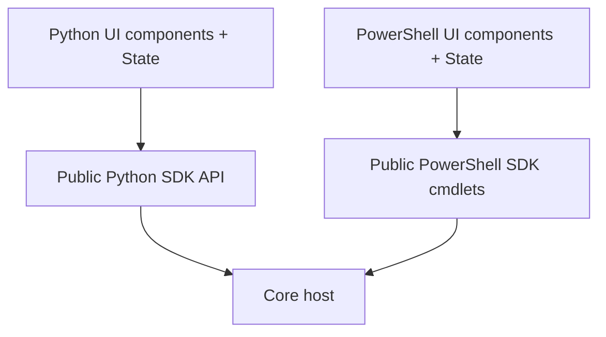

# UI architecture

Each UI library owns only declarative component helpers, reactive state and update scheduling. It does not own operating-system windows beyond the SDK handles it is given, does not modify Core transport or protocol and does not implement a plugin framework. Layout is created before mounting. Dynamic content changes use documented state bindings rather than mutation of private engine objects.

Python has a `ui.post()` queue for background producers; PowerShell requires owner-runspace state updates and explicit `Invoke-NHKUiBatch` for grouping changes. Both use the public SDK for close, dialogs, clipboard and specialized Core operations.
