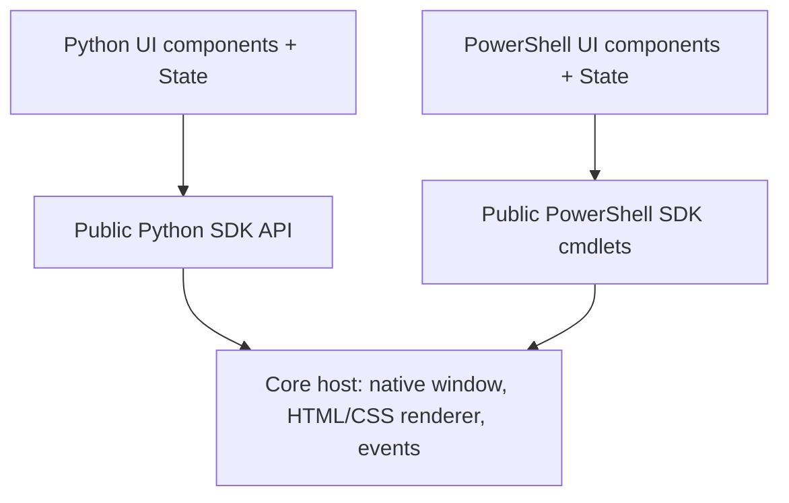
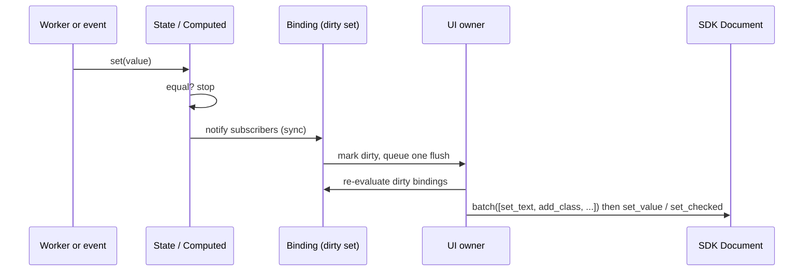

# UI architecture

This page explains how the UI libraries work (version 0.1.1). For exact signatures see the
[Python](python/reference.md) and [PowerShell](powershell/reference.md) references.

## Layering and ownership

Each UI library is a thin layer over its language SDK and uses **only** the SDK's public API:
Python calls `Application.open_html`, `Document.on`, `Document.batch`, `Document.command`,
`set_value`/`set_checked` and friends; PowerShell calls `New-NativeHTMLKitWindow`,
`Open-NativeHTMLKitHtml`, `Register-NativeHTMLKitDocumentEvent`, `Invoke-NativeHTMLKitBatch`,
`Set-NativeHTMLKitDocumentValue` and `Set-NativeHTMLKitChecked`. It never talks to the Core
host protocol, never starts its own host, event pump, HTTP server or JavaScript, and has no
plugin system.

The UI library owns three things: a declarative component tree, reactive state, and the
scheduler that turns state changes into document commands. Everything else (application
lifecycle, windows, dialogs, clipboard, bitmaps, preferences, diagnostics bundles) stays with
the SDK; an application uses those directly next to the UI (see the
SDK interop guide for [Python](python/guides/mixing-ui-and-sdk-calls.md) or
[PowerShell](powershell/guides/mixing-ui-and-sdk-calls.md)).

## Rendering model: build once, then bind

A UI has two phases.

1. **Build.** Component calls (`ui.text(...)`, `Add-NHKUiButton ...`) append nodes to an
   in-memory tree. Each node gets an id `<prefix>-<n>` from a random per-UI prefix
   (`nhkui-` + 12 hex digits), so several UIs and your own markup never collide. A component
   that shows changing data records a **binding**: the node id, the kind of property (text,
   visibility, disabled, list items, input value, checked) and the state or expression that
   provides it, plus the last value written.
2. **Mount / start.** The whole tree is rendered once into a complete HTML document (the shared
   stylesheet, your extra CSS, `body` classes for theme and density) and loaded into a new
   window with one SDK call. Live control values are then written explicitly, because native
   controls initialise from attributes only once.

After mounting, the **tree never changes shape**. There is no virtual DOM and no diffing of
markup: only bound properties of existing elements change. Conditional content is a region
that is always present and toggled with a CSS class; lists are text-only and replace their
children. This keeps native inputs (caret, selection, IME composition, focus) stable, which a
re-render would destroy. When an app needs a variable number of interactive rows, it
pre-allocates a fixed pool of rows and binds their visibility and text
(slot pool guide for [Python](python/guides/lists-and-conditional-content.md) and
[PowerShell](powershell/guides/lists-and-conditional-content.md)).

## From a state change to document commands

1. `set()` compares the new value with the current one (Python `is`/`==`, PowerShell
   `[object]::Equals`). Equal values stop here.
2. Subscribers run synchronously: computed values recompute immediately, and every binding
   that depends on the state marks itself dirty.
3. A flush is scheduled (details per language below). When it runs, each dirty binding is
   evaluated again and compared with the value it last wrote; unchanged ones are skipped.
4. The remaining changes become document operations:

   | Binding | Operation |
   |---|---|
   | text, heading, badge, alert, bound button label | `set_text` |
   | `when` / `Add-NHKUiWhen` | `add_class` / `remove_class` `nhk-hidden` |
   | button `disabled` | `set_attribute disabled=""` / `remove_attribute disabled` |
   | text list | `replace_children_html` with escaped `<li>` items |
   | input / select value | `set_value` |
   | checkbox | `set_checked` |

5. Operations are sent in `document.batch` chunks of up to 128 (Python sends a lone operation
   as a plain command), followed by the individual value/checked calls.

**Input echo suppression.** When a native `input`/`change` event arrives, the binding first
records the value it received as "last written" and only then sets the state. The flush then
sees no difference for that control and does not write it back, so typing is never disturbed.
Other bindings of the same state (a mirror label, a computed count) still update.

**Failures.** A write that fails because the window, document or application is gone (SDK
stale-handle error, host codes -32004/-32008) disposes the UI quietly and is counted as
"discarded after close". Any other failure, including an outcome-unknown timeout, marks the DOM
as **uncertain**: the UI stops writing (Python `sync()` and PowerShell `Sync-NHKUi` raise) and
`diagnostics` / `Get-NHKUiDiagnostics` report it. Nothing is retried silently, because a
retried or skipped write could leave the window showing something other than the state.

## Update coalescing

### Python: one owner thread per UI

Each mounted UI starts one daemon thread, the **UI owner** (`nativehtmlkit-ui`), with a
bounded work queue (4096 items). Three kinds of work run there, strictly in order:

- native events forwarded by the SDK's event worker (the worker only enqueues; it never waits
  for a document request, so the SDK keeps reading the host connection),
- functions queued with `ui.post(fn, *args)`,
- flushes.

At most one flush is outstanding. All `set()` calls that happen before it runs, inside the same
event callback, in posted functions queued ahead of it, or in a burst from a worker thread, are
merged into that one flush, and only the latest value of each binding is written. Bound lambdas
are evaluated on the owner thread during the flush. Computed values, however, recompute on the
thread that called `set()`; this is where the open computed-concurrency defect lives (concurrent setters
of the same computed can produce a false circular-dependency error and a stale value), which is
why worker results should be handed over with `ui.post()`.

A full queue does not block the SDK: the event is dropped and counted
(`event_queue_dropped`), and `post()` raises so the producer can react.

### PowerShell: the owner runspace

PowerShell has no thread per UI. `Start-NHKUi` records the runspace that started it as the
**owner**; every write, and every `.Set()` of a bound state, must happen there. SDK callbacks
(UI events, task completions, notifications) run on that runspace while `Wait-NativeHTMLKit`
pumps host messages, so they qualify.

Coalescing follows the call structure:

- **Inside a UI callback** (button click, input, change) and inside `Invoke-NHKUiBatch`,
  changes are collected and written once when the callback or batch ends.
- **Outside**, each outermost `.Set()` writes immediately when it returns. Nested `.Set()`
  calls made by subscribers and computed states during it are part of the same write, so one
  external change that cascades through ten computed values is still one batch. Several
  separate `.Set()` calls in a loop are several writes; wrap them in `Invoke-NHKUiBatch`.
- A write that waits for the host may pump an event whose callback changes state again; that
  nested sync only queues, and the outer write loop applies it afterwards, so an older value
  never overwrites a newer one.

Computed states declare their dependencies explicitly (`-DependsOn`) instead of tracking reads,
which avoids instrumenting PowerShell scriptblocks.

## Events

Mounting subscribes **once per event kind** (not once per element) to the SDK document. Core
delivers each event with its target `element` and the identified bubbling route `path`; the UI
calls the handler of the nearest registered element, like a delegated DOM handler. Handlers run
on the owner (thread or runspace). Events are notifications after native dispatch: a handler
cannot cancel a native default action (use the SDK's `prevent_default` registration for that).

## Lifecycle

- Python: `mount()` registers a weakly held `Application.on_shutdown` callback and a window
  event listener; the UI disposes itself when its window closes or the app shuts down.
  `dispose()` unsubscribes, closes bindings and stops the owner thread. Because the SDK has no
  way to remove an `on_shutdown` callback, registrations accumulate with many mount cycles
  (known open defect).
- PowerShell: `Stop-NHKUi` unregisters document events and state subscriptions. A closed window
  is noticed on the next write (or immediately if the app handles `window.event`).
- Neither library closes windows or the application, and neither disposes computed values:
  that is the application's job.

## What is deliberately not here

No router, modal wrapper, plugin or extension system, component registry, virtualized grid,
media player, JavaScript runtime or HTTP endpoint. HTML `<dialog>`, file dialogs, clipboard,
live bitmaps and native window management are SDK features that an app calls directly.
