# Examples

*PowerShell (UI library 0.1.1). Every example also exists in Python with the same window title and behaviour: [Python examples](../python/examples.md).*

16 small applications. Each one starts with a comment that says what it teaches and how to run it, uses only the public UI and SDK APIs, and is run by the repository's example harness against the real NativeHTMLKit host (headless) on Linux and Windows. Screenshots are real captures on KDE Plasma 6.6 Wayland.

| Example | What it is |
|---|---|
| [Hello UI](#hello) | The first window: a greeting that follows a text field, and a Reset button. |
| [Counter gallery](#counter) | The smallest tour of state, computed text, buttons, an input, a checkbox and a list. |
| [Expense tracker](#expenses) | Add expenses, remove the last one, filter by category and see totals (expense-tracker tutorial app). |
| [Task list](#todo) | Tasks with Done/Remove buttons per row and an All/Open/Done filter. |
| [Sign-up form](#signup-form) | Live validation, a guarded submit button, a confirmation screen and reset. |
| [Settings panel](#settings) | Save, Revert and Restore defaults with an unsaved-changes indicator. |
| [Settings editor](#settings-editor) | Edit, validate and save a JSON settings file; the saved theme applies on the next start (settings-editor tutorial app). |
| [Live log viewer](#log-viewer) | A background producer streams log lines; filter by level and text, pause and clear. |
| [Background calculation](#background) | Run a slow calculation off the UI thread and report the result; cancel it. |
| [Word counter](#word-counter) | Count words in a text file in the background with progress, Cancel and a top-ten list. |
| [Clipboard text tool](#clipboard-tool) | Transform text and copy or paste it with the SDK clipboard, handling unavailability. |
| [File inspector](#file-picker) | Pick files with the native open dialog and list their sizes and a total. |
| [Notes with inspector windows](#multi-window) | Several windows bound to the same state; open, track and close inspector windows. |
| [System dashboard](#dashboard) | A responsive card grid with a live clock and disk usage, themed with extra CSS. |
| [Theme preview](#theme-preview) | Every component in a chosen theme and density, with an optional custom accent colour. |
| [Message composer](#message-preview) | Untrusted typed text is always escaped; only fixed help markup is inserted as HTML. |

<a id="hello"></a>

## Hello UI

The first window: a greeting that follows a text field, and a Reset button.

**Teaches:** state and computed values, two-way input, button handler, application lifecycle.

**Run:** `pwsh -File ./hello.ps1` (source: [`examples/powershell/hello.ps1`](https://github.com/nativehtmlkit/nativehtmlkit_ui/blob/main/examples/powershell/hello.ps1))

Related guide: [reactive state](guides/reactive-state.md).

*Screenshot not captured yet.*

<details><summary>Full source</summary>

```powershell
# Hello UI: the first window of the getting-started page.
#
# Teaches: Start-NativeHTMLKitScript, New-NHKUiState and New-NHKUiComputed, a heading bound to a
#          computed state, a two-way input, a button callback that sets state, Start-NHKUi /
#          Wait-NativeHTMLKit / Stop-NHKUi in try/finally.
# Run:     pwsh -File ./hello.ps1   |   powershell.exe -NoProfile -File .\hello.ps1
#          (Install-Module NativeHTMLKit.UI -Scope CurrentUser)
# Guide:   docs/powershell/getting-started.md
$ErrorActionPreference = 'Stop'
Import-Module NativeHTMLKit.UI
$app = Start-NativeHTMLKitScript -Name 'Hello UI'

$name = New-NHKUiState -Value 'world'
$greeting = New-NHKUiComputed -DependsOn @($name) -Data $name -Compute { param($n) "Hello, $($n.Value)!" }

$ui = New-NHKUi -Title 'Hello UI' -Width 480 -Height 320
$null = Add-NHKUiColumn -UI $ui -Content {
    $null = Add-NHKUiHeading -UI $ui -Bind $greeting -Level 1
    $null = Add-NHKUiRow -UI $ui -Content {
        $null = Add-NHKUiInput -UI $ui -Bind $name -Label 'Your name'
        $null = Add-NHKUiButton -UI $ui -Text 'Reset' -Variant secondary -Data $name -OnClick {
            param($eventObject, $n)
            $n.Set('world')
        }
    }
}

try {
    $null = Start-NHKUi -UI $ui -Application $app
    Wait-NativeHTMLKit -Application $app -UntilShutdown
} finally {
    Stop-NHKUi -UI $ui
    $greeting.Dispose()
    Close-NativeHTMLKit -Application $app
}
```

</details>

<a id="counter"></a>

## Counter gallery

The smallest tour of state, computed text, buttons, an input, a checkbox and a list.

**Teaches:** state and computed values, bound text, two-way input and checkbox, when regions, grid.

**Run:** `pwsh -File ./counter.ps1` (source: [`examples/powershell/counter.ps1`](https://github.com/nativehtmlkit/nativehtmlkit_ui/blob/main/examples/powershell/counter.ps1))

Related guide: [reactive state](guides/reactive-state.md).

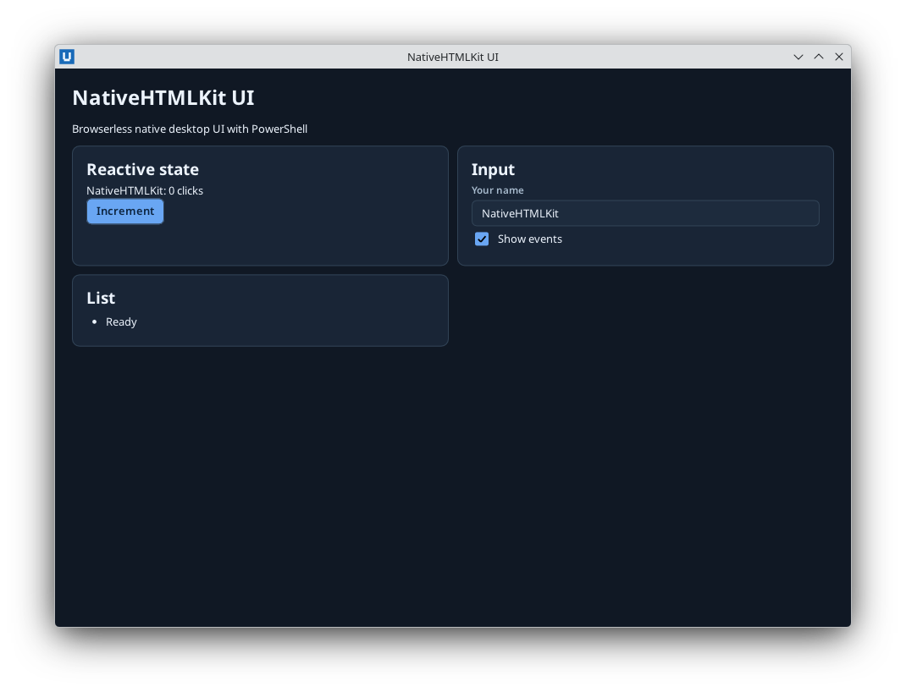

<details><summary>Full source</summary>

```powershell
# Counter gallery: the smallest tour of states, computed text, buttons, input, checkbox and list.
#
# Teaches: New-NHKUiState and New-NHKUiComputed (explicit -DependsOn), passing states to a
# button callback with -Data, a two-way input and checkbox, a text list shown or hidden with
# Add-NHKUiWhen, a responsive card grid, and disposing computed states at the end.
#
# Run:  pwsh -File ./counter.ps1                      (PowerShell 7.2+, Linux or Windows)
#       powershell.exe -NoProfile -File .\counter.ps1  (Windows PowerShell 5.1)
# Needs: Install-Module NativeHTMLKit.UI -Scope CurrentUser (installs the NativeHTMLKit SDK too)
Import-Module NativeHTMLKit.UI -ErrorAction Stop
$app = Start-NativeHTMLKitScript -Name 'NativeHTMLKit UI'
$ui = New-NHKUi -Title 'NativeHTMLKit UI Gallery' -Theme cobalt -Density compact
$count = New-NHKUiState -Value 0
$name = New-NHKUiState -Value 'NativeHTMLKit'
$show = New-NHKUiState -Value $true
$history = New-NHKUiState -Value @('Ready')
$message = New-NHKUiComputed -DependsOn @($count, $name) -Data @{ Count = $count; Name = $name } -Compute {
    param($s)
    return "$($s.Name.Value): $($s.Count.Value) clicks"
}
$updates = New-NHKUiComputed -DependsOn @($count) -Data $count -Compute { param($c) "Native reactive updates: $($c.Value)" }
$null = Add-NHKUiColumn -UI $ui -Content {
    $null = Add-NHKUiHeading -UI $ui -Text 'NativeHTMLKit UI' -Level 1
    $null = Add-NHKUiText -UI $ui -Text "Browserless $([char]0x2022) native HTML/CSS $([char]0x2022) PowerShell SDK only" -Muted   # ASCII source for Windows PowerShell 5.1
    $null = Add-NHKUiGrid -UI $ui -Content {
        $null = Add-NHKUiCard -UI $ui -Content {
            $null = Add-NHKUiHeading -UI $ui -Text 'State'
            $null = Add-NHKUiText -UI $ui -Bind $message
            $null = Add-NHKUiRow -UI $ui -Content {
                $null = Add-NHKUiButton -UI $ui -Text 'Increment' -Data @{ Count = $count; History = $history } -OnClick {
                    param($eventObject, $data)
                    $data.Count.Set([int]$data.Count.Value + 1)
                    $data.History.Set(@(@("Count became $($data.Count.Value)") + @($data.History.Value) | Select-Object -First 10))
                }
                $null = Add-NHKUiButton -UI $ui -Text 'Reset' -Variant secondary -Data $count -OnClick {
                    param($eventObject, $c)
                    $c.Set(0)
                }
            }
        }
        $null = Add-NHKUiCard -UI $ui -Content {
            $null = Add-NHKUiHeading -UI $ui -Text 'Input'
            $null = Add-NHKUiInput -UI $ui -Bind $name -Label 'Your name' -Placeholder 'Enter a name'
            $null = Add-NHKUiCheckbox -UI $ui -Bind $show -Label 'Show recent events'
        }
        $null = Add-NHKUiCard -UI $ui -Content {
            $null = Add-NHKUiHeading -UI $ui -Text 'Lists'
            $null = Add-NHKUiWhen -UI $ui -Bind $show -Content {
                $null = Add-NHKUiTextList -UI $ui -Bind $history
            }
        }
    }
    $null = Add-NHKUiAlert -UI $ui -Bind $updates
}
try {
    $null = Start-NHKUi -UI $ui -Application $app
    Wait-NativeHTMLKit -Application $app -UntilShutdown
} finally {
    Stop-NHKUi -UI $ui
    $message.Dispose()
    $updates.Dispose()
    Close-NativeHTMLKit -Application $app
}
```

</details>

<a id="expenses"></a>

## Expense tracker

Add expenses, remove the last one, filter by category and see totals (expense-tracker tutorial app).

**Teaches:** two-way inputs and select, validation, computed totals and filter, empty state.

**Run:** `pwsh -File ./expenses.ps1` (source: [`examples/powershell/expenses.ps1`](https://github.com/nativehtmlkit/nativehtmlkit_ui/blob/main/examples/powershell/expenses.ps1))

Built step by step in the [expense tracker tutorial](tutorials/expense-tracker.md).

Related guide: [forms and inputs](guides/forms-and-inputs.md).

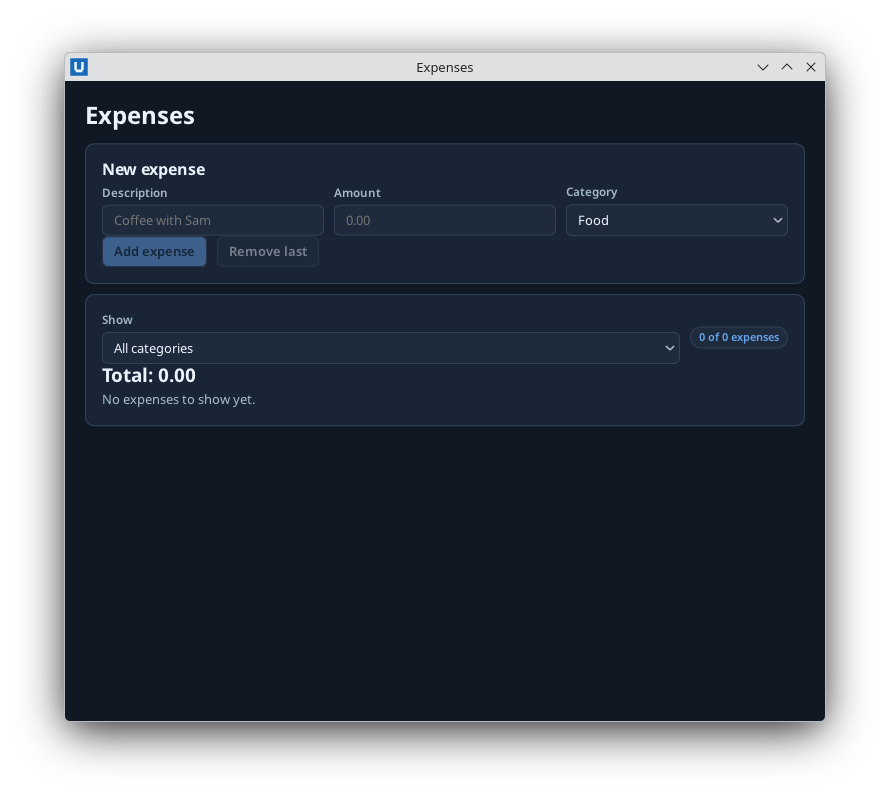

<details><summary>Full source</summary>

```powershell
# Expense tracker: add expenses, remove the last one, filter by category, see totals.
#
# Teaches: states and computed values with explicit -DependsOn, two-way input/select binding,
# a button disabled by a computed value, a filtered text list, an empty-state region with
# Add-NHKUiWhen, and culture-independent decimal parsing. This is the finished app of
# docs/powershell/tutorials/expense-tracker.md.
#
# Run:  pwsh -File ./expenses.ps1                      (PowerShell 7.2+, Linux or Windows)
#       powershell.exe -NoProfile -File .\expenses.ps1  (Windows PowerShell 5.1)
# Needs: Install-Module NativeHTMLKit.UI -Scope CurrentUser
$ErrorActionPreference = 'Stop'
Import-Module NativeHTMLKit.UI
$app = Start-NativeHTMLKitScript -Name 'Expenses'

$categories = [ordered]@{ food = 'Food'; transport = 'Transport'; home = 'Home'; other = 'Other' }
$categoryOptions = @($categories.Keys | ForEach-Object { @{ Value = $_; Label = $categories[$_] } })

# One hashtable holds every state; it is passed to callbacks and computed values as -Data.
$s = @{
    Expenses = (New-NHKUiState -Value @())    # array of objects; always replaced, never changed in place
    Description = (New-NHKUiState -Value ''); Amount = (New-NHKUiState -Value '')
    Category = (New-NHKUiState -Value 'food'); Show = (New-NHKUiState -Value 'all')
    Error = (New-NHKUiState -Value ''); Categories = $categories
    Culture = [Globalization.CultureInfo]::InvariantCulture
}
$s.Visible = New-NHKUiComputed -DependsOn @($s.Expenses, $s.Show) -Data $s -Compute {
    param($s)
    # The leading comma returns the array itself, even when it has zero or one element.
    , @($s.Expenses.Value | Where-Object { $s.Show.Value -eq 'all' -or $_.Category -eq $s.Show.Value })
}
$s.Total = New-NHKUiComputed -DependsOn @($s.Visible) -Data $s -Compute {
    param($s)
    $sum = [decimal]0
    foreach ($e in $s.Visible.Value) { $sum += $e.Amount }
    'Total: ' + $sum.ToString('#,##0.00', $s.Culture)
}
$s.Lines = New-NHKUiComputed -DependsOn @($s.Visible) -Data $s -Compute {
    param($s)
    , @($s.Visible.Value | ForEach-Object {
        '{0} ({1}): {2}' -f $_.Description, $s.Categories[$_.Category], $_.Amount.ToString('#,##0.00', $s.Culture) })
}
$s.Count = New-NHKUiComputed -DependsOn @($s.Visible, $s.Expenses) -Data $s -Compute {
    param($s) '{0} of {1} expenses' -f @($s.Visible.Value).Count, @($s.Expenses.Value).Count
}
$s.ByCategory = New-NHKUiComputed -DependsOn @($s.Expenses) -Data $s -Compute {
    param($s)
    $parts = foreach ($key in $s.Categories.Keys) {
        $items = @($s.Expenses.Value | Where-Object { $_.Category -eq $key })
        if ($items.Count -gt 0) {
            $sum = [decimal]0; foreach ($e in $items) { $sum += $e.Amount }
            $s.Categories[$key] + ': ' + $sum.ToString('#,##0.00', $s.Culture)
        }
    }
    @($parts) -join ' | '
}
$s.NothingVisible = New-NHKUiComputed -DependsOn @($s.Visible) -Data $s -Compute { param($s) @($s.Visible.Value).Count -eq 0 }
$s.NoExpenses = New-NHKUiComputed -DependsOn @($s.Expenses) -Data $s -Compute { param($s) @($s.Expenses.Value).Count -eq 0 }
$s.CannotAdd = New-NHKUiComputed -DependsOn @($s.Description, $s.Amount) -Data $s -Compute {
    param($s) (-not $s.Description.Value.Trim()) -or (-not $s.Amount.Value.Trim())
}
$computeds = @($s.Visible, $s.Total, $s.Lines, $s.Count, $s.ByCategory, $s.NothingVisible, $s.NoExpenses, $s.CannotAdd)

$ui = New-NHKUi -Title 'Expenses' -Width 760 -Height 640
$null = Add-NHKUiColumn -UI $ui -Content {
    $null = Add-NHKUiHeading -UI $ui -Text 'Expenses' -Level 1
    $null = Add-NHKUiCard -UI $ui -Content {
        $null = Add-NHKUiHeading -UI $ui -Text 'New expense' -Level 3
        $null = Add-NHKUiRow -UI $ui -Content {
            $null = Add-NHKUiInput -UI $ui -Bind $s.Description -Label 'Description' -Placeholder 'Coffee with Sam'
            $null = Add-NHKUiInput -UI $ui -Bind $s.Amount -Label 'Amount' -Placeholder '0.00'
            $null = Add-NHKUiSelect -UI $ui -Bind $s.Category -Label 'Category' -Options $categoryOptions
        }
        $null = Add-NHKUiWhen -UI $ui -Bind $s.Error -Content { $null = Add-NHKUiAlert -UI $ui -Bind $s.Error }
        $null = Add-NHKUiRow -UI $ui -Content {
            $null = Add-NHKUiButton -UI $ui -Text 'Add expense' -DisabledState $s.CannotAdd -Data $s -OnClick {
                param($eventObject, $s)
                $value = [decimal]0
                $text = $s.Amount.Value.Trim().Replace(',', '.')
                if (-not [decimal]::TryParse($text, [Globalization.NumberStyles]::Number, $s.Culture, [ref]$value)) {
                    $s.Error.Set('Amount must be a number, for example 12.50'); return
                }
                if ($value -le 0) { $s.Error.Set('Amount must be greater than zero'); return }
                $new = [pscustomobject]@{ Description = $s.Description.Value.Trim(); Amount = [Math]::Round($value, 2); Category = $s.Category.Value }
                $s.Expenses.Set(@($s.Expenses.Value) + @($new))
                $s.Description.Set('')      # writes back into the native inputs
                $s.Amount.Set('')
                $s.Error.Set('')
            }
            $null = Add-NHKUiButton -UI $ui -Text 'Remove last' -Variant secondary -DisabledState $s.NoExpenses -Data $s -OnClick {
                param($eventObject, $s)
                $items = @($s.Expenses.Value)
                $s.Expenses.Set(@($items | Select-Object -First ([Math]::Max(0, $items.Count - 1))))
            }
        }
    }
    $null = Add-NHKUiCard -UI $ui -Content {
        $null = Add-NHKUiRow -UI $ui -Content {
            $null = Add-NHKUiSelect -UI $ui -Bind $s.Show -Label 'Show' -Options (@(@{ Value = 'all'; Label = 'All categories' }) + $categoryOptions)
            $null = Add-NHKUiBadge -UI $ui -Bind $s.Count
        }
        $null = Add-NHKUiHeading -UI $ui -Bind $s.Total -Level 2
        $null = Add-NHKUiWhen -UI $ui -Bind $s.NothingVisible -Content {
            $null = Add-NHKUiText -UI $ui -Text 'No expenses to show yet.' -Muted
        }
        $null = Add-NHKUiTextList -UI $ui -Bind $s.Lines
        $null = Add-NHKUiText -UI $ui -Bind $s.ByCategory -Muted
    }
}

try {
    $null = Start-NHKUi -UI $ui -Application $app
    Wait-NativeHTMLKit -Application $app -UntilShutdown
} finally {
    Stop-NHKUi -UI $ui
    foreach ($c in $computeds) { $c.Dispose() }
    Close-NativeHTMLKit -Application $app
}
```

</details>

<a id="todo"></a>

## Task list

Tasks with Done/Remove buttons per row and an All/Open/Done filter.

**Teaches:** slot pool for rows with buttons, bound button labels, computed counts.

**Run:** `pwsh -File ./todo.ps1` (source: [`examples/powershell/todo.ps1`](https://github.com/nativehtmlkit/nativehtmlkit_ui/blob/main/examples/powershell/todo.ps1))

Related guide: [lists and conditional content](guides/lists-and-conditional-content.md).

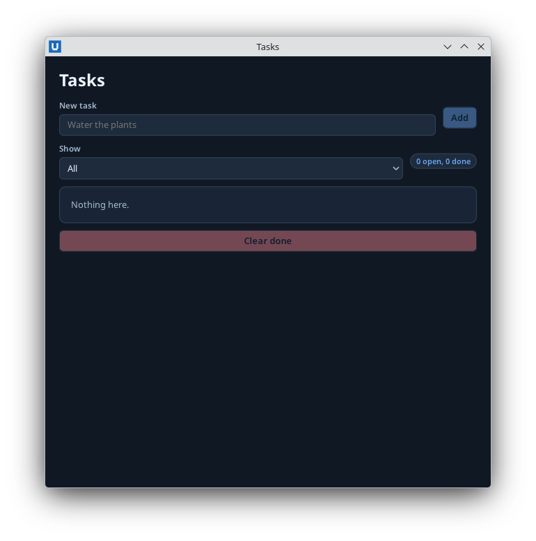

<details><summary>Full source</summary>

```powershell
# Task list with per-row Done/Remove buttons and an All/Open/Done filter.
#
# Teaches: the "slot pool" pattern. The UI tree is fixed once started, so the script creates
# $maxTasks rows up front and shows, hides and relabels them from state (Add-NHKUiWhen, bound
# text, bound button labels via -Bind). Each row gets its own -Data object with its index.
# Also: computed counts, a disabled Add button and "Clear done".
#
# Run:  pwsh -File ./todo.ps1   |   powershell.exe -NoProfile -File .\todo.ps1
$ErrorActionPreference = 'Stop'
Import-Module NativeHTMLKit.UI
$app = Start-NativeHTMLKitScript -Name 'Tasks'

$maxTasks = 8
$s = @{
    Tasks = (New-NHKUiState -Value @())   # objects with Id, Title, Done
    Title = (New-NHKUiState -Value ''); Show = (New-NHKUiState -Value 'all'); NextId = 1; Max = $maxTasks
}
$s.Visible = New-NHKUiComputed -DependsOn @($s.Tasks, $s.Show) -Data $s -Compute {
    param($s)
    , @($s.Tasks.Value | Where-Object { $s.Show.Value -eq 'all' -or [bool]$_.Done -eq ($s.Show.Value -eq 'done') })
}
$s.Counts = New-NHKUiComputed -DependsOn @($s.Tasks) -Data $s -Compute {
    param($s)
    $all = @($s.Tasks.Value); $done = @($all | Where-Object { $_.Done }).Count
    '{0} open, {1} done' -f ($all.Count - $done), $done
}
$s.Full = New-NHKUiComputed -DependsOn @($s.Tasks) -Data $s -Compute { param($s) @($s.Tasks.Value).Count -ge $s.Max }
$s.CannotAdd = New-NHKUiComputed -DependsOn @($s.Tasks, $s.Title) -Data $s -Compute {
    param($s) (@($s.Tasks.Value).Count -ge $s.Max) -or (-not $s.Title.Value.Trim())
}
$s.NoneDone = New-NHKUiComputed -DependsOn @($s.Tasks) -Data $s -Compute { param($s) @($s.Tasks.Value | Where-Object { $_.Done }).Count -eq 0 }
$s.Empty = New-NHKUiComputed -DependsOn @($s.Visible) -Data $s -Compute { param($s) @($s.Visible.Value).Count -eq 0 }
$computeds = New-Object System.Collections.ArrayList
foreach ($c in @($s.Visible, $s.Counts, $s.Full, $s.CannotAdd, $s.NoneDone, $s.Empty)) { [void]$computeds.Add($c) }

# Per-row computed values: is the row used, its text and its toggle label.
$rows = for ($row = 0; $row -lt $maxTasks; $row++) {
    $slot = @{ S = $s; Row = $row }
    $slot.Present = New-NHKUiComputed -DependsOn @($s.Visible) -Data $slot -Compute { param($t) $t.Row -lt @($t.S.Visible.Value).Count }
    $slot.Text = New-NHKUiComputed -DependsOn @($s.Visible) -Data $slot -Compute {
        param($t)
        $items = @($t.S.Visible.Value)
        if ($t.Row -ge $items.Count) { return '' }
        $mark = if ($items[$t.Row].Done) { '[x] ' } else { '[ ] ' }
        $mark + $items[$t.Row].Title
    }
    $slot.Toggle = New-NHKUiComputed -DependsOn @($s.Visible) -Data $slot -Compute {
        param($t)
        $items = @($t.S.Visible.Value)
        if ($t.Row -lt $items.Count -and $items[$t.Row].Done) { 'Reopen' } else { 'Done' }
    }
    foreach ($c in @($slot.Present, $slot.Text, $slot.Toggle)) { [void]$computeds.Add($c) }
    $slot
}

$ui = New-NHKUi -Title 'Tasks' -Width 640 -Height 620
$null = Add-NHKUiColumn -UI $ui -Content {
    $null = Add-NHKUiHeading -UI $ui -Text 'Tasks' -Level 1
    $null = Add-NHKUiRow -UI $ui -Content {
        $null = Add-NHKUiInput -UI $ui -Bind $s.Title -Label 'New task' -Placeholder 'Water the plants'
        $null = Add-NHKUiButton -UI $ui -Text 'Add' -DisabledState $s.CannotAdd -Data $s -OnClick {
            param($eventObject, $s)
            $text = $s.Title.Value.Trim()
            if (-not $text -or @($s.Tasks.Value).Count -ge $s.Max) { return }
            $s.Tasks.Set(@($s.Tasks.Value) + @([pscustomobject]@{ Id = $s.NextId; Title = $text; Done = $false }))
            $s.NextId = $s.NextId + 1
            $s.Title.Set('')
        }
    }
    $null = Add-NHKUiWhen -UI $ui -Bind $s.Full -Content {
        $null = Add-NHKUiAlert -UI $ui -Text "The list is full ($maxTasks tasks). Remove or clear some first."
    }
    $null = Add-NHKUiRow -UI $ui -Content {
        $null = Add-NHKUiSelect -UI $ui -Bind $s.Show -Label 'Show' -Options @(
            @{ Value = 'all'; Label = 'All' }, @{ Value = 'open'; Label = 'Open' }, @{ Value = 'done'; Label = 'Done' })
        $null = Add-NHKUiBadge -UI $ui -Bind $s.Counts
    }
    $null = Add-NHKUiCard -UI $ui -Content {
        $null = Add-NHKUiWhen -UI $ui -Bind $s.Empty -Content { $null = Add-NHKUiText -UI $ui -Text 'Nothing here.' -Muted }
        foreach ($slot in $rows) {
            $null = Add-NHKUiWhen -UI $ui -Bind $slot.Present -Content {
                $null = Add-NHKUiRow -UI $ui -Content {
                    $null = Add-NHKUiText -UI $ui -Bind $slot.Text
                    $null = Add-NHKUiButton -UI $ui -Bind $slot.Toggle -Variant secondary -Data $slot -OnClick {
                        param($eventObject, $t)
                        $items = @($t.S.Visible.Value)
                        if ($t.Row -ge $items.Count) { return }
                        $id = $items[$t.Row].Id
                        $t.S.Tasks.Set(@($t.S.Tasks.Value | ForEach-Object {
                            if ($_.Id -eq $id) { [pscustomobject]@{ Id = $_.Id; Title = $_.Title; Done = -not $_.Done } } else { $_ }
                        }))
                    }
                    $null = Add-NHKUiButton -UI $ui -Text 'Remove' -Variant quiet -Data $slot -OnClick {
                        param($eventObject, $t)
                        $items = @($t.S.Visible.Value)
                        if ($t.Row -ge $items.Count) { return }
                        $id = $items[$t.Row].Id
                        $t.S.Tasks.Set(@($t.S.Tasks.Value | Where-Object { $_.Id -ne $id }))
                    }
                }
            }
        }
    }
    $null = Add-NHKUiButton -UI $ui -Text 'Clear done' -Variant danger -DisabledState $s.NoneDone -Data $s -OnClick {
        param($eventObject, $s)
        $s.Tasks.Set(@($s.Tasks.Value | Where-Object { -not $_.Done }))
    }
}

try {
    $null = Start-NHKUi -UI $ui -Application $app
    Wait-NativeHTMLKit -Application $app -UntilShutdown
} finally {
    Stop-NHKUi -UI $ui
    foreach ($c in $computeds) { $c.Dispose() }
    Close-NativeHTMLKit -Application $app
}
```

</details>

<a id="signup-form"></a>

## Sign-up form

Live validation, a guarded submit button, a confirmation screen and reset.

**Teaches:** validation as computed state, guarded submit, form/confirmation swap, reset by setting states.

**Run:** `pwsh -File ./signup_form.ps1` (source: [`examples/powershell/signup_form.ps1`](https://github.com/nativehtmlkit/nativehtmlkit_ui/blob/main/examples/powershell/signup_form.ps1))

Related guide: [forms and inputs](guides/forms-and-inputs.md).

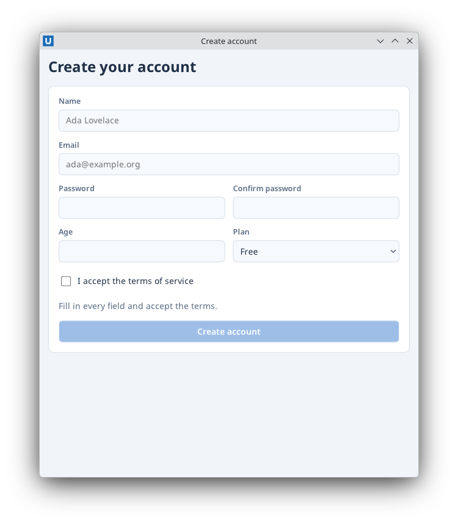

<details><summary>Full source</summary>

```powershell
# Sign-up form with live validation, a guarded submit button and a success screen.
#
# Teaches: validation as a computed array of messages (no DOM reads), messages only for fields
# the user has typed in, a submit button disabled until the form is valid, swapping the form
# and a confirmation with Add-NHKUiWhen, and resetting every control by setting its state.
#
# Run:  pwsh -File ./signup_form.ps1   |   powershell.exe -NoProfile -File .\signup_form.ps1
$ErrorActionPreference = 'Stop'
Import-Module NativeHTMLKit.UI
$app = Start-NativeHTMLKitScript -Name 'Create account'

$plans = @(@{ Value = 'free'; Label = 'Free' }, @{ Value = 'team'; Label = 'Team' }, @{ Value = 'enterprise'; Label = 'Enterprise' })
$s = @{ Plans = $plans }
foreach ($name in @('Name', 'Email', 'Password', 'Confirm', 'Age', 'Welcome')) { $s[$name] = New-NHKUiState -Value '' }
$s.Plan = New-NHKUiState -Value 'free'
$s.Terms = New-NHKUiState -Value $false
$fields = @($s.Name, $s.Email, $s.Password, $s.Confirm, $s.Age)

$s.Errors = New-NHKUiComputed -DependsOn $fields -Data $s -Compute {
    param($s)
    $found = New-Object System.Collections.ArrayList
    if ($s.Name.Value -and $s.Name.Value.Trim().Length -lt 2) { [void]$found.Add('Name needs at least 2 characters.') }
    if ($s.Email.Value -and $s.Email.Value.Trim() -notmatch '^[^@\s]+@[^@\s]+\.[^@\s]+$') { [void]$found.Add('Enter a valid email address.') }
    if ($s.Password.Value -and $s.Password.Value.Length -lt 8) { [void]$found.Add('Password needs at least 8 characters.') }
    if ($s.Confirm.Value -and $s.Confirm.Value -cne $s.Password.Value) { [void]$found.Add('Passwords do not match.') }
    if ($s.Age.Value -and -not ($s.Age.Value -match '^\d{1,3}$' -and [int]$s.Age.Value -ge 16 -and [int]$s.Age.Value -le 120)) {
        [void]$found.Add('Age must be a whole number from 16 to 120.')
    }
    , @($found)
}
$s.HasErrors = New-NHKUiComputed -DependsOn @($s.Errors) -Data $s -Compute { param($s) @($s.Errors.Value).Count -gt 0 }
$s.Complete = New-NHKUiComputed -DependsOn ($fields + @($s.Terms)) -Data $s -Compute {
    param($s) (@($s.Name, $s.Email, $s.Password, $s.Confirm, $s.Age | Where-Object { -not $_.Value }).Count -eq 0) -and [bool]$s.Terms.Value
}
$s.CannotSubmit = New-NHKUiComputed -DependsOn @($s.Complete, $s.HasErrors) -Data $s -Compute {
    param($s) (-not $s.Complete.Value) -or $s.HasErrors.Value
}
$s.Hint = New-NHKUiComputed -DependsOn @($s.Complete) -Data $s -Compute {
    param($s) if ($s.Complete.Value) { '' } else { 'Fill in every field and accept the terms.' }
}
$s.FormVisible = New-NHKUiComputed -DependsOn @($s.Welcome) -Data $s -Compute { param($s) -not $s.Welcome.Value }
$computeds = @($s.Errors, $s.HasErrors, $s.Complete, $s.CannotSubmit, $s.Hint, $s.FormVisible)

# Workaround for a UI 0.1.1 stylesheet defect: a field placed directly in a column gets a
# 200px flex basis (meant for rows) and therefore 200px of height. See docs/LIMITATIONS.md.
$fieldFix = '.nhk-col > .nhk-field { flex: 0 0 auto; }'
$ui = New-NHKUi -Title 'Create account' -Width 620 -Height 700 -Theme daylight -Density regular -ExtraCss $fieldFix
$null = Add-NHKUiColumn -UI $ui -Content {
    $null = Add-NHKUiHeading -UI $ui -Text 'Create your account' -Level 1
    $null = Add-NHKUiWhen -UI $ui -Bind $s.FormVisible -Content {
        $null = Add-NHKUiCard -UI $ui -Content {
            $null = Add-NHKUiColumn -UI $ui -Content {
                $null = Add-NHKUiInput -UI $ui -Bind $s.Name -Label 'Name' -Placeholder 'Ada Lovelace'
                $null = Add-NHKUiInput -UI $ui -Bind $s.Email -Label 'Email' -Type email -Placeholder 'ada@example.org'
                $null = Add-NHKUiRow -UI $ui -Content {
                    $null = Add-NHKUiInput -UI $ui -Bind $s.Password -Label 'Password' -Type password
                    $null = Add-NHKUiInput -UI $ui -Bind $s.Confirm -Label 'Confirm password' -Type password
                }
                $null = Add-NHKUiRow -UI $ui -Content {
                    $null = Add-NHKUiInput -UI $ui -Bind $s.Age -Label 'Age' -Type number
                    $null = Add-NHKUiSelect -UI $ui -Bind $s.Plan -Label 'Plan' -Options $s.Plans
                }
                $null = Add-NHKUiCheckbox -UI $ui -Bind $s.Terms -Label 'I accept the terms of service'
                $null = Add-NHKUiWhen -UI $ui -Bind $s.HasErrors -Content { $null = Add-NHKUiTextList -UI $ui -Bind $s.Errors }
                $null = Add-NHKUiText -UI $ui -Bind $s.Hint -Muted
                $null = Add-NHKUiButton -UI $ui -Text 'Create account' -DisabledState $s.CannotSubmit -Data $s -OnClick {
                    param($eventObject, $s)
                    if ($s.CannotSubmit.Value) { return }   # never trust that a disabled button cannot be activated
                    $plan = ($s.Plans | Where-Object { $_.Value -eq $s.Plan.Value }).Label
                    $s.Welcome.Set("Welcome, $($s.Name.Value.Trim())! Your $plan account is ready.")
                }
            }
        }
    }
    $null = Add-NHKUiWhen -UI $ui -Bind $s.Welcome -Content {
        $null = Add-NHKUiCard -UI $ui -Content {
            $null = Add-NHKUiAlert -UI $ui -Bind $s.Welcome
            $null = Add-NHKUiButton -UI $ui -Text 'Start over' -Variant secondary -Data $s -OnClick {
                param($eventObject, $s)
                foreach ($name in @('Name', 'Email', 'Password', 'Confirm', 'Age', 'Welcome')) { $s[$name].Set('') }
                $s.Plan.Set('free')
                $s.Terms.Set($false)
            }
        }
    }
}

try {
    $null = Start-NHKUi -UI $ui -Application $app
    Wait-NativeHTMLKit -Application $app -UntilShutdown
} finally {
    Stop-NHKUi -UI $ui
    foreach ($c in $computeds) { $c.Dispose() }
    Close-NativeHTMLKit -Application $app
}
```

</details>

<a id="settings"></a>

## Settings panel

Save, Revert and Restore defaults with an unsaved-changes indicator.

**Teaches:** dirty tracking with a computed snapshot, writing state back into controls, nested when regions.

**Run:** `pwsh -File ./settings.ps1` (source: [`examples/powershell/settings.ps1`](https://github.com/nativehtmlkit/nativehtmlkit_ui/blob/main/examples/powershell/settings.ps1))

Related guide: [reactive state](guides/reactive-state.md).

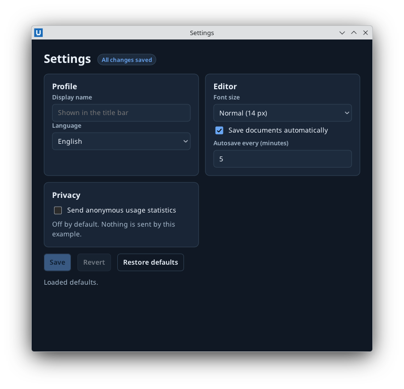

<details><summary>Full source</summary>

```powershell
# Settings panel with Save, Revert and Restore defaults, plus an "unsaved changes" indicator.
#
# Teaches: one computed snapshot key over many controls, dirty tracking by comparing it with
# the last saved key, writing state back into inputs/selects/checkboxes (Revert, Defaults),
# and buttons enabled only when they would do something. Replace the Save body with your own
# persistence (for example ConvertTo-Json to a file).
#
# Run:  pwsh -File ./settings.ps1   |   powershell.exe -NoProfile -File .\settings.ps1
$ErrorActionPreference = 'Stop'
Import-Module NativeHTMLKit.UI
$app = Start-NativeHTMLKitScript -Name 'Settings'

$defaults = [ordered]@{ DisplayName = ''; Language = 'en'; FontSize = '14'; Autosave = $true; Interval = '5'; Telemetry = $false }
$s = @{ Defaults = $defaults; Fields = [ordered]@{}; Saved = @{} }
foreach ($key in $defaults.Keys) { $s.Fields[$key] = New-NHKUiState -Value $defaults[$key]; $s.Saved[$key] = $defaults[$key] }
$s.Status = New-NHKUiState -Value 'Loaded defaults.'
# A text key of all current values; comparing keys detects unsaved changes.
$s.Key = New-NHKUiComputed -DependsOn @($s.Fields.Values) -Data $s -Compute {
    param($s) (@($s.Fields.Keys | ForEach-Object { $_ + '=' + [string]$s.Fields[$_].Value }) -join ';')
}
$s.SavedKey = New-NHKUiState -Value $s.Key.Value
$s.Dirty = New-NHKUiComputed -DependsOn @($s.Key, $s.SavedKey) -Data $s -Compute { param($s) $s.Key.Value -ne $s.SavedKey.Value }
$s.Badge = New-NHKUiComputed -DependsOn @($s.Dirty) -Data $s -Compute { param($s) if ($s.Dirty.Value) { 'Unsaved changes' } else { 'All changes saved' } }
$s.IntervalOk = New-NHKUiComputed -DependsOn @($s.Fields.Interval) -Data $s -Compute {
    param($s) $v = [string]$s.Fields.Interval.Value; ($v -match '^\d{1,2}$') -and [int]$v -ge 1 -and [int]$v -le 60
}
$s.IntervalBad = New-NHKUiComputed -DependsOn @($s.IntervalOk) -Data $s -Compute { param($s) -not $s.IntervalOk.Value }
$s.CannotSave = New-NHKUiComputed -DependsOn @($s.Dirty, $s.IntervalOk) -Data $s -Compute { param($s) (-not $s.Dirty.Value) -or (-not $s.IntervalOk.Value) }
$s.Clean = New-NHKUiComputed -DependsOn @($s.Dirty) -Data $s -Compute { param($s) -not $s.Dirty.Value }
$computeds = @($s.Key, $s.Dirty, $s.Badge, $s.IntervalOk, $s.IntervalBad, $s.CannotSave, $s.Clean)
$f = $s.Fields

$ui = New-NHKUi -Title 'Settings' -Width 700 -Height 640 -Density regular
$null = Add-NHKUiColumn -UI $ui -Content {
    $null = Add-NHKUiRow -UI $ui -Content {
        $null = Add-NHKUiHeading -UI $ui -Text 'Settings' -Level 1
        $null = Add-NHKUiBadge -UI $ui -Bind $s.Badge
    }
    $null = Add-NHKUiGrid -UI $ui -Content {
        $null = Add-NHKUiCard -UI $ui -Content {
            $null = Add-NHKUiHeading -UI $ui -Text 'Profile' -Level 3
            $null = Add-NHKUiInput -UI $ui -Bind $f.DisplayName -Label 'Display name' -Placeholder 'Shown in the title bar'
            $null = Add-NHKUiSelect -UI $ui -Bind $f.Language -Label 'Language' -Options @(
                @{ Value = 'en'; Label = 'English' }, @{ Value = 'de'; Label = 'German' },
                @{ Value = 'fr'; Label = 'French' }, @{ Value = 'ja'; Label = 'Japanese' })
        }
        $null = Add-NHKUiCard -UI $ui -Content {
            $null = Add-NHKUiHeading -UI $ui -Text 'Editor' -Level 3
            $null = Add-NHKUiSelect -UI $ui -Bind $f.FontSize -Label 'Font size' -Options @(
                @{ Value = '12'; Label = 'Small (12 px)' }, @{ Value = '14'; Label = 'Normal (14 px)' }, @{ Value = '16'; Label = 'Large (16 px)' })
            $null = Add-NHKUiCheckbox -UI $ui -Bind $f.Autosave -Label 'Save documents automatically'
            $null = Add-NHKUiWhen -UI $ui -Bind $f.Autosave -Content {
                $null = Add-NHKUiInput -UI $ui -Bind $f.Interval -Label 'Autosave every (minutes)' -Type number
                $null = Add-NHKUiWhen -UI $ui -Bind $s.IntervalBad -Content {
                    $null = Add-NHKUiAlert -UI $ui -Text 'Use a whole number of minutes from 1 to 60.'
                }
            }
        }
        $null = Add-NHKUiCard -UI $ui -Content {
            $null = Add-NHKUiHeading -UI $ui -Text 'Privacy' -Level 3
            $null = Add-NHKUiCheckbox -UI $ui -Bind $f.Telemetry -Label 'Send anonymous usage statistics'
            $null = Add-NHKUiText -UI $ui -Text 'Off by default. Nothing is sent by this example.' -Muted
        }
    }
    $null = Add-NHKUiRow -UI $ui -Content {
        $null = Add-NHKUiButton -UI $ui -Text 'Save' -DisabledState $s.CannotSave -Data $s -OnClick {
            param($eventObject, $s)
            if ($s.CannotSave.Value) { return }
            foreach ($key in $s.Fields.Keys) { $s.Saved[$key] = $s.Fields[$key].Value }
            $s.SavedKey.Set($s.Key.Value)
            $s.Status.Set('Saved at ' + (Get-Date).ToString('HH:mm:ss') + '.')
        }
        $null = Add-NHKUiButton -UI $ui -Text 'Revert' -Variant secondary -DisabledState $s.Clean -Data $s -OnClick {
            param($eventObject, $s)
            foreach ($key in $s.Fields.Keys) { $s.Fields[$key].Set($s.Saved[$key]) }
            $s.Status.Set('Reverted to the last saved settings.')
        }
        $null = Add-NHKUiButton -UI $ui -Text 'Restore defaults' -Variant quiet -Data $s -OnClick {
            param($eventObject, $s)
            foreach ($key in $s.Fields.Keys) { $s.Fields[$key].Set($s.Defaults[$key]) }
            $s.Status.Set('Defaults restored (not saved yet).')
        }
    }
    $null = Add-NHKUiText -UI $ui -Bind $s.Status -Muted
}

try {
    $null = Start-NHKUi -UI $ui -Application $app
    Wait-NativeHTMLKit -Application $app -UntilShutdown
} finally {
    Stop-NHKUi -UI $ui
    foreach ($c in $computeds) { $c.Dispose() }
    Close-NativeHTMLKit -Application $app
}
```

</details>

<a id="settings-editor"></a>

## Settings editor

Edit, validate and save a JSON settings file; the saved theme applies on the next start (settings-editor tutorial app).

**Teaches:** initial state from a file, computed validation message, atomic JSON save, revert from disk.

**Run:** `pwsh -File ./settings_editor.ps1 [PATH]` (source: [`examples/powershell/settings_editor.ps1`](https://github.com/nativehtmlkit/nativehtmlkit_ui/blob/main/examples/powershell/settings_editor.ps1))

Built step by step in the [settings editor tutorial](tutorials/settings-editor.md).

Related guide: [forms and inputs](guides/forms-and-inputs.md).

*Screenshot not captured yet.*

<details><summary>Full source</summary>

```powershell
# Settings editor: edit, validate and save a JSON settings file (settings-editor tutorial, final code).
#
# Teaches: loading initial state from a file, computed validation and "unsaved changes" states,
#          saving JSON atomically, Revert, an Add-NHKUiAlert status line, and starting the UI in
#          the theme the user saved.
# Run:     pwsh -File ./settings_editor.ps1 [PATH]   |   powershell.exe -NoProfile -File .\settings_editor.ps1 [PATH]
#          (default file: nativehtmlkit-settings.json in your application-data folder:
#          %APPDATA% on Windows, $XDG_CONFIG_HOME or ~/.config on Linux)
# Guide:   docs/powershell/tutorials/settings-editor.md (step 2 of 2)
param([string]$Path)
$ErrorActionPreference = 'Stop'
Import-Module NativeHTMLKit.UI -ErrorAction Stop
$app = Start-NativeHTMLKitScript -Name 'Settings editor'

# .NET path methods instead of Join-Path/Test-Path: on Windows the backend's working directory is an
# extended-length path (\\?\C:\...), which Windows PowerShell 5.1's Join-Path rejects.
if (-not $Path) { $Path = [IO.Path]::Combine([Environment]::GetFolderPath([Environment+SpecialFolder]::ApplicationData, [Environment+SpecialFolderOption]::Create), 'nativehtmlkit-settings.json') }
$Path = [IO.Path]::GetFullPath($Path)
$defaults = [ordered]@{ DisplayName = ''; Email = ''; Theme = 'cobalt'; RefreshSeconds = 60; Notifications = $false }
$themes = @('cobalt', 'graphite', 'daylight')

function Read-Settings {
    $result = [ordered]@{}
    foreach ($key in $defaults.Keys) { $result[$key] = $defaults[$key] }
    if ([IO.File]::Exists($Path)) {
        $data = [IO.File]::ReadAllText($Path) | ConvertFrom-Json
        foreach ($key in $defaults.Keys) {
            if ($null -ne $data.PSObject.Properties[$key]) { $result[$key] = $data.$key }
        }
    }
    if ($themes -notcontains $result.Theme) { $result.Theme = 'cobalt' }
    return $result
}

function Get-Snapshot {
    # The values as they would be saved; also used to detect unsaved changes.
    return [ordered]@{ DisplayName = $name.Value.Trim(); Email = $email.Value.Trim(); Theme = $theme.Value
        RefreshSeconds = $interval.Value.Trim(); Notifications = [bool]$notify.Value }
}

function Save-Settings {
    $snapshot = Get-Snapshot
    $snapshot.RefreshSeconds = [int]$snapshot.RefreshSeconds
    $json = ConvertTo-Json -InputObject $snapshot
    $folder = [IO.Path]::GetDirectoryName($Path)
    $null = [IO.Directory]::CreateDirectory($folder)
    $temporary = [IO.Path]::Combine($folder, '.settings-' + [guid]::NewGuid().ToString('N') + '.tmp')
    [IO.File]::WriteAllText($temporary, $json, (New-Object Text.UTF8Encoding($false)))
    if ([IO.File]::Exists($Path)) { [IO.File]::Replace($temporary, $Path, [NullString]::Value) } else { [IO.File]::Move($temporary, $Path) }
}

$loaded = Read-Settings
$name = New-NHKUiState -Value ([string]$loaded.DisplayName)
$email = New-NHKUiState -Value ([string]$loaded.Email)
$theme = New-NHKUiState -Value ([string]$loaded.Theme)
$interval = New-NHKUiState -Value ([string]$loaded.RefreshSeconds)
$notify = New-NHKUiState -Value ([bool]$loaded.Notifications)
$saved = New-NHKUiState -Value (ConvertTo-Json -InputObject (Get-Snapshot) -Compress)
$status = New-NHKUiState -Value "Editing $Path"
$all = @($name, $email, $theme, $interval, $notify, $saved)

$problem = New-NHKUiComputed -DependsOn $all -Compute {
    $s = Get-Snapshot
    $seconds = 0
    if ($s.DisplayName -eq '') { 'Enter a display name.' }
    elseif ($s.Email -notmatch '^[^@\s]+@[^@\s]+\.[^@\s]+$') { 'The e-mail address looks invalid.' }
    elseif (-not [int]::TryParse($s.RefreshSeconds, [ref]$seconds) -or $seconds -lt 5 -or $seconds -gt 3600) { 'Refresh interval must be a whole number from 5 to 3600.' }
    else { '' }
}
$changes = New-NHKUiComputed -DependsOn $all -Compute {
    if ((ConvertTo-Json -InputObject (Get-Snapshot) -Compress) -eq $saved.Value) { 'All changes saved' } else { 'Unsaved changes' }
}
$hasProblem = New-NHKUiComputed -DependsOn @($problem) -Compute { $problem.Value -ne '' }

$ui = New-NHKUi -Title 'Settings editor' -Theme $loaded.Theme -Density regular -Width 600 -Height 640
$null = Add-NHKUiColumn -UI $ui -Content {
    $null = Add-NHKUiRow -UI $ui -Content {
        $null = Add-NHKUiHeading -UI $ui -Text 'Settings' -Level 1
        $null = Add-NHKUiBadge -UI $ui -Bind $changes
    }
    $null = Add-NHKUiCard -UI $ui -Content {
        $null = Add-NHKUiInput -UI $ui -Bind $name -Label 'Display name'
        $null = Add-NHKUiInput -UI $ui -Bind $email -Label 'E-mail' -Type email
        $null = Add-NHKUiInput -UI $ui -Bind $interval -Label 'Refresh interval (seconds)' -Type number
        $null = Add-NHKUiSelect -UI $ui -Bind $theme -Label 'Theme (applies on next start)' -Options @(
            @{ Value = 'cobalt'; Label = 'Cobalt' }, @{ Value = 'graphite'; Label = 'Graphite' }, @{ Value = 'daylight'; Label = 'Daylight' })
        $null = Add-NHKUiCheckbox -UI $ui -Bind $notify -Label 'Send me e-mail notifications'
    }
    $null = Add-NHKUiWhen -UI $ui -Bind $hasProblem -Content {
        $null = Add-NHKUiText -UI $ui -Bind $problem
    }
    $null = Add-NHKUiRow -UI $ui -Content {
        $null = Add-NHKUiButton -UI $ui -Text 'Save' -OnClick {
            param($eventObject, $data)
            if ($problem.Value -ne '') { $status.Set('Fix the problem above before saving.'); return }
            try {
                Save-Settings
                $saved.Set((ConvertTo-Json -InputObject (Get-Snapshot) -Compress))
                $status.Set("Saved $(Get-Date -Format 'HH:mm:ss')")
            } catch {
                $status.Set('Could not save: ' + $_.Exception.Message)
            }
        }
        $null = Add-NHKUiButton -UI $ui -Text 'Revert' -Variant secondary -OnClick {
            param($eventObject, $data)
            $fresh = Read-Settings
            $name.Set([string]$fresh.DisplayName); $email.Set([string]$fresh.Email); $theme.Set([string]$fresh.Theme)
            $interval.Set([string]$fresh.RefreshSeconds); $notify.Set([bool]$fresh.Notifications)
            $status.Set('Reverted to the saved file')
        }
    }
    $null = Add-NHKUiAlert -UI $ui -Bind $status
}

try {
    $null = Start-NHKUi -UI $ui -Application $app
    Wait-NativeHTMLKit -Application $app -UntilShutdown
} finally {
    Stop-NHKUi -UI $ui
    foreach ($c in @($problem, $changes, $hasProblem)) { $c.Dispose() }
    Close-NativeHTMLKit -Application $app
}
```

</details>

<a id="log-viewer"></a>

## Live log viewer

A background producer streams log lines; filter by level and text, pause and clear.

**Teaches:** streaming background producer, bounded history, filtered text list, pause.

**Run:** `pwsh -File ./log_viewer.ps1` (source: [`examples/powershell/log_viewer.ps1`](https://github.com/nativehtmlkit/nativehtmlkit_ui/blob/main/examples/powershell/log_viewer.ps1))

Related guide: [background work](guides/background-work.md).

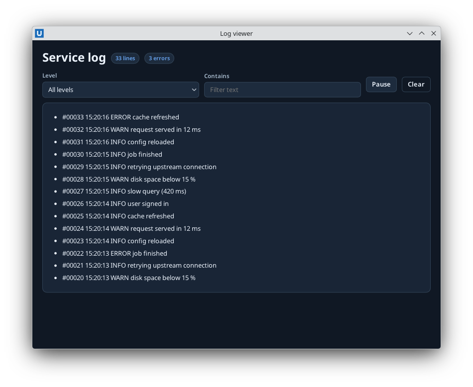

<details><summary>Full source</summary>

```powershell
# Live log viewer: a timer streams lines; filter by level and text, pause, clear.
#
# Teaches: periodic work on the owner runspace without blocking the window. A background task
# (Start-NativeHTMLKitTask) only waits; its -OnCompleted callback, which the SDK runs on this
# runspace, appends a line and schedules the next tick. Also: bounded history, a computed
# filtered view rendered by Add-NHKUiTextList (all text is encoded), counters, pausing
# without losing lines.
#
# Run:  pwsh -File ./log_viewer.ps1   |   powershell.exe -NoProfile -File .\log_viewer.ps1
$ErrorActionPreference = 'Stop'
Import-Module NativeHTMLKit.UI
$app = Start-NativeHTMLKitScript -Name 'Log viewer'

$s = @{
    Lines = (New-NHKUiState -Value @())   # objects with Level and Text, newest last
    Held = (New-NHKUiState -Value @())    # lines that arrived while paused
    Paused = (New-NHKUiState -Value $false); Level = (New-NHKUiState -Value 'all'); Search = (New-NHKUiState -Value '')
    N = 0; Keep = 500; Show = 14
    Messages = @('request served in 12 ms', 'cache refreshed', 'user signed in', 'slow query (420 ms)',
                 'disk space below 15 %', 'retrying upstream connection', 'job finished', 'config reloaded')
}
$s.Shown = New-NHKUiComputed -DependsOn @($s.Lines, $s.Level, $s.Search) -Data $s -Compute {
    param($s)
    $match = @($s.Lines.Value | Where-Object {
        ($s.Level.Value -eq 'all' -or $_.Level -eq $s.Level.Value) -and
        $_.Text.IndexOf([string]$s.Search.Value, [StringComparison]::OrdinalIgnoreCase) -ge 0 } | ForEach-Object { $_.Text })
    $newest = @($match | Select-Object -Last $s.Show)
    [array]::Reverse($newest)
    , $newest
}
$s.Total = New-NHKUiComputed -DependsOn @($s.Lines) -Data $s -Compute { param($s) '{0} lines' -f @($s.Lines.Value).Count }
$s.Errors = New-NHKUiComputed -DependsOn @($s.Lines) -Data $s -Compute { param($s) '{0} errors' -f @($s.Lines.Value | Where-Object { $_.Level -eq 'ERROR' }).Count }
$s.PauseLabel = New-NHKUiComputed -DependsOn @($s.Paused) -Data $s -Compute { param($s) if ($s.Paused.Value) { 'Resume' } else { 'Pause' } }
$s.Waiting = New-NHKUiComputed -DependsOn @($s.Held) -Data $s -Compute { param($s) 'Paused: {0} new lines are waiting.' -f @($s.Held.Value).Count }
$s.NoMatch = New-NHKUiComputed -DependsOn @($s.Shown) -Data $s -Compute { param($s) @($s.Shown.Value).Count -eq 0 }
$computeds = @($s.Shown, $s.Total, $s.Errors, $s.PauseLabel, $s.Waiting, $s.NoMatch)

function Add-LogLine($s) {
    $s.N = $s.N + 1
    $level = if ($s.N % 11 -eq 0) { 'ERROR' } elseif ($s.N % 4 -eq 0) { 'WARN' } else { 'INFO' }
    $text = '#{0:D5} {1} {2,-5} {3}' -f $s.N, (Get-Date).ToString('HH:mm:ss'), $level, $s.Messages[$s.N % $s.Messages.Count]
    $entry = [pscustomobject]@{ Level = $level; Text = $text }
    $target = if ($s.Paused.Value) { $s.Held } else { $s.Lines }
    $target.Set(@(@($target.Value) + @($entry) | Select-Object -Last $s.Keep))
}
function Start-Tick {
    # The worker runs in its own runspace and only sleeps; the callback runs here, on the owner.
    $null = Start-NativeHTMLKitTask -Application $app -ScriptBlock { Start-Sleep -Milliseconds 200 } -OnCompleted {
        param($result)
        Add-LogLine $s
        Start-Tick
    }
}

$ui = New-NHKUi -Title 'Log viewer' -Width 820 -Height 620
$null = Add-NHKUiColumn -UI $ui -Content {
    $null = Add-NHKUiRow -UI $ui -Content {
        $null = Add-NHKUiHeading -UI $ui -Text 'Service log' -Level 1
        $null = Add-NHKUiBadge -UI $ui -Bind $s.Total
        $null = Add-NHKUiBadge -UI $ui -Bind $s.Errors
    }
    $null = Add-NHKUiRow -UI $ui -Content {
        $null = Add-NHKUiSelect -UI $ui -Bind $s.Level -Label 'Level' -Options @(
            @{ Value = 'all'; Label = 'All levels' }, @{ Value = 'INFO'; Label = 'Info' },
            @{ Value = 'WARN'; Label = 'Warnings' }, @{ Value = 'ERROR'; Label = 'Errors' })
        $null = Add-NHKUiInput -UI $ui -Bind $s.Search -Label 'Contains' -Type search -Placeholder 'Filter text'
        $null = Add-NHKUiButton -UI $ui -Bind $s.PauseLabel -Variant secondary -Data $s -OnClick {
            param($eventObject, $s)
            if ($s.Paused.Value) {
                $s.Lines.Set(@(@($s.Lines.Value) + @($s.Held.Value) | Select-Object -Last $s.Keep))
                $s.Held.Set(@())
            }
            $s.Paused.Set(-not $s.Paused.Value)
        }
        $null = Add-NHKUiButton -UI $ui -Text 'Clear' -Variant quiet -Data $s -OnClick { param($eventObject, $s) $s.Lines.Set(@()) }
    }
    $null = Add-NHKUiWhen -UI $ui -Bind $s.Paused -Content { $null = Add-NHKUiAlert -UI $ui -Bind $s.Waiting }
    $null = Add-NHKUiCard -UI $ui -Content {
        $null = Add-NHKUiWhen -UI $ui -Bind $s.NoMatch -Content { $null = Add-NHKUiText -UI $ui -Text 'No matching lines.' -Muted }
        $null = Add-NHKUiTextList -UI $ui -Bind $s.Shown
    }
}

try {
    $null = Start-NHKUi -UI $ui -Application $app
    Start-Tick
    Wait-NativeHTMLKit -Application $app -UntilShutdown
} finally {
    Stop-NHKUi -UI $ui
    foreach ($c in $computeds) { $c.Dispose() }
    Close-NativeHTMLKit -Application $app     # also stops a pending tick task
}
```

</details>

<a id="background"></a>

## Background calculation

Run a slow calculation off the UI thread and report the result; cancel it.

**Teaches:** Python executor and ui.post(), PowerShell Start-NativeHTMLKitTask, busy flag, cancel.

**Run:** `pwsh -File ./background.ps1` (source: [`examples/powershell/background.ps1`](https://github.com/nativehtmlkit/nativehtmlkit_ui/blob/main/examples/powershell/background.ps1))

Related guide: [background work](guides/background-work.md).

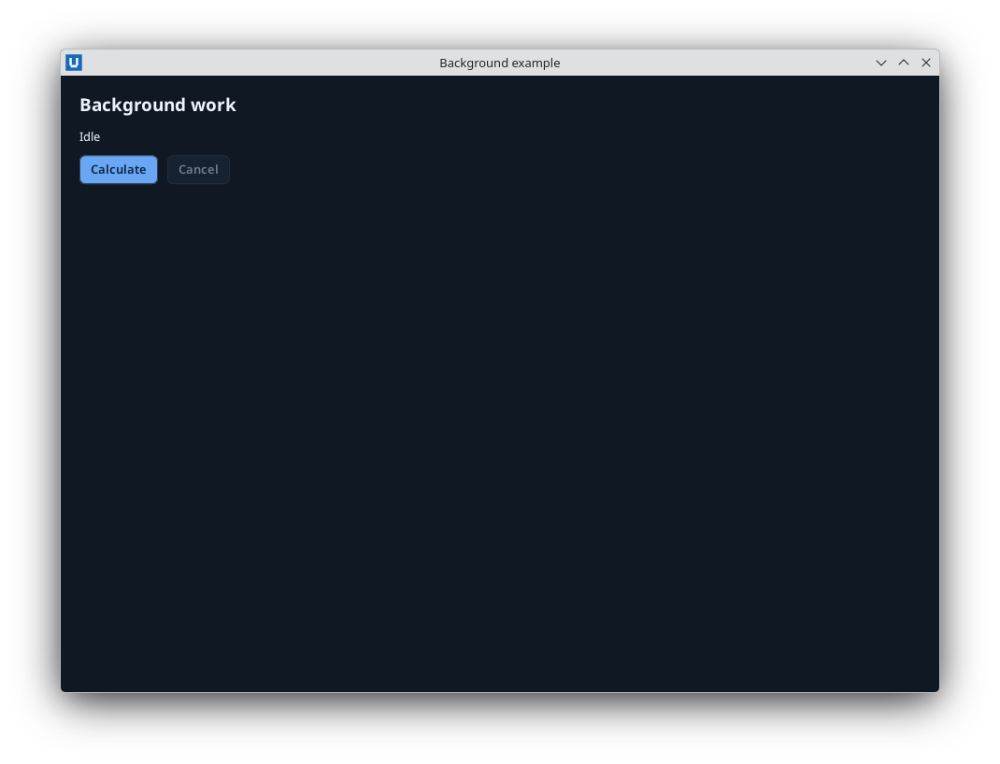

<details><summary>Full source</summary>

```powershell
# Background calculation: run slow work in an SDK task and report the result on the owner runspace.
#
# Teaches: UI states may only change on the runspace that started the UI. Slow work runs in
# Start-NativeHTMLKitTask (a separate runspace that receives plain data only); its -OnCompleted
# and -OnFailed callbacks run later on this runspace, where they may set states. Also: a busy
# flag that disables the button, Cancel via Stop-NativeHTMLKitTask, and a task timeout.
#
# Run:  pwsh -File ./background.ps1   |   powershell.exe -NoProfile -File .\background.ps1
$ErrorActionPreference = 'Stop'
Import-Module NativeHTMLKit.UI
$app = Start-NativeHTMLKitScript -Name 'NativeHTMLKit Background'

$s = @{ App = $app; Status = (New-NHKUiState -Value 'Idle'); Busy = (New-NHKUiState -Value $false); Task = $null }
$s.Idle = New-NHKUiComputed -DependsOn @($s.Busy) -Data $s -Compute { param($s) -not $s.Busy.Value }

$ui = New-NHKUi -Title 'Background example'
$null = Add-NHKUiColumn -UI $ui -Content {
    $null = Add-NHKUiHeading -UI $ui -Text 'Background work'
    $null = Add-NHKUiText -UI $ui -Bind $s.Status
    $null = Add-NHKUiRow -UI $ui -Content {
        $null = Add-NHKUiButton -UI $ui -Text 'Calculate' -DisabledState $s.Busy -Data $s -OnClick {
            param($eventObject, $s)
            $s.Busy.Set($true)
            $s.Status.Set('Running')
            # The worker sees only its arguments: no UI, state or SDK objects.
            $s.Task = Start-NativeHTMLKitTask -Application $s.App -ArgumentList @(500000) -TimeoutMilliseconds 60000 -ScriptBlock {
                param([int]$n)
                $sum = [long]0
                for ($i = 0; $i -lt $n; $i++) { $sum += $i }
                $sum
            } -OnCompleted {
                param($result)
                $s.Status.Set('Done: ' + $result[0])
                $s.Busy.Set($false)
            } -OnFailed {
                param($failure)
                if ($failure -is [OperationCanceledException]) { $s.Status.Set('Cancelled') }
                else { $s.Status.Set('Failed: ' + $failure.GetType().Name) }
                $s.Busy.Set($false)
            }
        }
        $null = Add-NHKUiButton -UI $ui -Text 'Cancel' -Variant secondary -DisabledState $s.Idle -Data $s -OnClick {
            param($eventObject, $s)
            if ($null -ne $s.Task) { Stop-NativeHTMLKitTask -Task $s.Task }   # -OnFailed then reports the cancellation
        }
    }
}

try {
    $null = Start-NHKUi -UI $ui -Application $app
    Wait-NativeHTMLKit -Application $app -UntilShutdown
} finally {
    Stop-NHKUi -UI $ui
    $s.Idle.Dispose()
    Close-NativeHTMLKit -Application $app      # also stops a task that is still running
}
```

</details>

<a id="word-counter"></a>

## Word counter

Count words in a text file in the background with progress, Cancel and a top-ten list.

**Teaches:** background work with progress, cancellation, merging partial results, throttled updates.

**Run:** `pwsh -File ./word_counter.ps1 [FILE]` (source: [`examples/powershell/word_counter.ps1`](https://github.com/nativehtmlkit/nativehtmlkit_ui/blob/main/examples/powershell/word_counter.ps1))

Related guide: [background work](guides/background-work.md).

*Screenshot not captured yet.*

<details><summary>Full source</summary>

```powershell
# Word counter: count words in a text file with SDK background tasks, with progress and Cancel.
#
# Teaches: splitting work into chunks that each run in Start-NativeHTMLKitTask (a separate
#          runspace that receives plain data only), merging each chunk's result and reporting
#          progress in -OnCompleted on the owner runspace, starting the next chunk from there,
#          Cancel via a flag plus Stop-NativeHTMLKitTask, Invoke-NHKUiBatch for several .Set()
#          calls in one write, and a busy state that disables Count while work runs.
# Run:     pwsh -File ./word_counter.ps1 [FILE]   |   powershell.exe -NoProfile -File .\word_counter.ps1 [FILE]
#          (without FILE it counts 20,000 lines of generated text)
# Guide:   docs/powershell/guides/background-work.md
param([string]$Path)
$ErrorActionPreference = 'Stop'
Import-Module NativeHTMLKit.UI
$app = Start-NativeHTMLKitScript -Name 'Word counter'

$culture = [Globalization.CultureInfo]::InvariantCulture
$s = @{ App = $app; Path = $Path; Lines = @(); Next = 0; Counts = @{}; Task = $null; Cancel = $false
        Progress = (New-NHKUiState -Value 'Press Count to start.'); TopWords = (New-NHKUiState -Value @())
        Running = (New-NHKUiState -Value $false) }
$s.Idle = New-NHKUiComputed -DependsOn @($s.Running) -Data $s -Compute { param($s) -not $s.Running.Value }
$chunkSize = 2000

function Format-Number([long]$Value) { return [string]::Format($culture, '{0:N0}', $Value) }

function Read-Lines {
    if ($s.Path) { return , [IO.File]::ReadAllLines([IO.Path]::GetFullPath($s.Path)) }
    # Generated sample: line i is nine consecutive words of a fixed list, starting at word i.
    $words = 'the quick brown fox jumps over the lazy dog while native windows render html'.Split(' ')
    $distinct = @(for ($i = 0; $i -lt $words.Count; $i++) { (@(for ($j = 0; $j -lt 9; $j++) { $words[($i + $j) % $words.Count] })) -join ' ' })
    return , [string[]]@(for ($i = 0; $i -lt 20000; $i++) { $distinct[$i % $words.Count] })
}

function Complete-Count([string]$Message, [object[]]$Words) {
    Invoke-NHKUiBatch -UI $ui -ScriptBlock {
        $s.Progress.Set($Message)
        $s.TopWords.Set($Words)
        $s.Running.Set($false)
    }
}

function Start-Chunk {
    if ($s.Cancel) { Complete-Count 'Cancelled.' @(); return }
    $total = $s.Lines.Count
    if ($s.Next -ge $total) {
        $sum = [long]0
        foreach ($value in $s.Counts.Values) { $sum += $value }
        $top = @($s.Counts.GetEnumerator() | Sort-Object @{ Expression = 'Value'; Descending = $true }, @{ Expression = 'Name'; Descending = $false } |
            Select-Object -First 10 | ForEach-Object { '{0}: {1}' -f $_.Name, (Format-Number $_.Value) })
        Complete-Count ('Done: {0} words, {1} different, {2} lines.' -f (Format-Number $sum), (Format-Number $s.Counts.Count), (Format-Number $total)) $top
        return
    }
    $count = [Math]::Min($chunkSize, $total - $s.Next)
    $chunk = [string[]]$s.Lines[$s.Next..($s.Next + $count - 1)]
    $s.Next += $count
    # The worker sees only its argument (an array of strings) and returns a plain hashtable.
    $s.Task = Start-NativeHTMLKitTask -Application $s.App -ArgumentList (, $chunk) -TimeoutMilliseconds 60000 -ScriptBlock {
        param([string[]]$lines)
        $pattern = New-Object Text.RegularExpressions.Regex("[^\W\d_]+(?:'[^\W\d_]+)?")
        $counts = @{}
        foreach ($line in $lines) {
            foreach ($match in $pattern.Matches($line)) {
                $word = $match.Value.ToLowerInvariant()
                if ($counts.ContainsKey($word)) { $counts[$word]++ } else { $counts[$word] = 1 }
            }
        }
        $counts
    } -OnCompleted {
        param($result)
        foreach ($entry in $result[0].GetEnumerator()) {
            if ($s.Counts.ContainsKey($entry.Key)) { $s.Counts[$entry.Key] += $entry.Value } else { $s.Counts[$entry.Key] = $entry.Value }
        }
        $s.Progress.Set(('{0}% - {1} lines' -f [Math]::Round(100.0 * $s.Next / [Math]::Max(1, $s.Lines.Count)), (Format-Number $s.Next)))
        Start-Chunk
    } -OnFailed {
        param($failure)
        if ($s.Cancel) { Complete-Count 'Cancelled.' @() } else { Complete-Count ('Failed: ' + $failure.Message) @() }
    }
}

$ui = New-NHKUi -Title 'Word counter' -Theme daylight -Density regular -Width 560 -Height 560
$source = if ($Path) { [IO.Path]::GetFileName($Path) } else { 'generated sample text' }
$null = Add-NHKUiColumn -UI $ui -Content {
    $null = Add-NHKUiHeading -UI $ui -Text 'Word counter' -Level 1
    $null = Add-NHKUiText -UI $ui -Text "Source: $source" -Muted
    $null = Add-NHKUiRow -UI $ui -Content {
        $null = Add-NHKUiButton -UI $ui -Text 'Count' -DisabledState $s.Running -Data $s -OnClick {
            param($eventObject, $s)
            if ($s.Running.Value) { return }
            try { $s.Lines = Read-Lines }
            catch { $s.Progress.Set('Cannot read the file: ' + $_.Exception.Message); return }
            $s.Next = 0; $s.Counts = @{}; $s.Cancel = $false
            $s.Running.Set($true)
            $s.TopWords.Set(@())
            $s.Progress.Set('Starting...')
            Start-Chunk
        }
        $null = Add-NHKUiButton -UI $ui -Text 'Cancel' -Variant secondary -DisabledState $s.Idle -Data $s -OnClick {
            param($eventObject, $s)
            $s.Cancel = $true
            if ($null -ne $s.Task) { Stop-NativeHTMLKitTask -Task $s.Task }
        }
    }
    $null = Add-NHKUiAlert -UI $ui -Bind $s.Progress
    $null = Add-NHKUiCard -UI $ui -Content {
        $null = Add-NHKUiHeading -UI $ui -Text 'Most frequent words' -Level 2
        $null = Add-NHKUiTextList -UI $ui -Bind $s.TopWords
    }
}

try {
    $null = Start-NHKUi -UI $ui -Application $app
    Wait-NativeHTMLKit -Application $app -UntilShutdown
} finally {
    Stop-NHKUi -UI $ui
    $s.Idle.Dispose()
    Close-NativeHTMLKit -Application $app      # also stops a task that is still running
}
```

</details>

<a id="clipboard-tool"></a>

## Clipboard text tool

Transform text and copy or paste it with the SDK clipboard, handling unavailability.

**Teaches:** SDK clipboard calls from UI handlers, error handling, computed preview.

**Run:** `pwsh -File ./clipboard_tool.ps1` (source: [`examples/powershell/clipboard_tool.ps1`](https://github.com/nativehtmlkit/nativehtmlkit_ui/blob/main/examples/powershell/clipboard_tool.ps1))

Related guide: [mixing ui and sdk calls](guides/mixing-ui-and-sdk-calls.md).

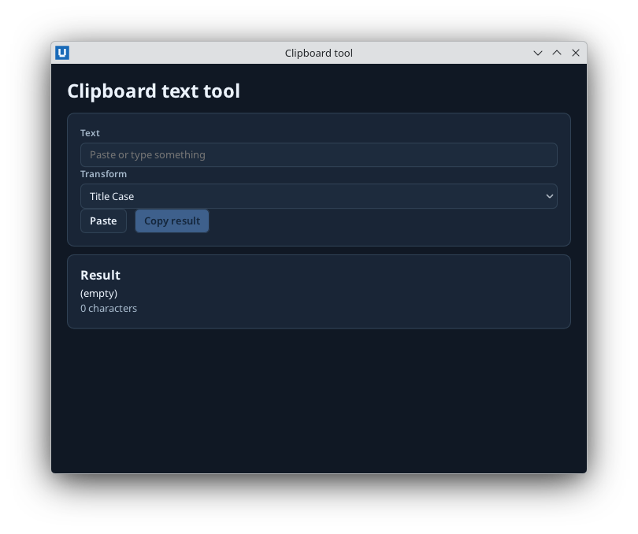

<details><summary>Full source</summary>

```powershell
# Text transformer with copy/paste: mixes UI state with direct SDK clipboard calls.
#
# Teaches: calling public SDK cmdlets (Set-NativeHTMLKitClipboard / Get-NativeHTMLKitClipboard)
# from a UI button callback, reporting SDK errors in the UI instead of failing the callback
# (the clipboard is unavailable in headless test mode, error -32001), and a computed preview.
#
# Run:  pwsh -File ./clipboard_tool.ps1   |   powershell.exe -NoProfile -File .\clipboard_tool.ps1
$ErrorActionPreference = 'Stop'
Import-Module NativeHTMLKit.UI
$app = Start-NativeHTMLKitScript -Name 'Clipboard tool'

$s = @{
    App = $app; Source = (New-NHKUiState -Value ''); Mode = (New-NHKUiState -Value 'title'); Status = (New-NHKUiState -Value '')
    TextInfo = [Globalization.CultureInfo]::InvariantCulture.TextInfo
}
$s.Result = New-NHKUiComputed -DependsOn @($s.Source, $s.Mode) -Data $s -Compute {
    param($s)
    $text = [string]$s.Source.Value
    switch ($s.Mode.Value) {
        'upper' { $text.ToUpperInvariant() }
        'lower' { $text.ToLowerInvariant() }
        'title' { $s.TextInfo.ToTitleCase($text.ToLowerInvariant()) }
        'slug' { ($text.ToLowerInvariant() -replace '[^a-z0-9]+', '-').Trim('-') }
        'squash' { (@($text -split '\s+' | Where-Object { $_ })) -join ' ' }
        'reverse' { $words = @($text -split '\s+' | Where-Object { $_ }); [array]::Reverse($words); $words -join ' ' }
    }
}
$s.Preview = New-NHKUiComputed -DependsOn @($s.Result) -Data $s -Compute { param($s) if ($s.Result.Value) { $s.Result.Value } else { '(empty)' } }
$s.Length = New-NHKUiComputed -DependsOn @($s.Result) -Data $s -Compute { param($s) '{0} characters' -f ([string]$s.Result.Value).Length }
$s.Empty = New-NHKUiComputed -DependsOn @($s.Result) -Data $s -Compute { param($s) -not $s.Result.Value }
$computeds = @($s.Result, $s.Preview, $s.Length, $s.Empty)

$ui = New-NHKUi -Title 'Clipboard tool' -Width 680 -Height 520
$null = Add-NHKUiColumn -UI $ui -Content {
    $null = Add-NHKUiHeading -UI $ui -Text 'Clipboard text tool' -Level 1
    $null = Add-NHKUiCard -UI $ui -Content {
        $null = Add-NHKUiInput -UI $ui -Bind $s.Source -Label 'Text' -Placeholder 'Paste or type something'
        $null = Add-NHKUiSelect -UI $ui -Bind $s.Mode -Label 'Transform' -Options @(
            @{ Value = 'upper'; Label = 'UPPER CASE' }, @{ Value = 'lower'; Label = 'lower case' },
            @{ Value = 'title'; Label = 'Title Case' }, @{ Value = 'slug'; Label = 'slug-for-urls' },
            @{ Value = 'squash'; Label = 'Collapse whitespace' }, @{ Value = 'reverse'; Label = 'Reverse word order' })
        $null = Add-NHKUiRow -UI $ui -Content {
            $null = Add-NHKUiButton -UI $ui -Text 'Paste' -Variant secondary -Data $s -OnClick {
                param($eventObject, $s)
                try {
                    $s.Source.Set((Get-NativeHTMLKitClipboard -Application $s.App))
                    $s.Status.Set('Pasted from the clipboard.')
                } catch { $s.Status.Set('Clipboard unavailable: ' + $_.Exception.Message) }
            }
            $null = Add-NHKUiButton -UI $ui -Text 'Copy result' -DisabledState $s.Empty -Data $s -OnClick {
                param($eventObject, $s)
                try {
                    Set-NativeHTMLKitClipboard -Application $s.App -Text ([string]$s.Result.Value)
                    $s.Status.Set(('Copied {0} characters to the clipboard.' -f ([string]$s.Result.Value).Length))
                } catch { $s.Status.Set('Clipboard unavailable: ' + $_.Exception.Message) }
            }
        }
    }
    $null = Add-NHKUiCard -UI $ui -Content {
        $null = Add-NHKUiHeading -UI $ui -Text 'Result' -Level 3
        $null = Add-NHKUiText -UI $ui -Bind $s.Preview
        $null = Add-NHKUiText -UI $ui -Bind $s.Length -Muted
    }
    $null = Add-NHKUiWhen -UI $ui -Bind $s.Status -Content { $null = Add-NHKUiAlert -UI $ui -Bind $s.Status }
}

try {
    $null = Start-NHKUi -UI $ui -Application $app
    Wait-NativeHTMLKit -Application $app -UntilShutdown
} finally {
    Stop-NHKUi -UI $ui
    foreach ($c in $computeds) { $c.Dispose() }
    Close-NativeHTMLKit -Application $app
}
```

</details>

<a id="file-picker"></a>

## File inspector

Pick files with the native open dialog and list their sizes and a total.

**Teaches:** SDK file dialog from the UI, cancel and error paths, busy flag.

**Run:** `pwsh -File ./file_picker.ps1` (source: [`examples/powershell/file_picker.ps1`](https://github.com/nativehtmlkit/nativehtmlkit_ui/blob/main/examples/powershell/file_picker.ps1))

Related guide: [mixing ui and sdk calls](guides/mixing-ui-and-sdk-calls.md).

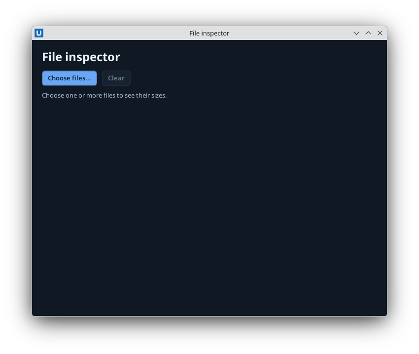

<details><summary>Full source</summary>

```powershell
# File inspector: pick files with the native open dialog and list their sizes and a total.
#
# Teaches: calling an SDK dialog (Show-NativeHTMLKitFileDialog) from a UI button callback with
# the UI's own window ($ui.Window) as the owner, handling cancel and errors (dialogs are
# unavailable in headless test mode, error -32001), and turning the result into list state.
# The call waits until the user closes the dialog; UI changes made in the callback are written
# once it returns.
#
# Run:  pwsh -File ./file_picker.ps1   |   powershell.exe -NoProfile -File .\file_picker.ps1
$ErrorActionPreference = 'Stop'
Import-Module NativeHTMLKit.UI
$app = Start-NativeHTMLKitScript -Name 'File inspector'

$s = @{
    Files = (New-NHKUiState -Value @())   # objects with Name and Size (bytes)
    Status = (New-NHKUiState -Value 'Choose one or more files to see their sizes.'); UI = $null
}
$s.HasFiles = New-NHKUiComputed -DependsOn @($s.Files) -Data $s -Compute { param($s) @($s.Files.Value).Count -gt 0 }
$s.NoFiles = New-NHKUiComputed -DependsOn @($s.HasFiles) -Data $s -Compute { param($s) -not $s.HasFiles.Value }
$s.Lines = New-NHKUiComputed -DependsOn @($s.Files) -Data $s -Compute {
    param($s) , @($s.Files.Value | ForEach-Object { '{0}: {1:N1} KB' -f $_.Name, ($_.Size / 1KB) })
}
$s.Summary = New-NHKUiComputed -DependsOn @($s.Files) -Data $s -Compute {
    param($s)
    $total = [long]0; foreach ($f in @($s.Files.Value)) { $total += $f.Size }
    '{0} files, {1:N1} KB in total' -f @($s.Files.Value).Count, ($total / 1KB)
}
$computeds = @($s.HasFiles, $s.NoFiles, $s.Lines, $s.Summary)

$ui = New-NHKUi -Title 'File inspector' -Width 720 -Height 560
$s.UI = $ui
$null = Add-NHKUiColumn -UI $ui -Content {
    $null = Add-NHKUiHeading -UI $ui -Text 'File inspector' -Level 1
    $null = Add-NHKUiRow -UI $ui -Content {
        $null = Add-NHKUiButton -UI $ui -Text 'Choose files...' -Data $s -OnClick {
            param($eventObject, $s)
            try {
                $result = Show-NativeHTMLKitFileDialog -Window $s.UI.Window -Kind OpenFiles -Multiple $true -Title 'Choose files to inspect'
            } catch {
                $s.Status.Set('File dialogs are unavailable here: ' + $_.Exception.Message)
                return
            }
            $paths = @($result.paths)
            if ($result.cancelled -or $paths.Count -eq 0) { $s.Status.Set('No files chosen.'); return }
            $rows = foreach ($path in $paths) {
                try { $item = Get-Item -LiteralPath $path; [pscustomobject]@{ Name = $item.Name; Size = [long]$item.Length } }
                catch { [pscustomobject]@{ Name = ([IO.Path]::GetFileName($path) + ' (unreadable)'); Size = [long]0 } }
            }
            $s.Files.Set(@($rows))
            $s.Status.Set(('{0} file(s) chosen.' -f @($rows).Count))
        }
        $null = Add-NHKUiButton -UI $ui -Text 'Clear' -Variant secondary -DisabledState $s.NoFiles -Data $s -OnClick {
            param($eventObject, $s) $s.Files.Set(@())
        }
    }
    $null = Add-NHKUiText -UI $ui -Bind $s.Status -Muted
    $null = Add-NHKUiWhen -UI $ui -Bind $s.HasFiles -Content {
        $null = Add-NHKUiCard -UI $ui -Content {
            $null = Add-NHKUiHeading -UI $ui -Bind $s.Summary -Level 3
            $null = Add-NHKUiTextList -UI $ui -Bind $s.Lines
        }
    }
}

try {
    $null = Start-NHKUi -UI $ui -Application $app
    Wait-NativeHTMLKit -Application $app -UntilShutdown
} finally {
    Stop-NHKUi -UI $ui
    foreach ($c in $computeds) { $c.Dispose() }
    Close-NativeHTMLKit -Application $app
}
```

</details>

<a id="multi-window"></a>

## Notes with inspector windows

Several windows bound to the same state; open, track and close inspector windows.

**Teaches:** several UIs in one application, shared state, window events, closing windows from code.

**Run:** `pwsh -File ./multi_window.ps1` (source: [`examples/powershell/multi_window.ps1`](https://github.com/nativehtmlkit/nativehtmlkit_ui/blob/main/examples/powershell/multi_window.ps1))

Related guide: [multiple windows](guides/multiple-windows.md).

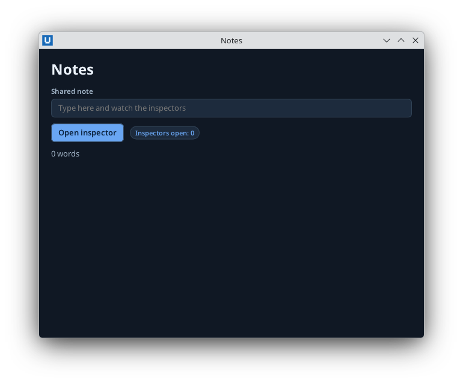

<details><summary>Full source</summary>

```powershell
# Notes editor with live inspector windows that share the editor's state.
#
# Teaches: several UIs in one application, each in its own native window; binding several
# windows to the same states; starting a UI from a button callback (Start-NHKUi -NoReady);
# State.Subscribe for a side effect (an edit counter); and noticing windows the user closed via
# the SDK's window.event notification, which is where the inspector's UI is stopped.
#
# Run:  pwsh -File ./multi_window.ps1   |   powershell.exe -NoProfile -File .\multi_window.ps1
$ErrorActionPreference = 'Stop'
Import-Module NativeHTMLKit.UI
$app = Start-NativeHTMLKitScript -Name 'Notes'

$s = @{
    App = $app; Note = (New-NHKUiState -Value ''); Edits = (New-NHKUiState -Value 0); Open = (New-NHKUiState -Value 0)
    Inspectors = (New-Object System.Collections.ArrayList); Max = 3
}
$null = $s.Note.Subscribe({ param($value, $ctx) $ctx.Edits.Set([int]$ctx.Edits.Value + 1) }, $s)
$s.NoteText = New-NHKUiComputed -DependsOn @($s.Note) -Data $s -Compute { param($s) 'Note: ' + $s.Note.Value }
$s.Stats = New-NHKUiComputed -DependsOn @($s.Note) -Data $s -Compute {
    param($s) '{0} words, {1} characters' -f @(([string]$s.Note.Value) -split '\s+' | Where-Object { $_ }).Count, ([string]$s.Note.Value).Length
}
$s.Words = New-NHKUiComputed -DependsOn @($s.Note) -Data $s -Compute { param($s) '{0} words' -f @(([string]$s.Note.Value) -split '\s+' | Where-Object { $_ }).Count }
$s.EditsText = New-NHKUiComputed -DependsOn @($s.Edits) -Data $s -Compute { param($s) '{0} edits' -f $s.Edits.Value }
$s.OpenText = New-NHKUiComputed -DependsOn @($s.Open) -Data $s -Compute { param($s) 'Inspectors open: {0}' -f $s.Open.Value }
$s.AtMax = New-NHKUiComputed -DependsOn @($s.Open) -Data $s -Compute { param($s) $s.Open.Value -ge $s.Max }
$computeds = @($s.NoteText, $s.Stats, $s.Words, $s.EditsText, $s.OpenText, $s.AtMax)

# The SDK calls this for every window event; stop the UI of an inspector the user closed.
Register-NativeHTMLKitNotification -Application $app -Method 'window.event' -Callback {
    param($notification)
    if ($notification.type -ne 'closed') { return }
    foreach ($entry in @($s.Inspectors)) {
        if ($entry.WindowId -eq $notification.window_id) {
            Stop-NHKUi -UI $entry.UI
            $s.Inspectors.Remove($entry)
            $s.Open.Set($s.Inspectors.Count)
        }
    }
}

# Workaround for a UI 0.1.1 stylesheet defect: a field placed directly in a column gets a
# 200px flex basis (meant for rows) and therefore 200px of height. See docs/LIMITATIONS.md.
$fieldFix = '.nhk-col > .nhk-field { flex: 0 0 auto; }'
$ui = New-NHKUi -Title 'Notes' -Width 640 -Height 480 -ExtraCss $fieldFix
$null = Add-NHKUiColumn -UI $ui -Content {
    $null = Add-NHKUiHeading -UI $ui -Text 'Notes' -Level 1
    $null = Add-NHKUiInput -UI $ui -Bind $s.Note -Label 'Shared note' -Placeholder 'Type here and watch the inspectors'
    $null = Add-NHKUiRow -UI $ui -Content {
        $null = Add-NHKUiButton -UI $ui -Text 'Open inspector' -DisabledState $s.AtMax -Data $s -OnClick {
            param($eventObject, $s)
            if ($s.Inspectors.Count -ge $s.Max) { return }
            $number = $s.Inspectors.Count + 1
            $inspector = New-NHKUi -Title "Inspector $number" -Width 420 -Height 320 -Theme graphite
            $null = Add-NHKUiColumn -UI $inspector -Content {
                $null = Add-NHKUiHeading -UI $inspector -Text "Inspector $number" -Level 2
                $null = Add-NHKUiText -UI $inspector -Bind $s.NoteText
                $null = Add-NHKUiText -UI $inspector -Bind $s.Stats
                $null = Add-NHKUiBadge -UI $inspector -Bind $s.EditsText
                $null = Add-NHKUiButton -UI $inspector -Text 'Close inspector' -Variant secondary -Data $inspector -OnClick {
                    param($eventObject, $me) Close-NativeHTMLKitWindow -Window $me.Window
                }
            }
            $window = Start-NHKUi -UI $inspector -Application $s.App -NoReady
            [void]$s.Inspectors.Add([pscustomobject]@{ UI = $inspector; WindowId = $window.Id })
            $s.Open.Set($s.Inspectors.Count)
        }
        $null = Add-NHKUiBadge -UI $ui -Bind $s.OpenText
    }
    $null = Add-NHKUiText -UI $ui -Bind $s.Words -Muted
}

try {
    $null = Start-NHKUi -UI $ui -Application $app
    Wait-NativeHTMLKit -Application $app -UntilShutdown
} finally {
    foreach ($entry in @($s.Inspectors)) { Stop-NHKUi -UI $entry.UI }
    Stop-NHKUi -UI $ui
    foreach ($c in $computeds) { $c.Dispose() }
    Close-NativeHTMLKit -Application $app
}
```

</details>

<a id="dashboard"></a>

## System dashboard

A responsive card grid with a live clock and disk usage, themed with extra CSS.

**Teaches:** responsive grid, themes and density, extra CSS, one-second timer.

**Run:** `pwsh -File ./dashboard.ps1 [cobalt|graphite|daylight]` (source: [`examples/powershell/dashboard.ps1`](https://github.com/nativehtmlkit/nativehtmlkit_ui/blob/main/examples/powershell/dashboard.ps1))

Related guide: [layouts](guides/layouts.md).

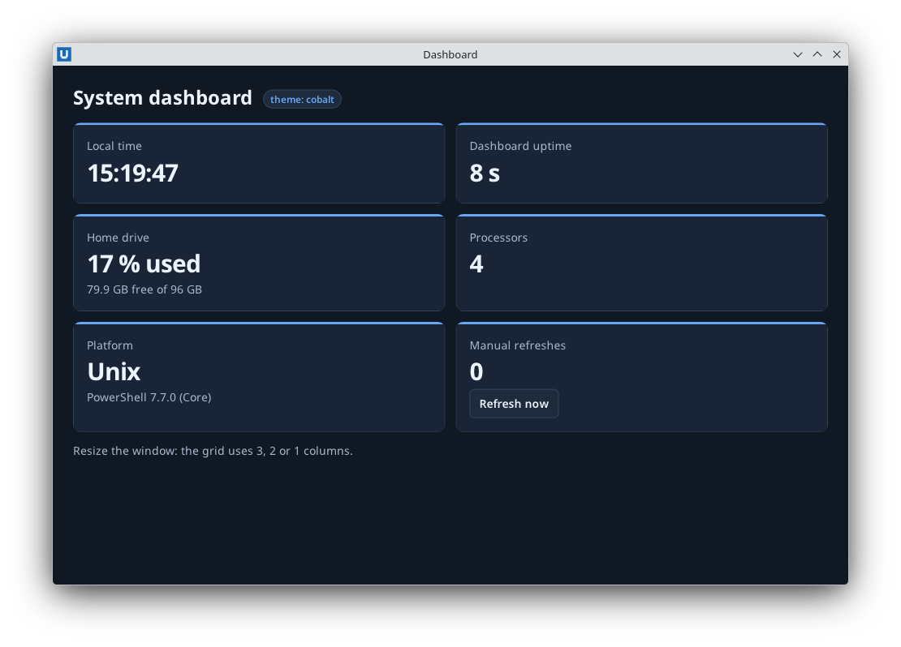

<details><summary>Full source</summary>

```powershell
# System dashboard: a responsive card grid with a live clock and disk usage, themed via CSS.
#
# Teaches: Add-NHKUiGrid (3 columns, 2 below 1000 px, 1 below 620 px), -Theme and -Density,
# -ExtraCss with selectors for the UI's own classes and theme token overrides, and a 1-second
# timer built from a sleeping background task whose -OnCompleted callback refreshes state.
#
# Run:  pwsh -File ./dashboard.ps1 [cobalt|graphite|daylight]
#       powershell.exe -NoProfile -File .\dashboard.ps1 daylight
$ErrorActionPreference = 'Stop'
Import-Module NativeHTMLKit.UI
$app = Start-NativeHTMLKitScript -Name 'Dashboard'

$theme = 'cobalt'
if ($args.Count -gt 0 -and @('cobalt', 'graphite', 'daylight') -contains $args[0]) { $theme = [string]$args[0] }
$css = @'
.nhk-card h1.nhk-heading { font-size: 30px; margin: 4px 0; }
.nhk-card { border-top: 3px solid var(--nhk-accent); }
body.nhk-theme-daylight { --nhk-accent: #0f7b6c; --nhk-accent-strong: #0b6458; --nhk-focus: #0f7b6c; }
'@

$s = @{
    Started = [Diagnostics.Stopwatch]::StartNew(); Refreshed = (New-NHKUiState -Value '0')
    Clock = (New-NHKUiState -Value '--:--:--'); Uptime = (New-NHKUiState -Value '0 s')
    Disk = (New-NHKUiState -Value ''); DiskDetail = (New-NHKUiState -Value ''); UI = $null
}
function Update-Dashboard($s) {
    # Several states change at once: write them as one batched update.
    Invoke-NHKUiBatch -UI $s.UI -ScriptBlock {
        $s.Clock.Set((Get-Date).ToString('HH:mm:ss'))
        $sec = [int]$s.Started.Elapsed.TotalSeconds
        $text = if ($sec -ge 60) { '{0} min {1} s' -f [Math]::Floor($sec / 60), ($sec % 60) } else { "$sec s" }
        $s.Uptime.Set($text)
        $drive = New-Object IO.DriveInfo ([IO.Path]::GetPathRoot([Environment]::GetFolderPath('UserProfile')))
        $s.Disk.Set(('{0:N0} % used' -f (100.0 * ($drive.TotalSize - $drive.AvailableFreeSpace) / $drive.TotalSize)))
        $s.DiskDetail.Set(('{0:N1} GB free of {1:N0} GB' -f ($drive.AvailableFreeSpace / 1GB), ($drive.TotalSize / 1GB)))
    }
}
function Start-Tick {
    $null = Start-NativeHTMLKitTask -Application $app -ScriptBlock { Start-Sleep -Milliseconds 1000 } -OnCompleted {
        param($result)
        Update-Dashboard $s
        Start-Tick
    }
}

$ui = New-NHKUi -Title 'Dashboard' -Width 980 -Height 640 -Theme $theme -Density regular -ExtraCss $css
$s.UI = $ui
$null = Add-NHKUiColumn -UI $ui -Content {
    $null = Add-NHKUiRow -UI $ui -Content {
        $null = Add-NHKUiHeading -UI $ui -Text 'System dashboard' -Level 1
        $null = Add-NHKUiBadge -UI $ui -Text "theme: $theme"
    }
    $null = Add-NHKUiGrid -UI $ui -Content {
        $null = Add-NHKUiCard -UI $ui -Content {
            $null = Add-NHKUiText -UI $ui -Text 'Local time' -Muted
            $null = Add-NHKUiHeading -UI $ui -Bind $s.Clock -Level 1
        }
        $null = Add-NHKUiCard -UI $ui -Content {
            $null = Add-NHKUiText -UI $ui -Text 'Dashboard uptime' -Muted
            $null = Add-NHKUiHeading -UI $ui -Bind $s.Uptime -Level 1
        }
        $null = Add-NHKUiCard -UI $ui -Content {
            $null = Add-NHKUiText -UI $ui -Text 'Home drive' -Muted
            $null = Add-NHKUiHeading -UI $ui -Bind $s.Disk -Level 1
            $null = Add-NHKUiText -UI $ui -Bind $s.DiskDetail -Muted
        }
        $null = Add-NHKUiCard -UI $ui -Content {
            $null = Add-NHKUiText -UI $ui -Text 'Processors' -Muted
            $null = Add-NHKUiHeading -UI $ui -Text ([string][Environment]::ProcessorCount) -Level 1
        }
        $null = Add-NHKUiCard -UI $ui -Content {
            $null = Add-NHKUiText -UI $ui -Text 'Platform' -Muted
            $null = Add-NHKUiHeading -UI $ui -Text ([string][Environment]::OSVersion.Platform) -Level 1
            $null = Add-NHKUiText -UI $ui -Text ('PowerShell {0} ({1})' -f $PSVersionTable.PSVersion, $PSVersionTable.PSEdition) -Muted
        }
        $null = Add-NHKUiCard -UI $ui -Content {
            $null = Add-NHKUiText -UI $ui -Text 'Manual refreshes' -Muted
            $null = Add-NHKUiHeading -UI $ui -Bind $s.Refreshed -Level 1
            $null = Add-NHKUiButton -UI $ui -Text 'Refresh now' -Variant secondary -Data $s -OnClick {
                param($eventObject, $s)
                Update-Dashboard $s
                $s.Refreshed.Set([string]([int]$s.Refreshed.Value + 1))
            }
        }
    }
    $null = Add-NHKUiText -UI $ui -Text 'Resize the window: the grid uses 3, 2 or 1 columns.' -Muted
}

try {
    $null = Start-NHKUi -UI $ui -Application $app
    Update-Dashboard $s
    Start-Tick
    Wait-NativeHTMLKit -Application $app -UntilShutdown
} finally {
    Stop-NHKUi -UI $ui
    Close-NativeHTMLKit -Application $app
}
```

</details>

<a id="theme-preview"></a>

## Theme preview

Every component in a chosen theme and density, with an optional custom accent colour.

**Teaches:** themes and densities, overriding design tokens with extra CSS, several instances side by side.

**Run:** `pwsh -File ./theme_preview.ps1 [cobalt|graphite|daylight] [compact|regular|comfortable] [#RRGGBB]` (source: [`examples/powershell/theme_preview.ps1`](https://github.com/nativehtmlkit/nativehtmlkit_ui/blob/main/examples/powershell/theme_preview.ps1))

Related guide: [theming and custom css](guides/theming-and-custom-css.md).

*Screenshot not captured yet.*

<details><summary>Full source</summary>

```powershell
# Theme preview: try the UI module's themes, densities and a custom accent colour.
#
# Teaches: New-NHKUi -Theme/-Density/-ExtraCss, overriding the module's CSS custom properties
#          (--nhk-accent and friends) for one theme, and the main components side by side.
#          -Instance multiple lets you start several previews at once and compare them.
# Run:     pwsh -File ./theme_preview.ps1 [cobalt|graphite|daylight] [compact|regular|comfortable] [#RRGGBB]
#          powershell.exe -NoProfile -File .\theme_preview.ps1 daylight comfortable '#0f7b6c'
# Guide:   docs/powershell/guides/theming-and-custom-css.md
param([string]$Theme = 'cobalt', [string]$Density = 'compact', [string]$Accent = '')
$ErrorActionPreference = 'Stop'
Import-Module NativeHTMLKit.UI
$app = Start-NativeHTMLKitScript -Name 'Theme preview' -Instance multiple

if (@('cobalt', 'graphite', 'daylight') -notcontains $Theme) { $Theme = 'cobalt' }
if (@('compact', 'regular', 'comfortable') -notcontains $Density) { $Density = 'compact' }
if ($Accent -notmatch '^#[0-9A-Fa-f]{6}$') { $Accent = '' }
# -ExtraCss is appended after the module stylesheet, so the same selector wins.
$css = ''
if ($Accent) { $css = "body.nhk-theme-$Theme { --nhk-accent: $Accent; --nhk-accent-strong: $Accent; --nhk-focus: $Accent; }" }

$s = @{ Name = (New-NHKUiState -Value 'Ada'); Enabled = (New-NHKUiState -Value $true)
        Size = (New-NHKUiState -Value 'm'); Always = (New-NHKUiState -Value $true) }
$s.Hello = New-NHKUiComputed -DependsOn @($s.Name) -Data $s -Compute { param($s) 'Hello ' + $s.Name.Value }
$accentText = if ($Accent) { $Accent } else { 'default' }
$themeTitle = $Theme.Substring(0, 1).ToUpperInvariant() + $Theme.Substring(1)

$ui = New-NHKUi -Title "Theme preview: $Theme/$Density" -Theme $Theme -Density $Density -ExtraCss $css -Width 720 -Height 560
$null = Add-NHKUiColumn -UI $ui -Content {
    $null = Add-NHKUiHeading -UI $ui -Text "$themeTitle theme, $Density density" -Level 1
    $null = Add-NHKUiRow -UI $ui -Content {
        $null = Add-NHKUiBadge -UI $ui -Text 'Badge'
        $null = Add-NHKUiBadge -UI $ui -Bind $s.Hello
        $null = Add-NHKUiBadge -UI $ui -Text "accent $accentText"
    }
    $null = Add-NHKUiGrid -UI $ui -Content {
        $null = Add-NHKUiCard -UI $ui -Content {
            $null = Add-NHKUiHeading -UI $ui -Text 'Controls' -Level 2
            $null = Add-NHKUiInput -UI $ui -Bind $s.Name -Label 'Name'
            $null = Add-NHKUiSelect -UI $ui -Bind $s.Size -Label 'Size' -Options @(
                @{ Value = 's'; Label = 'Small' }, @{ Value = 'm'; Label = 'Medium' }, @{ Value = 'l'; Label = 'Large' })
            $null = Add-NHKUiCheckbox -UI $ui -Bind $s.Enabled -Label 'Enabled'
        }
        $null = Add-NHKUiCard -UI $ui -Content {
            $null = Add-NHKUiHeading -UI $ui -Text 'Buttons' -Level 2
            $null = Add-NHKUiRow -UI $ui -Content {
                $null = Add-NHKUiButton -UI $ui -Text 'Primary'
                $null = Add-NHKUiButton -UI $ui -Text 'Secondary' -Variant secondary
                $null = Add-NHKUiButton -UI $ui -Text 'Danger' -Variant danger
                $null = Add-NHKUiButton -UI $ui -Text 'Quiet' -Variant quiet
                $null = Add-NHKUiButton -UI $ui -Text 'Disabled' -DisabledState $s.Always
            }
        }
    }
    $null = Add-NHKUiAlert -UI $ui -Text 'Alerts use role=status, so screen readers announce changes.'
    $null = Add-NHKUiText -UI $ui -Text 'Muted text for secondary information.' -Muted
}

try {
    $null = Start-NHKUi -UI $ui -Application $app
    Wait-NativeHTMLKit -Application $app -UntilShutdown
} finally {
    Stop-NHKUi -UI $ui
    $s.Hello.Dispose()
    Close-NativeHTMLKit -Application $app
}
```

</details>

<a id="message-preview"></a>

## Message composer

Untrusted typed text is always escaped; only fixed help markup is inserted as HTML.

**Teaches:** escaping untrusted text, trusted static markup, length limit.

**Run:** `pwsh -File ./message_preview.ps1` (source: [`examples/powershell/message_preview.ps1`](https://github.com/nativehtmlkit/nativehtmlkit_ui/blob/main/examples/powershell/message_preview.ps1))

Related guide: [trusted and untrusted content](guides/trusted-and-untrusted-content.md).

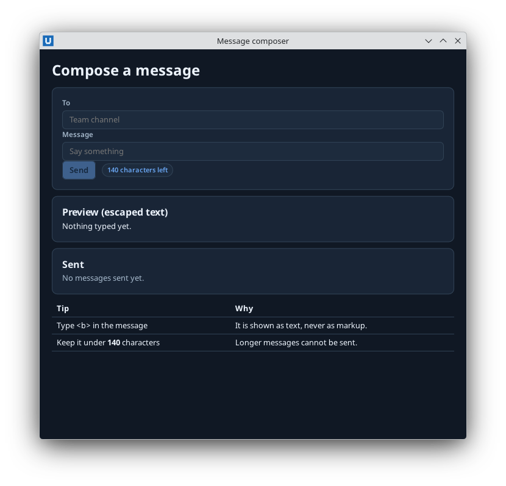

<details><summary>Full source</summary>

```powershell
# Message composer: untrusted user text is always encoded; only static help uses Add-NHKUiHtml.
#
# Teaches: the trust boundary. Everything a user types reaches the window through text
# bindings (Add-NHKUiText, Add-NHKUiTextList), which HTML-encode it, so typing <b>hi</b> shows
# those characters literally. Add-NHKUiHtml is used only for a fixed, developer-written
# snippet. Also: a length limit with a computed counter and a sent-messages list.
#
# Run:  pwsh -File ./message_preview.ps1   |   powershell.exe -NoProfile -File .\message_preview.ps1
$ErrorActionPreference = 'Stop'
Import-Module NativeHTMLKit.UI
$app = Start-NativeHTMLKitScript -Name 'Message composer'

$help = @'
<table class="help">
  <tr><th>Tip</th><th>Why</th></tr>
  <tr><td>Type <code>&lt;b&gt;</code> in the message</td><td>It is shown as text, never as markup.</td></tr>
  <tr><td>Keep it under <strong>140</strong> characters</td><td>Longer messages cannot be sent.</td></tr>
</table>
'@
$css = '.help { border-collapse: collapse; width: 100%; } .help td, .help th { text-align: left; padding: 4px 8px; border-bottom: 1px solid var(--nhk-border); }'

$s = @{ Recipient = (New-NHKUiState -Value ''); Message = (New-NHKUiState -Value ''); Sent = (New-NHKUiState -Value @()); Limit = 140 }
$s.Remaining = New-NHKUiComputed -DependsOn @($s.Message) -Data $s -Compute { param($s) $s.Limit - ([string]$s.Message.Value).Length }
$s.RemainingText = New-NHKUiComputed -DependsOn @($s.Remaining) -Data $s -Compute { param($s) '{0} characters left' -f $s.Remaining.Value }
$s.TooLong = New-NHKUiComputed -DependsOn @($s.Remaining) -Data $s -Compute { param($s) $s.Remaining.Value -lt 0 }
$s.TooLongText = New-NHKUiComputed -DependsOn @($s.Remaining) -Data $s -Compute { param($s) 'Too long by {0} characters.' -f (-$s.Remaining.Value) }
$s.CannotSend = New-NHKUiComputed -DependsOn @($s.Message, $s.Remaining) -Data $s -Compute {
    param($s) (-not ([string]$s.Message.Value).Trim()) -or $s.Remaining.Value -lt 0
}
$s.Preview = New-NHKUiComputed -DependsOn @($s.Message) -Data $s -Compute {
    param($s) if ($s.Message.Value) { $s.Message.Value } else { 'Nothing typed yet.' }
}
$s.NothingSent = New-NHKUiComputed -DependsOn @($s.Sent) -Data $s -Compute { param($s) @($s.Sent.Value).Count -eq 0 }
$computeds = @($s.Remaining, $s.RemainingText, $s.TooLong, $s.TooLongText, $s.CannotSend, $s.Preview, $s.NothingSent)

$ui = New-NHKUi -Title 'Message composer' -Width 700 -Height 640 -ExtraCss $css
$null = Add-NHKUiColumn -UI $ui -Content {
    $null = Add-NHKUiHeading -UI $ui -Text 'Compose a message' -Level 1
    $null = Add-NHKUiCard -UI $ui -Content {
        $null = Add-NHKUiInput -UI $ui -Bind $s.Recipient -Label 'To' -Placeholder 'Team channel'
        $null = Add-NHKUiInput -UI $ui -Bind $s.Message -Label 'Message' -Placeholder 'Say something'
        $null = Add-NHKUiRow -UI $ui -Content {
            $null = Add-NHKUiButton -UI $ui -Text 'Send' -DisabledState $s.CannotSend -Data $s -OnClick {
                param($eventObject, $s)
                if ($s.CannotSend.Value) { return }
                $to = ([string]$s.Recipient.Value).Trim(); if (-not $to) { $to = 'everyone' }
                $line = 'To {0}: {1}' -f $to, ([string]$s.Message.Value).Trim()
                $s.Sent.Set(@(@($line) + @($s.Sent.Value) | Select-Object -First 10))
                $s.Message.Set('')
            }
            $null = Add-NHKUiBadge -UI $ui -Bind $s.RemainingText
        }
        $null = Add-NHKUiWhen -UI $ui -Bind $s.TooLong -Content { $null = Add-NHKUiAlert -UI $ui -Bind $s.TooLongText }
    }
    $null = Add-NHKUiCard -UI $ui -Content {
        $null = Add-NHKUiHeading -UI $ui -Text 'Preview (escaped text)' -Level 3
        $null = Add-NHKUiText -UI $ui -Bind $s.Preview
    }
    $null = Add-NHKUiCard -UI $ui -Content {
        $null = Add-NHKUiHeading -UI $ui -Text 'Sent' -Level 3
        $null = Add-NHKUiWhen -UI $ui -Bind $s.NothingSent -Content { $null = Add-NHKUiText -UI $ui -Text 'No messages sent yet.' -Muted }
        $null = Add-NHKUiTextList -UI $ui -Bind $s.Sent
    }
    $null = Add-NHKUiHtml -UI $ui -Markup $help    # trusted, static, written by the developer
}

try {
    $null = Start-NHKUi -UI $ui -Application $app
    Wait-NativeHTMLKit -Application $app -UntilShutdown
} finally {
    Stop-NHKUi -UI $ui
    foreach ($c in $computeds) { $c.Dispose() }
    Close-NativeHTMLKit -Application $app
}
```

</details>
