# Examples

*Python (UI library 0.1.1). Every example also exists in PowerShell with the same window title and behaviour: [PowerShell examples](../powershell/examples.md).*

16 small applications. Each one starts with a comment that says what it teaches and how to run it, uses only the public UI and SDK APIs, and is run by the repository's example harness against the real NativeHTMLKit host (headless) on Linux and Windows. Screenshots are real captures on KDE Plasma 6.6 Wayland.

| Example | What it is |
|---|---|
| [Hello UI](#hello) | The first window: a greeting that follows a text field, and a Reset button. |
| [Counter gallery](#counter) | The smallest tour of state, computed text, buttons, an input, a checkbox and a list. |
| [Expense tracker](#expenses) | Add expenses, remove the last one, filter by category and see totals (expense-tracker tutorial app). |
| [Task list](#todo) | Tasks with Done/Remove buttons per row and an All/Open/Done filter. |
| [Sign-up form](#signup-form) | Live validation, a guarded submit button, a confirmation screen and reset. |
| [Settings panel](#settings) | Save, Revert and Restore defaults with an unsaved-changes indicator. |
| [Settings editor](#settings-editor) | Edit, validate and save a JSON settings file; the saved theme applies on the next start (settings-editor tutorial app). |
| [Live log viewer](#log-viewer) | A background producer streams log lines; filter by level and text, pause and clear. |
| [Background calculation](#background) | Run a slow calculation off the UI thread and report the result; cancel it. |
| [Word counter](#word-counter) | Count words in a text file in the background with progress, Cancel and a top-ten list. |
| [Clipboard text tool](#clipboard-tool) | Transform text and copy or paste it with the SDK clipboard, handling unavailability. |
| [File inspector](#file-picker) | Pick files with the native open dialog and list their sizes and a total. |
| [Notes with inspector windows](#multi-window) | Several windows bound to the same state; open, track and close inspector windows. |
| [System dashboard](#dashboard) | A responsive card grid with a live clock and disk usage, themed with extra CSS. |
| [Theme preview](#theme-preview) | Every component in a chosen theme and density, with an optional custom accent colour. |
| [Message composer](#message-preview) | Untrusted typed text is always escaped; only fixed help markup is inserted as HTML. |

<a id="hello"></a>

## Hello UI

The first window: a greeting that follows a text field, and a Reset button.

**Teaches:** state and computed values, two-way input, button handler, application lifecycle.

**Run:** `python hello.py` (source: [`examples/python/hello.py`](https://github.com/nativehtmlkit/nativehtmlkit_ui/blob/main/examples/python/hello.py))

Related guide: [reactive state](guides/reactive-state.md).

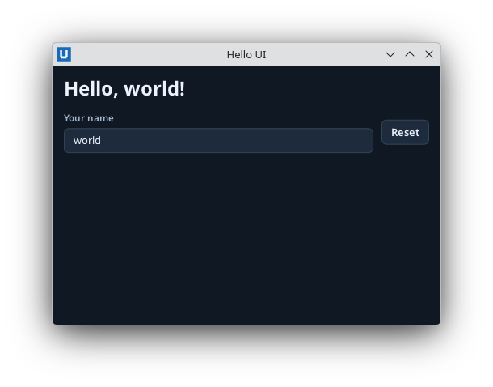

<details><summary>Full source</summary>

```python
"""Hello UI: the first window of the getting-started page.

Teaches: Application.start(), state() and computed(), a heading bound to a computed value, a
two-way input, a button that sets state, mount/run/dispose behind the script entry point.
Run:     python hello.py      (pip install nativehtmlkit_ui)
Guide:   docs/python/getting-started.md
"""
from nativehtmlkit import Application
from nativehtmlkit_ui import UI, computed, state


def main():
    with Application.start(name="Hello UI") as app:
        name = state("world")
        greeting = computed(lambda: f"Hello, {name.value}!")

        ui = UI(title="Hello UI", width=480, height=320)
        with ui.column():
            ui.heading(greeting, level=1)
            with ui.row():
                ui.input(name, label="Your name")
                ui.button("Reset", variant="secondary", on_click=lambda _event: name.set("world"))
        try:
            ui.mount(app)
            app.run()
        finally:
            ui.dispose()


if __name__ == "__main__":
    main()
```

</details>

<a id="counter"></a>

## Counter gallery

The smallest tour of state, computed text, buttons, an input, a checkbox and a list.

**Teaches:** state and computed values, bound text, two-way input and checkbox, when regions, grid.

**Run:** `python counter.py` (source: [`examples/python/counter.py`](https://github.com/nativehtmlkit/nativehtmlkit_ui/blob/main/examples/python/counter.py))

Related guide: [reactive state](guides/reactive-state.md).

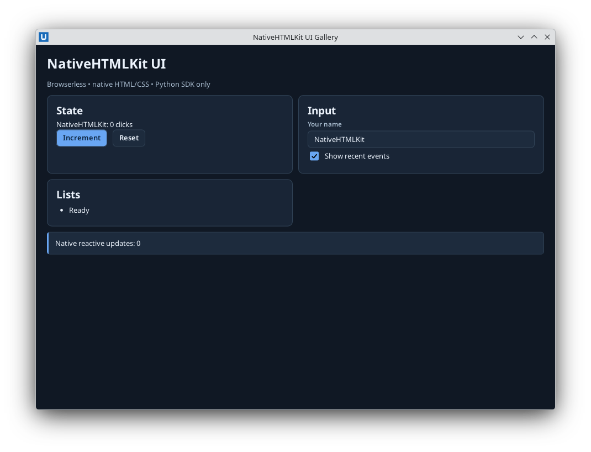

<details><summary>Full source</summary>

```python
"""Counter gallery: the smallest tour of state, computed text, buttons, input, checkbox and list.

Teaches: state() and computed(), text bound to a lambda, a two-way input and checkbox, a reactive
text list shown or hidden with ui.when(), and a responsive card grid.

Run:  python counter.py      (pip install nativehtmlkit_ui)
  or: python -m nativehtmlkit run counter:main --name Counter   (from this directory)
"""
from nativehtmlkit_ui import UI, state, computed


def main(app):
    count = state(0)
    name = state("NativeHTMLKit")
    show = state(True)
    history = state(["Ready"])
    message = computed(lambda: f"{name.value}: {count.value} clicks")
    ui = UI(title="NativeHTMLKit UI Gallery", theme="cobalt", density="compact")

    def add(_event):
        count.set(count.value + 1)
        history.set([f"Count became {count.value}", *history.value][:10])

    with ui.column():
        ui.heading("NativeHTMLKit UI", level=1)
        ui.text("Browserless • native HTML/CSS • Python SDK only", muted=True)
        with ui.grid():
            with ui.card():
                ui.heading("State")
                ui.text(message)
                with ui.row():
                    ui.button("Increment", on_click=add)
                    ui.button("Reset", variant="secondary", on_click=lambda e: count.set(0))
            with ui.card():
                ui.heading("Input")
                ui.input(name, label="Your name", placeholder="Enter a name")
                ui.checkbox(show, label="Show recent events")
            with ui.card():
                ui.heading("Lists")
                with ui.when(show):
                    ui.text_list(history)
        ui.alert(lambda: f"Native reactive updates: {count.value}")
    ui.mount(app)


if __name__ == "__main__":
    from nativehtmlkit import Application
    with Application.start(name="NativeHTMLKit UI") as application:
        main(application)
        application.run()
```

</details>

<a id="expenses"></a>

## Expense tracker

Add expenses, remove the last one, filter by category and see totals (expense-tracker tutorial app).

**Teaches:** two-way inputs and select, validation, computed totals and filter, empty state.

**Run:** `python expenses.py` (source: [`examples/python/expenses.py`](https://github.com/nativehtmlkit/nativehtmlkit_ui/blob/main/examples/python/expenses.py))

Built step by step in the [expense tracker tutorial](tutorials/expense-tracker.md).

Related guide: [forms and inputs](guides/forms-and-inputs.md).

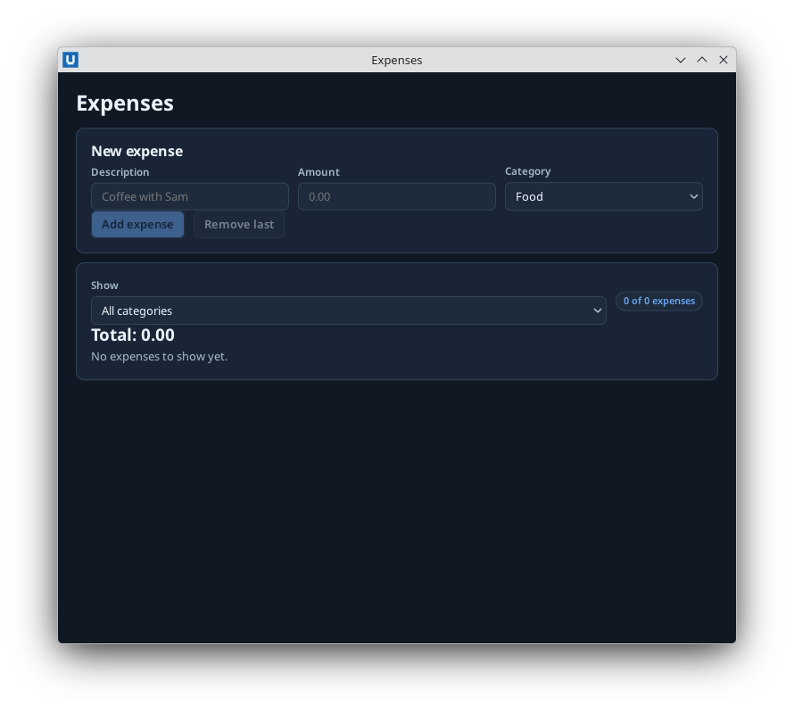

<details><summary>Full source</summary>

```python
"""Expense tracker: add expenses, remove the last one, filter by category, see totals.

Teaches: state + computed values, two-way input/select binding, a disabled button driven by a
computed value, a filtered text list, an empty-state region with ui.when(), and Decimal input
validation. This is the finished app of docs/python/tutorials/expense-tracker.md.

Run:  python expenses.py      (pip install nativehtmlkit_ui)
"""
from decimal import Decimal, InvalidOperation

from nativehtmlkit_ui import UI, computed, state

CATEGORIES = {"food": "Food", "transport": "Transport", "home": "Home", "other": "Other"}


def money(value: Decimal) -> str:
    return f"{value:,.2f}"


def main(app):
    expenses = state([])                 # list of dicts; always replaced, never mutated in place
    description = state("")
    amount = state("")
    category = state("food")
    show = state("all")
    error = state("")

    visible = computed(lambda: [e for e in expenses.value if show.value in ("all", e["category"])])
    total = computed(lambda: sum((e["amount"] for e in visible.value), Decimal("0")))
    by_category = computed(lambda: [
        f"{label}: {money(sum((e['amount'] for e in expenses.value if e['category'] == key), Decimal('0')))}"
        for key, label in CATEGORIES.items() if any(e["category"] == key for e in expenses.value)])
    cannot_add = computed(lambda: not description.value.strip() or not amount.value.strip())

    def add(_event):
        try:
            value = Decimal(amount.value.strip().replace(",", "."))
        except InvalidOperation:
            error.set("Amount must be a number, for example 12.50")
            return
        if value <= 0:
            error.set("Amount must be greater than zero")
            return
        expenses.set([*expenses.value, {"description": description.value.strip(),
                                        "amount": value.quantize(Decimal("0.01")),
                                        "category": category.value}])
        description.set("")          # writes back into the native inputs
        amount.set("")
        error.set("")

    def remove_last(_event):
        expenses.set(expenses.value[:-1])

    ui = UI(title="Expenses", width=760, height=640)
    with ui.column():
        ui.heading("Expenses", level=1)
        with ui.card():
            ui.heading("New expense", level=3)
            with ui.row():
                ui.input(description, label="Description", placeholder="Coffee with Sam")
                ui.input(amount, label="Amount", placeholder="0.00")
                ui.select(category, list(CATEGORIES.items()), label="Category")
            with ui.when(error):
                ui.alert(error)
            with ui.row():
                ui.button("Add expense", on_click=add, disabled=cannot_add)
                ui.button("Remove last", variant="secondary", on_click=remove_last,
                          disabled=lambda: not expenses.value)
        with ui.card():
            with ui.row():
                ui.select(show, [("all", "All categories"), *CATEGORIES.items()], label="Show")
                ui.badge(lambda: f"{len(visible.value)} of {len(expenses.value)} expenses")
            ui.heading(lambda: f"Total: {money(total.value)}", level=2)
            with ui.when(lambda: not visible.value):
                ui.text("No expenses to show yet.", muted=True)
            ui.text_list(visible, formatter=lambda e: (
                f"{e['description']} ({CATEGORIES[e['category']]}): {money(e['amount'])}"))
            ui.text(lambda: " | ".join(by_category.value), muted=True)
    ui.mount(app)


if __name__ == "__main__":
    from nativehtmlkit import Application
    with Application.start(name="Expenses") as application:
        main(application)
        application.run()
```

</details>

<a id="todo"></a>

## Task list

Tasks with Done/Remove buttons per row and an All/Open/Done filter.

**Teaches:** slot pool for rows with buttons, bound button labels, computed counts.

**Run:** `python todo.py` (source: [`examples/python/todo.py`](https://github.com/nativehtmlkit/nativehtmlkit_ui/blob/main/examples/python/todo.py))

Related guide: [lists and conditional content](guides/lists-and-conditional-content.md).

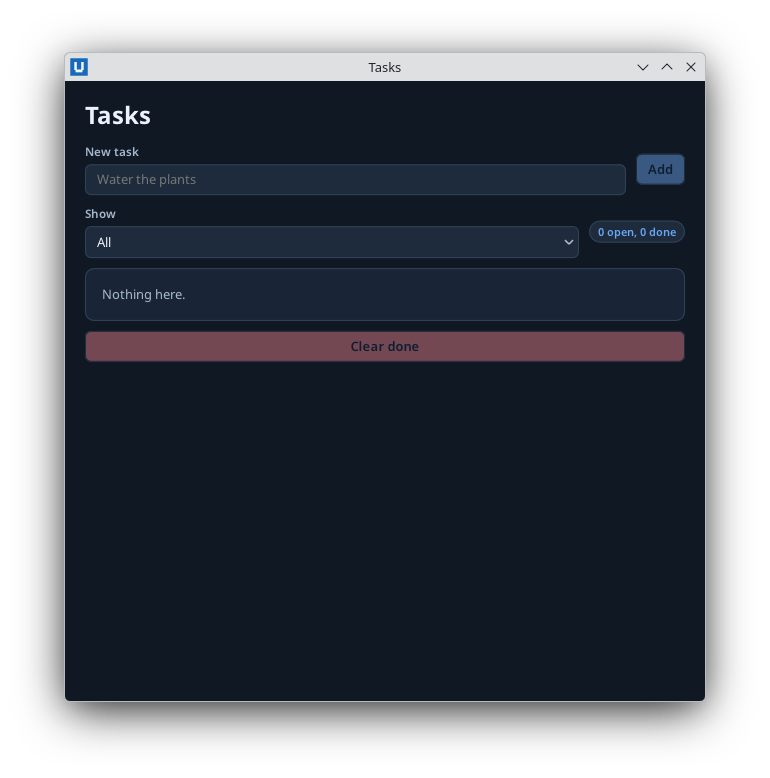

<details><summary>Full source</summary>

```python
"""Task list with per-row Done/Remove buttons and an All/Open/Done filter.

Teaches: the "slot pool" pattern. The UI tree is fixed once mounted, so the app creates
MAX_TASKS rows up front and shows, hides and relabels them from state (ui.when + bound text +
bound button labels). Also: computed counts, a disabled Add button and "Clear done".

Run:  python todo.py      (pip install nativehtmlkit_ui)
"""
from itertools import count

from nativehtmlkit_ui import UI, computed, state

MAX_TASKS = 8


def main(app):
    next_id = count(1)
    tasks = state([])          # [{"id": 1, "title": "...", "done": False}, ...]
    title = state("")
    show = state("all")

    visible = computed(lambda: [t for t in tasks.value
                                if show.value == "all" or t["done"] == (show.value == "done")])
    open_count = computed(lambda: sum(not t["done"] for t in tasks.value))
    full = computed(lambda: len(tasks.value) >= MAX_TASKS)

    def task_at(row):
        rows = visible.value
        return rows[row] if row < len(rows) else None

    def add(_event):
        text = title.value.strip()
        if text and not full.value:
            tasks.set([*tasks.value, {"id": next(next_id), "title": text, "done": False}])
            title.set("")

    def toggle(row):
        task = task_at(row)
        if task:
            tasks.set([dict(t, done=not t["done"]) if t["id"] == task["id"] else t for t in tasks.value])

    def remove(row):
        task = task_at(row)
        if task:
            tasks.set([t for t in tasks.value if t["id"] != task["id"]])

    ui = UI(title="Tasks", width=640, height=620)
    with ui.column():
        ui.heading("Tasks", level=1)
        with ui.row():
            ui.input(title, label="New task", placeholder="Water the plants")
            ui.button("Add", on_click=add, disabled=lambda: full.value or not title.value.strip())
        with ui.when(full):
            ui.alert(f"The list is full ({MAX_TASKS} tasks). Remove or clear some first.")
        with ui.row():
            ui.select(show, [("all", "All"), ("open", "Open"), ("done", "Done")], label="Show")
            ui.badge(lambda: f"{open_count.value} open, {len(tasks.value) - open_count.value} done")
        with ui.card():
            with ui.when(lambda: not visible.value):
                ui.text("Nothing here.", muted=True)
            for row in range(MAX_TASKS):
                with ui.when(lambda row=row: task_at(row) is not None):
                    with ui.row():
                        ui.text(lambda row=row: ("[x] " if task_at(row)["done"] else "[ ] ") + task_at(row)["title"]
                                if task_at(row) else "")
                        ui.button(lambda row=row: "Reopen" if task_at(row) and task_at(row)["done"] else "Done",
                                  variant="secondary", on_click=lambda _e, row=row: toggle(row))
                        ui.button("Remove", variant="quiet", on_click=lambda _e, row=row: remove(row))
        ui.button("Clear done", variant="danger", disabled=lambda: open_count.value == len(tasks.value),
                  on_click=lambda _e: tasks.set([t for t in tasks.value if not t["done"]]))
    ui.mount(app)


if __name__ == "__main__":
    from nativehtmlkit import Application
    with Application.start(name="Tasks") as application:
        main(application)
        application.run()
```

</details>

<a id="signup-form"></a>

## Sign-up form

Live validation, a guarded submit button, a confirmation screen and reset.

**Teaches:** validation as computed state, guarded submit, form/confirmation swap, reset by setting states.

**Run:** `python signup_form.py` (source: [`examples/python/signup_form.py`](https://github.com/nativehtmlkit/nativehtmlkit_ui/blob/main/examples/python/signup_form.py))

Related guide: [forms and inputs](guides/forms-and-inputs.md).

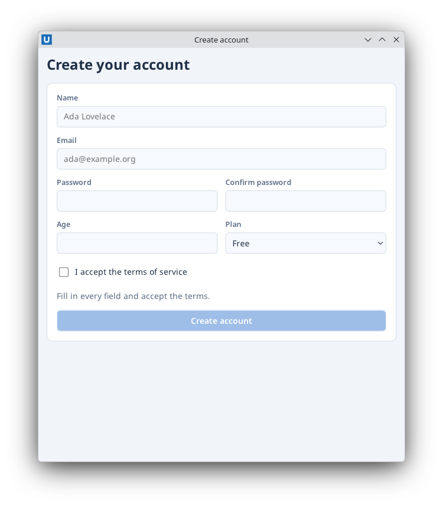

<details><summary>Full source</summary>

```python
"""Sign-up form with live validation, a guarded submit button and a success screen.

Teaches: validation as a computed list of messages (no DOM reads), showing errors only for
fields the user has typed in, a submit button disabled until the form is valid, swapping the
form and a confirmation with ui.when(), and resetting every control by setting its state.

Run:  python signup_form.py      (pip install nativehtmlkit_ui)
"""
import re

from nativehtmlkit_ui import UI, computed, state

EMAIL = re.compile(r"^[^@\s]+@[^@\s]+\.[^@\s]+$")
PLANS = [("free", "Free"), ("team", "Team"), ("enterprise", "Enterprise")]


# Workaround for a UI 0.1.1 stylesheet defect: a field placed directly in a column gets a
# 200px flex basis (meant for rows) and therefore 200px of height. See docs/LIMITATIONS.md.
FIELD_FIX = ".nhk-col > .nhk-field { flex: 0 0 auto; }"

def main(app):
    name, email, password, confirm, age = (state("") for _ in range(5))
    plan = state("free")
    terms = state(False)
    welcome = state("")                 # non-empty once the account was "created"

    def problems() -> list[str]:
        found = []
        if name.value and len(name.value.strip()) < 2:
            found.append("Name needs at least 2 characters.")
        if email.value and not EMAIL.match(email.value.strip()):
            found.append("Enter a valid email address.")
        if password.value and len(password.value) < 8:
            found.append("Password needs at least 8 characters.")
        if confirm.value and confirm.value != password.value:
            found.append("Passwords do not match.")
        if age.value and not (age.value.isdigit() and 16 <= int(age.value) <= 120):
            found.append("Age must be a whole number from 16 to 120.")
        return found

    errors = computed(problems)
    complete = computed(lambda: all(s.value for s in (name, email, password, confirm, age)) and terms.value)
    can_submit = computed(lambda: complete.value and not errors.value)

    def submit(_event):
        if can_submit.value:  # re-check: never trust that a disabled button cannot be activated
            welcome.set(f"Welcome, {name.value.strip()}! Your {dict(PLANS)[plan.value]} account is ready.")

    def start_over(_event):
        for field in (name, email, password, confirm, age, welcome):
            field.set("")
        plan.set("free")
        terms.set(False)

    ui = UI(title="Create account", width=620, height=700, theme="daylight", density="regular", extra_css=FIELD_FIX)
    with ui.column():
        ui.heading("Create your account", level=1)
        with ui.when(lambda: not welcome.value):
            with ui.card():
                with ui.column():
                    ui.input(name, label="Name", placeholder="Ada Lovelace")
                    ui.input(email, label="Email", kind="email", placeholder="ada@example.org")
                    with ui.row():
                        ui.input(password, label="Password", kind="password")
                        ui.input(confirm, label="Confirm password", kind="password")
                    with ui.row():
                        ui.input(age, label="Age", kind="number")
                        ui.select(plan, PLANS, label="Plan")
                    ui.checkbox(terms, label="I accept the terms of service")
                    with ui.when(errors):
                        ui.text_list(errors)
                    ui.text(lambda: "" if complete.value else "Fill in every field and accept the terms.",
                            muted=True)
                    ui.button("Create account", on_click=submit, disabled=lambda: not can_submit.value)
        with ui.when(welcome):
            with ui.card():
                ui.alert(welcome)
                ui.button("Start over", variant="secondary", on_click=start_over)
    ui.mount(app)


if __name__ == "__main__":
    from nativehtmlkit import Application
    with Application.start(name="Create account") as application:
        main(application)
        application.run()
```

</details>

<a id="settings"></a>

## Settings panel

Save, Revert and Restore defaults with an unsaved-changes indicator.

**Teaches:** dirty tracking with a computed snapshot, writing state back into controls, nested when regions.

**Run:** `python settings.py` (source: [`examples/python/settings.py`](https://github.com/nativehtmlkit/nativehtmlkit_ui/blob/main/examples/python/settings.py))

Related guide: [reactive state](guides/reactive-state.md).

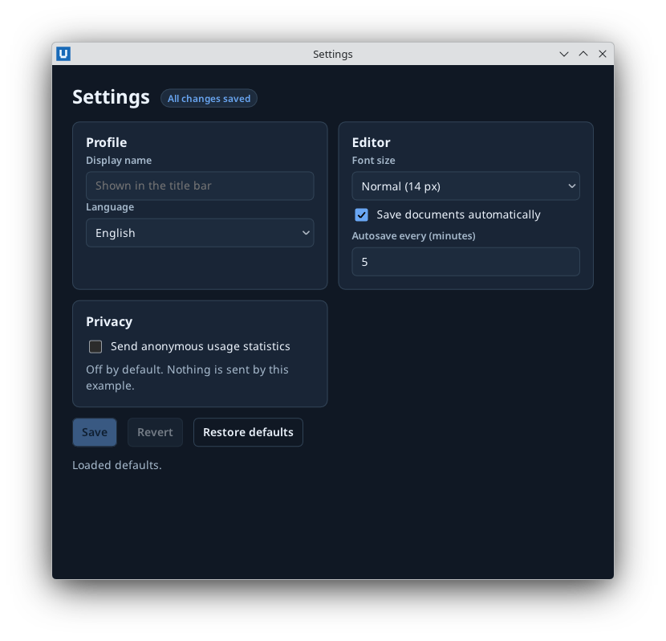

<details><summary>Full source</summary>

```python
"""Settings panel with Save, Revert and Restore defaults, plus an "unsaved changes" indicator.

Teaches: one computed snapshot of many controls, dirty tracking by comparing it with the last
saved snapshot, writing state back into inputs/selects/checkboxes (Revert, Defaults) and
enabling buttons only when they would do something. Replace save() with your own persistence.

Run:  python settings.py      (pip install nativehtmlkit_ui)
"""
from datetime import datetime

from nativehtmlkit_ui import UI, computed, state

DEFAULTS = {"display_name": "", "language": "en", "font_size": "14", "autosave": True,
            "interval": "5", "telemetry": False}
LANGUAGES = [("en", "English"), ("de", "Deutsch"), ("fr", "Français"), ("ja", "日本語")]
FONT_SIZES = [("12", "Small (12 px)"), ("14", "Normal (14 px)"), ("16", "Large (16 px)")]


def main(app):
    fields = {key: state(value) for key, value in DEFAULTS.items()}
    saved = state(dict(DEFAULTS))
    status = state("Loaded defaults.")

    current = computed(lambda: {key: s.value for key, s in fields.items()})
    dirty = computed(lambda: current.value != saved.value)
    interval_ok = computed(lambda: fields["interval"].value.isdigit() and 1 <= int(fields["interval"].value) <= 60)

    def load(values: dict) -> None:
        for key, value in values.items():
            fields[key].set(value)

    def save(_event):
        if interval_ok.value:
            saved.set(dict(current.value))
            status.set(f"Saved at {datetime.now():%H:%M:%S}.")

    def revert(_event):
        load(saved.value)
        status.set("Reverted to the last saved settings.")

    def defaults(_event):
        load(DEFAULTS)
        status.set("Defaults restored (not saved yet).")

    ui = UI(title="Settings", width=700, height=640, density="regular")
    with ui.column():
        with ui.row():
            ui.heading("Settings", level=1)
            ui.badge(lambda: "Unsaved changes" if dirty.value else "All changes saved")
        with ui.grid():
            with ui.card():
                ui.heading("Profile", level=3)
                ui.input(fields["display_name"], label="Display name", placeholder="Shown in the title bar")
                ui.select(fields["language"], LANGUAGES, label="Language")
            with ui.card():
                ui.heading("Editor", level=3)
                ui.select(fields["font_size"], FONT_SIZES, label="Font size")
                ui.checkbox(fields["autosave"], label="Save documents automatically")
                with ui.when(fields["autosave"]):
                    ui.input(fields["interval"], label="Autosave every (minutes)", kind="number")
                    with ui.when(lambda: not interval_ok.value):
                        ui.alert("Use a whole number of minutes from 1 to 60.")
            with ui.card():
                ui.heading("Privacy", level=3)
                ui.checkbox(fields["telemetry"], label="Send anonymous usage statistics")
                ui.text("Off by default. Nothing is sent by this example.", muted=True)
        with ui.row():
            ui.button("Save", on_click=save, disabled=lambda: not dirty.value or not interval_ok.value)
            ui.button("Revert", variant="secondary", on_click=revert, disabled=lambda: not dirty.value)
            ui.button("Restore defaults", variant="quiet", on_click=defaults)
        ui.text(status, muted=True)
    ui.mount(app)


if __name__ == "__main__":
    from nativehtmlkit import Application
    with Application.start(name="Settings") as application:
        main(application)
        application.run()
```

</details>

<a id="settings-editor"></a>

## Settings editor

Edit, validate and save a JSON settings file; the saved theme applies on the next start (settings-editor tutorial app).

**Teaches:** initial state from a file, computed validation message, atomic JSON save, revert from disk.

**Run:** `python settings_editor.py [PATH]` (source: [`examples/python/settings_editor.py`](https://github.com/nativehtmlkit/nativehtmlkit_ui/blob/main/examples/python/settings_editor.py))

Built step by step in the [settings editor tutorial](tutorials/settings-editor.md).

Related guide: [forms and inputs](guides/forms-and-inputs.md).

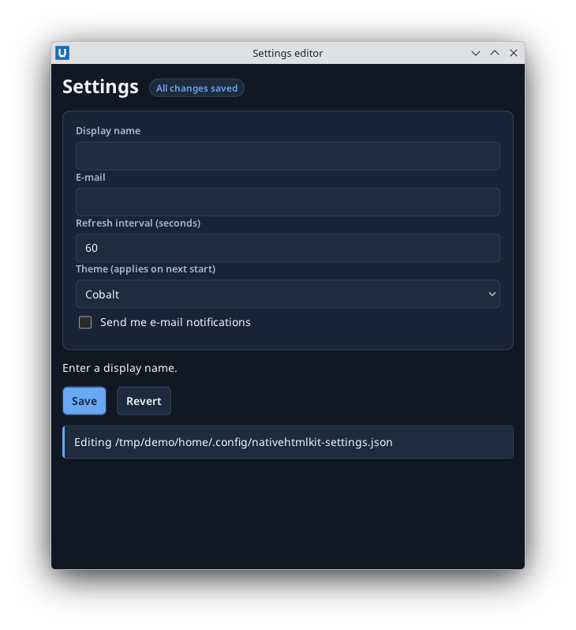

<details><summary>Full source</summary>

```python
"""Settings editor: edit, validate and save a JSON settings file (settings-editor tutorial, final code).

Teaches: loading initial state from a file, a computed validation message and an "unsaved
changes" badge, buttons that save (atomically) and revert, a status alert, and starting the UI
in the theme the user saved.
Run:     python settings_editor.py [PATH]
         (default file: nativehtmlkit-settings.json in your application-data folder:
         %APPDATA% on Windows, $XDG_CONFIG_HOME or ~/.config on Linux)
Guide:   docs/python/tutorials/settings-editor.md (step 2 of 2)
"""
import json
import os
import re
import sys
import tempfile
from datetime import datetime
from pathlib import Path

from nativehtmlkit import Application
from nativehtmlkit_ui import UI, computed, state

DEFAULTS = {"DisplayName": "", "Email": "", "Theme": "cobalt", "RefreshSeconds": 60, "Notifications": False}
THEMES = [("cobalt", "Cobalt"), ("graphite", "Graphite"), ("daylight", "Daylight")]
EMAIL = re.compile(r"^[^@\s]+@[^@\s]+\.[^@\s]+$")


def default_path() -> Path:
    if os.name == "nt":
        base = Path(os.environ.get("APPDATA") or Path.home() / "AppData" / "Roaming")
    else:
        base = Path(os.environ.get("XDG_CONFIG_HOME") or Path.home() / ".config")
    return base / "nativehtmlkit-settings.json"


def read_settings(path: Path) -> dict:
    """Start from the defaults and copy known keys, so a partial or older file still works."""
    result = dict(DEFAULTS)
    if path.is_file():
        data = json.loads(path.read_text(encoding="utf-8"))
        result.update({key: data[key] for key in DEFAULTS if key in data})
    if result["Theme"] not in dict(THEMES):
        result["Theme"] = "cobalt"
    return result


def write_settings(path: Path, values: dict) -> None:
    """Write a temporary file next to the target and replace the target with it."""
    path.parent.mkdir(parents=True, exist_ok=True)
    fd, temporary = tempfile.mkstemp(prefix=".settings-", suffix=".tmp", dir=path.parent)
    try:
        with os.fdopen(fd, "w", encoding="utf-8") as stream:
            json.dump(values, stream, indent=2)
        os.replace(temporary, path)
    except BaseException:
        Path(temporary).unlink(missing_ok=True)
        raise


def main():
    with Application.start(name="Settings editor") as app:
        path = Path(sys.argv[1]).resolve() if len(sys.argv) > 1 else default_path()
        loaded = read_settings(path)

        name = state(str(loaded["DisplayName"]))
        email = state(str(loaded["Email"]))
        theme = state(str(loaded["Theme"]))
        interval = state(str(loaded["RefreshSeconds"]))
        notify = state(bool(loaded["Notifications"]))
        status = state(f"Editing {path}")

        # The values as they would be saved; also used to detect unsaved changes.
        snapshot = computed(lambda: {"DisplayName": name.value.strip(), "Email": email.value.strip(),
                                     "Theme": theme.value, "RefreshSeconds": interval.value.strip(),
                                     "Notifications": notify.value})
        saved = state(snapshot.value)

        def find_problem(values):
            seconds = values["RefreshSeconds"]
            if not values["DisplayName"]:
                return "Enter a display name."
            if not EMAIL.match(values["Email"]):
                return "The e-mail address looks invalid."
            if not (seconds.isdigit() and 5 <= int(seconds) <= 3600):
                return "Refresh interval must be a whole number from 5 to 3600."
            return ""

        problem = computed(lambda: find_problem(snapshot.value))
        changes = computed(lambda: "All changes saved" if snapshot.value == saved.value else "Unsaved changes")

        def save(_event):
            if problem.value:
                status.set("Fix the problem above before saving.")
                return
            values = dict(snapshot.value, RefreshSeconds=int(snapshot.value["RefreshSeconds"]))
            try:
                write_settings(path, values)
            except OSError as error:
                status.set(f"Could not save: {error.strerror or error}")
                return
            saved.set(snapshot.value)
            status.set(f"Saved {datetime.now():%H:%M:%S}")

        def revert(_event):
            try:
                fresh = read_settings(path)
            except (OSError, ValueError) as error:
                status.set(f"Could not read the file: {error}")
                return
            name.set(str(fresh["DisplayName"]))
            email.set(str(fresh["Email"]))
            theme.set(str(fresh["Theme"]))
            interval.set(str(fresh["RefreshSeconds"]))
            notify.set(bool(fresh["Notifications"]))
            status.set("Reverted to the saved file")

        ui = UI(title="Settings editor", theme=loaded["Theme"], density="regular", width=600, height=640)
        with ui.column():
            with ui.row():
                ui.heading("Settings", level=1)
                ui.badge(changes)
            with ui.card():
                ui.input(name, label="Display name")
                ui.input(email, label="E-mail", kind="email")
                ui.input(interval, label="Refresh interval (seconds)", kind="number")
                ui.select(theme, THEMES, label="Theme (applies on next start)")
                ui.checkbox(notify, label="Send me e-mail notifications")
            with ui.when(problem):
                ui.text(problem)
            with ui.row():
                ui.button("Save", on_click=save)
                ui.button("Revert", variant="secondary", on_click=revert)
            ui.alert(status)
        try:
            ui.mount(app)
            app.run()
        finally:
            ui.dispose()


if __name__ == "__main__":
    main()
```

</details>

<a id="log-viewer"></a>

## Live log viewer

A background producer streams log lines; filter by level and text, pause and clear.

**Teaches:** streaming background producer, bounded history, filtered text list, pause.

**Run:** `python log_viewer.py` (source: [`examples/python/log_viewer.py`](https://github.com/nativehtmlkit/nativehtmlkit_ui/blob/main/examples/python/log_viewer.py))

Related guide: [background work](guides/background-work.md).

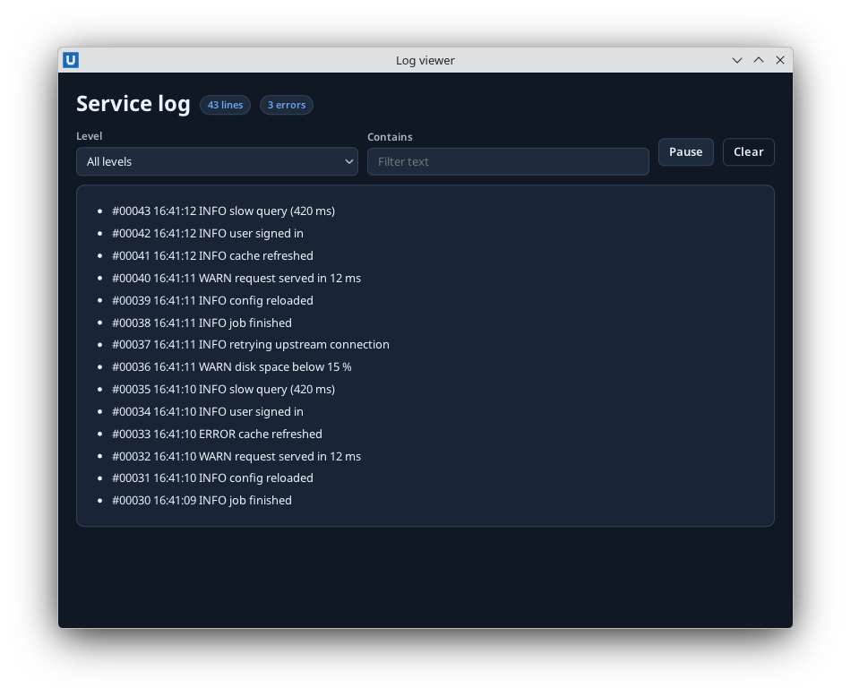

<details><summary>Full source</summary>

```python
"""Live log viewer: a background producer streams lines; filter by level and text, pause, clear.

Teaches: a worker thread that hands every result to the UI owner with ui.post(), bounded
history, a computed filtered view rendered with text_list (all text is escaped), counters,
pausing without losing lines, and stopping the worker from app.on_shutdown().

Run:  python log_viewer.py      (pip install nativehtmlkit_ui)
"""
import threading
from datetime import datetime

from nativehtmlkit_ui import UI, computed, state

KEEP = 500           # lines kept in memory
SHOW = 14            # newest matching lines shown
MESSAGES = ["request served in 12 ms", "cache refreshed", "user signed in", "slow query (420 ms)",
            "disk space below 15 %", "retrying upstream connection", "job finished", "config reloaded"]


def level_for(n: int) -> str:
    return "ERROR" if n % 11 == 0 else "WARN" if n % 4 == 0 else "INFO"


def main(app):
    lines = state([])            # newest last; each line is (level, text)
    paused = state(False)
    held = state([])             # lines that arrived while paused
    level = state("all")
    search = state("")

    def matches(lvl: str, text: str) -> bool:
        return (level.value == "all" or lvl == level.value) and search.value.lower() in text.lower()

    shown = computed(lambda: [text for lvl, text in lines.value if matches(lvl, text)][-SHOW:][::-1])
    errors = computed(lambda: sum(1 for lvl, _ in lines.value if lvl == "ERROR"))

    def receive(entry) -> None:                      # runs on the UI owner (posted)
        if paused.value:
            held.set([*held.value, entry][-KEEP:])
        else:
            lines.set([*lines.value, entry][-KEEP:])

    def toggle_pause(_event):
        if paused.value:
            lines.set([*lines.value, *held.value][-KEEP:])
            held.set([])
        paused.set(not paused.value)

    ui = UI(title="Log viewer", width=820, height=620)
    with ui.column():
        with ui.row():
            ui.heading("Service log", level=1)
            ui.badge(lambda: f"{len(lines.value)} lines")
            ui.badge(lambda: f"{errors.value} errors")
        with ui.row():
            ui.select(level, [("all", "All levels"), ("INFO", "Info"), ("WARN", "Warnings"), ("ERROR", "Errors")],
                      label="Level")
            ui.input(search, label="Contains", kind="search", placeholder="Filter text")
            ui.button(lambda: "Resume" if paused.value else "Pause", variant="secondary", on_click=toggle_pause)
            ui.button("Clear", variant="quiet", on_click=lambda _e: lines.set([]))
        with ui.when(paused):
            ui.alert(lambda: f"Paused: {len(held.value)} new lines are waiting.")
        with ui.card():
            with ui.when(lambda: not shown.value):
                ui.text("No matching lines.", muted=True)
            ui.text_list(shown)

    stop = threading.Event()

    def produce() -> None:                           # worker thread: never touches the UI directly
        n = 0
        while not stop.wait(0.2):
            n += 1
            lvl = level_for(n)
            text = f"#{n:05d} {datetime.now():%H:%M:%S} {lvl:<5} {MESSAGES[n % len(MESSAGES)]}"
            try:
                ui.post(receive, (lvl, text))
            except RuntimeError:                     # queue full: skip a line rather than block
                pass

    ui.mount(app)
    worker = threading.Thread(target=produce, name="log-producer", daemon=True)
    worker.start()
    app.on_shutdown(stop.set)


if __name__ == "__main__":
    from nativehtmlkit import Application
    with Application.start(name="Log viewer") as application:
        main(application)
        application.run()
```

</details>

<a id="background"></a>

## Background calculation

Run a slow calculation off the UI thread and report the result; cancel it.

**Teaches:** Python executor and ui.post(), PowerShell Start-NativeHTMLKitTask, busy flag, cancel.

**Run:** `python background.py` (source: [`examples/python/background.py`](https://github.com/nativehtmlkit/nativehtmlkit_ui/blob/main/examples/python/background.py))

Related guide: [background work](guides/background-work.md).

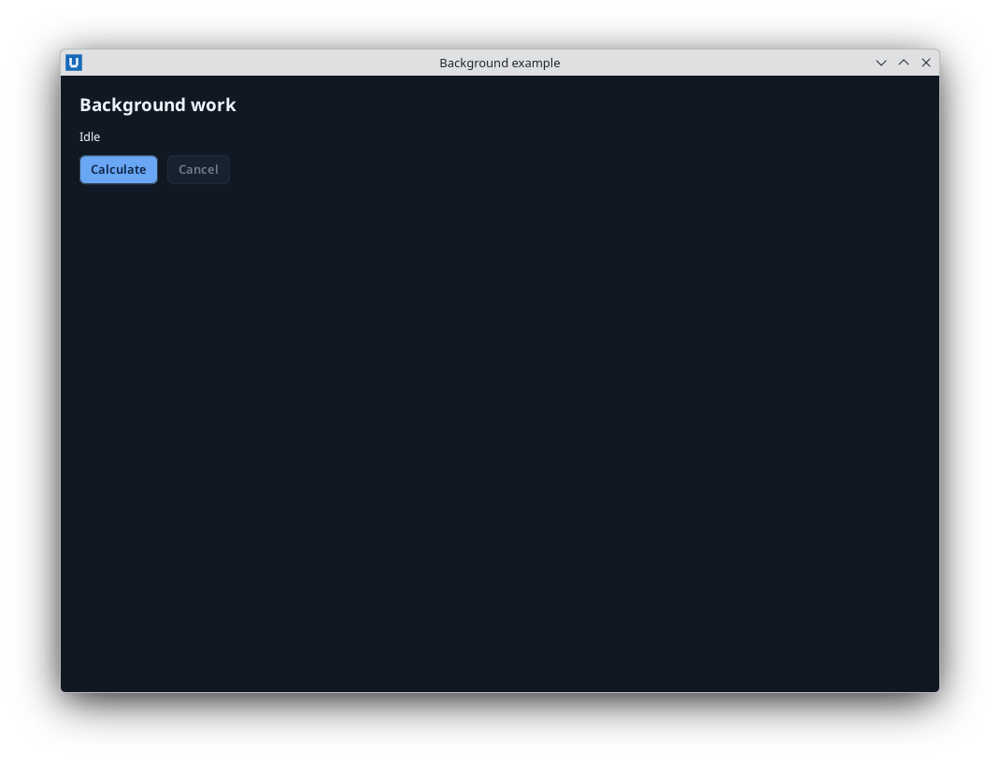

<details><summary>Full source</summary>

```python
"""Background calculation: run slow work on a thread pool and report the result with ui.post().

Teaches: never block a UI event handler with slow work; submit it to an executor, then hand the
result (or the error) back to the UI owner with ui.post(); a busy flag that disables the button;
a Cancel button that sets a threading.Event the worker checks; shutting the executor down from
app.on_shutdown().

Run:  python background.py      (pip install nativehtmlkit_ui)
"""
import threading
from concurrent.futures import ThreadPoolExecutor

from nativehtmlkit_ui import UI, state


def main(app):
    status = state("Idle")
    busy = state(False)
    ui = UI(title="Background example")
    executor = ThreadPoolExecutor(max_workers=2, thread_name_prefix="ui-example")
    cancel = threading.Event()

    def calculate(n: int) -> int:               # runs on an executor thread; touches no state
        total = 0
        for start in range(0, n, 10_000):
            if cancel.is_set():
                raise InterruptedError("cancelled")
            total += sum(range(start, min(n, start + 10_000)))
        return total

    def finished(text: str) -> None:            # runs on the UI owner
        status.set(text)
        busy.set(False)

    def run(_event):
        cancel.clear()
        busy.set(True)
        status.set("Running")
        future = executor.submit(calculate, 500_000)

        def completed(f):                       # runs on an executor thread
            try:
                ui.post(finished, f"Done: {f.result()}")
            except InterruptedError:
                ui.post(finished, "Cancelled")
            except Exception as exc:
                ui.post(finished, f"Failed: {type(exc).__name__}")
        future.add_done_callback(completed)

    with ui.column():
        ui.heading("Background work")
        ui.text(status)
        with ui.row():
            ui.button("Calculate", on_click=run, disabled=busy)
            ui.button("Cancel", variant="secondary", on_click=lambda _e: cancel.set(),
                      disabled=lambda: not busy.value)
    ui.mount(app)
    app.on_shutdown(cancel.set)
    app.on_shutdown(lambda: executor.shutdown(wait=False, cancel_futures=True))


if __name__ == "__main__":
    from nativehtmlkit import Application
    with Application.start(name="NativeHTMLKit Background") as application:
        main(application)
        application.run()
```

</details>

<a id="word-counter"></a>

## Word counter

Count words in a text file in the background with progress, Cancel and a top-ten list.

**Teaches:** background work with progress, cancellation, merging partial results, throttled updates.

**Run:** `python word_counter.py [FILE]` (source: [`examples/python/word_counter.py`](https://github.com/nativehtmlkit/nativehtmlkit_ui/blob/main/examples/python/word_counter.py))

Related guide: [background work](guides/background-work.md).

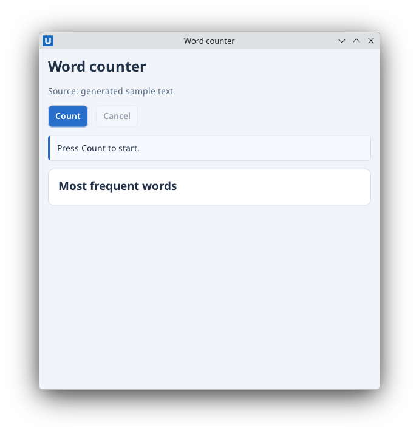

<details><summary>Full source</summary>

```python
"""Word counter: count words in a text file in a worker thread, with progress and Cancel.

Teaches: starting background work from a button, handing progress and results back to the UI
owner with ui.post(), throttled progress (at most five updates per second), a Cancel button
driven by a threading.Event, and a busy state that disables Count while the worker runs.
Run:     python word_counter.py [FILE]   (without FILE it counts 20,000 lines of generated text)
Guide:   docs/python/guides/background-work.md
"""
import re
import sys
import threading
import time
from collections import Counter
from pathlib import Path

from nativehtmlkit import Application
from nativehtmlkit_ui import UI, state

WORD = re.compile(r"[^\W\d_]+(?:'[^\W\d_]+)?")
SAMPLE_WORDS = "the quick brown fox jumps over the lazy dog while native windows render html".split()
SAMPLE_LINES = 20_000


def sample_lines():
    return [" ".join(SAMPLE_WORDS[(i + j) % len(SAMPLE_WORDS)] for j in range(9)) for i in range(SAMPLE_LINES)]


def main():
    with Application.start(name="Word counter") as app:
        source = Path(sys.argv[1]) if len(sys.argv) > 1 else None
        progress = state("Press Count to start.")
        top_words = state([])
        running = state(False)
        cancel = threading.Event()

        def finish(message, words):          # runs on the UI owner thread
            progress.set(message)
            top_words.set(words)
            running.set(False)

        def work():                          # runs on the worker thread; touches no state
            try:
                lines = source.read_text(encoding="utf-8", errors="replace").splitlines() if source else sample_lines()
            except OSError as error:
                ui.post(finish, f"Cannot read the file: {error.strerror or error}", [])
                return
            counts, last = Counter(), 0.0
            for number, line in enumerate(lines, 1):
                if cancel.is_set():
                    ui.post(finish, "Cancelled.", [])
                    return
                counts.update(word.lower() for word in WORD.findall(line))
                if time.monotonic() - last > 0.2:
                    last = time.monotonic()
                    ui.post(progress.set, f"{number / max(1, len(lines)):.0%} - {number:,} lines")
            ui.post(finish, f"Done: {sum(counts.values()):,} words, {len(counts):,} different, {len(lines):,} lines.",
                    [f"{word}: {count:,}" for word, count in sorted(counts.items(), key=lambda kv: (-kv[1], kv[0]))[:10]])

        def start(_event):
            if running.value:
                return
            cancel.clear()
            running.set(True)
            top_words.set([])
            progress.set("Starting...")
            threading.Thread(target=work, name="word-count", daemon=True).start()

        ui = UI(title="Word counter", theme="daylight", density="regular", width=560, height=560)
        with ui.column():
            ui.heading("Word counter", level=1)
            ui.text(f"Source: {source.name if source else 'generated sample text'}", muted=True)
            with ui.row():
                ui.button("Count", on_click=start, disabled=running)
                ui.button("Cancel", variant="secondary", on_click=lambda _e: cancel.set(),
                          disabled=lambda: not running.value)
            ui.alert(progress)
            with ui.card():
                ui.heading("Most frequent words", level=2)
                ui.text_list(top_words)
        try:
            ui.mount(app)
            app.on_shutdown(cancel.set)
            app.run()
        finally:
            cancel.set()
            ui.dispose()


if __name__ == "__main__":
    main()
```

</details>

<a id="clipboard-tool"></a>

## Clipboard text tool

Transform text and copy or paste it with the SDK clipboard, handling unavailability.

**Teaches:** SDK clipboard calls from UI handlers, error handling, computed preview.

**Run:** `python clipboard_tool.py` (source: [`examples/python/clipboard_tool.py`](https://github.com/nativehtmlkit/nativehtmlkit_ui/blob/main/examples/python/clipboard_tool.py))

Related guide: [mixing ui and sdk calls](guides/mixing-ui-and-sdk-calls.md).

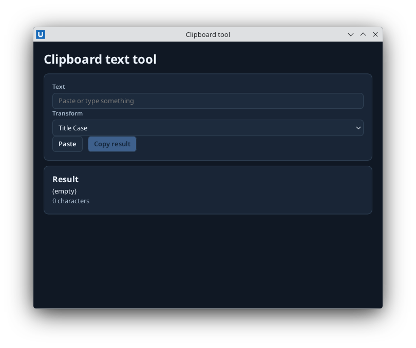

<details><summary>Full source</summary>

```python
"""Text transformer with copy/paste: mixes UI state with direct SDK clipboard calls.

Teaches: calling public SDK services (app.set_clipboard_text / app.clipboard_text) from a UI
event handler, reporting SDK errors in the UI instead of crashing (the clipboard is
unavailable in headless test mode, error -32001), and a computed live preview.

Run:  python clipboard_tool.py      (pip install nativehtmlkit_ui)
"""
import re

from nativehtmlkit import RpcError
from nativehtmlkit_ui import UI, computed, state

TRANSFORMS = {
    "upper": ("UPPER CASE", str.upper),
    "lower": ("lower case", str.lower),
    "title": ("Title Case", str.title),
    "slug": ("slug-for-urls", lambda s: re.sub(r"[^a-z0-9]+", "-", s.lower()).strip("-")),
    "squash": ("Collapse whitespace", lambda s: " ".join(s.split())),
    "reverse": ("Reverse word order", lambda s: " ".join(reversed(s.split()))),
}


def main(app):
    source = state("")
    mode = state("title")
    status = state("")

    result = computed(lambda: TRANSFORMS[mode.value][1](source.value))

    def copy(_event):
        try:
            app.set_clipboard_text(result.value)
            status.set(f"Copied {len(result.value)} characters to the clipboard.")
        except RpcError as error:
            status.set(f"Clipboard unavailable: {error}")

    def paste(_event):
        try:
            source.set(app.clipboard_text())
            status.set("Pasted from the clipboard.")
        except RpcError as error:
            status.set(f"Clipboard unavailable: {error}")

    ui = UI(title="Clipboard tool", width=680, height=520)
    with ui.column():
        ui.heading("Clipboard text tool", level=1)
        with ui.card():
            ui.input(source, label="Text", placeholder="Paste or type something")
            ui.select(mode, [(key, label) for key, (label, _) in TRANSFORMS.items()], label="Transform")
            with ui.row():
                ui.button("Paste", variant="secondary", on_click=paste)
                ui.button("Copy result", on_click=copy, disabled=lambda: not result.value)
        with ui.card():
            ui.heading("Result", level=3)
            ui.text(lambda: result.value or "(empty)")
            ui.text(lambda: f"{len(result.value)} characters", muted=True)
        with ui.when(status):
            ui.alert(status)
    ui.mount(app)


if __name__ == "__main__":
    from nativehtmlkit import Application
    with Application.start(name="Clipboard tool") as application:
        main(application)
        application.run()
```

</details>

<a id="file-picker"></a>

## File inspector

Pick files with the native open dialog and list their sizes and a total.

**Teaches:** SDK file dialog from the UI, cancel and error paths, busy flag.

**Run:** `python file_picker.py` (source: [`examples/python/file_picker.py`](https://github.com/nativehtmlkit/nativehtmlkit_ui/blob/main/examples/python/file_picker.py))

Related guide: [mixing ui and sdk calls](guides/mixing-ui-and-sdk-calls.md).

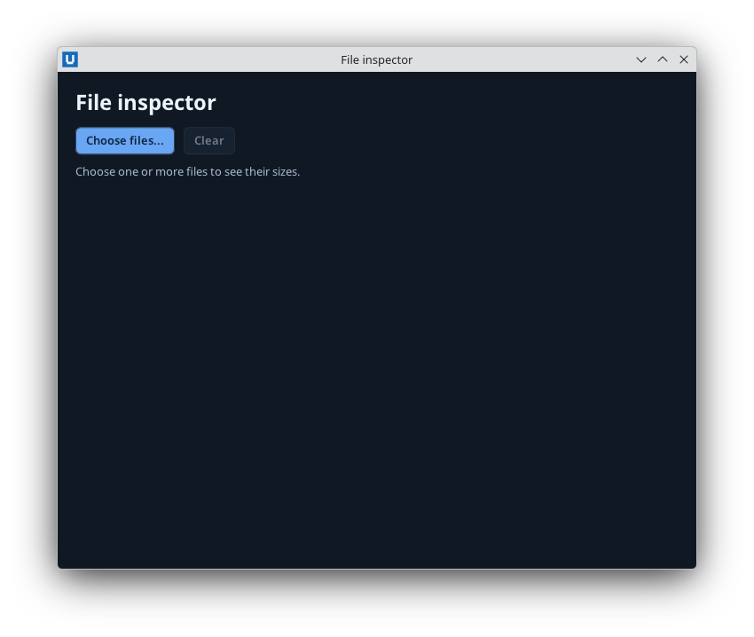

<details><summary>Full source</summary>

```python
"""File inspector: pick files with the native open dialog and list their sizes and a total.

Teaches: an SDK dialog started without blocking the UI (window.open_files(wait=False) returns a
future), handing its result back with ui.post(), a busy flag that disables the button while the
dialog is open, cancel and error handling (dialogs are unavailable in headless test mode).

Run:  python file_picker.py      (pip install nativehtmlkit_ui)
"""
from pathlib import Path

from nativehtmlkit import RpcError
from nativehtmlkit_ui import UI, computed, state


def human(size: int) -> str:
    for unit in ("bytes", "KB", "MB", "GB"):
        if size < 1024 or unit == "GB":
            return f"{size} {unit}" if unit == "bytes" else f"{size:.1f} {unit}"
        size /= 1024
    return str(size)


def main(app):
    files = state([])             # [(name, size_in_bytes)]
    busy = state(False)
    status = state("Choose one or more files to see their sizes.")
    total = computed(lambda: sum(size for _, size in files.value))

    def chosen(future) -> None:                  # posted to the UI owner
        busy.set(False)
        try:
            result = future.result()
        except RpcError as error:
            status.set(f"File dialogs are unavailable here: {error}")
            return
        if result.get("cancelled") or not result.get("paths"):
            status.set("No files chosen.")
            return
        rows = []
        for raw in result["paths"]:
            path = Path(raw)
            try:
                rows.append((path.name, path.stat().st_size))
            except OSError as error:
                rows.append((f"{path.name} (unreadable: {error.strerror})", 0))
        files.set(rows)
        status.set(f"{len(rows)} file(s) chosen.")

    def choose(_event):
        busy.set(True)
        future = ui.window.open_files(multiple=True, title="Choose files to inspect", wait=False)
        future.add_done_callback(lambda f: ui.post(chosen, f))

    ui = UI(title="File inspector", width=720, height=560)
    with ui.column():
        ui.heading("File inspector", level=1)
        with ui.row():
            ui.button(lambda: "Waiting for the dialog..." if busy.value else "Choose files...",
                      on_click=choose, disabled=busy)
            ui.button("Clear", variant="secondary", disabled=lambda: not files.value,
                      on_click=lambda _e: files.set([]))
        ui.text(status, muted=True)
        with ui.when(files):
            with ui.card():
                ui.heading(lambda: f"{len(files.value)} files, {human(total.value)} in total", level=3)
                ui.text_list(files, formatter=lambda row: f"{row[0]}: {human(row[1])}")
    ui.mount(app)


if __name__ == "__main__":
    from nativehtmlkit import Application
    with Application.start(name="File inspector") as application:
        main(application)
        application.run()
```

</details>

<a id="multi-window"></a>

## Notes with inspector windows

Several windows bound to the same state; open, track and close inspector windows.

**Teaches:** several UIs in one application, shared state, window events, closing windows from code.

**Run:** `python multi_window.py` (source: [`examples/python/multi_window.py`](https://github.com/nativehtmlkit/nativehtmlkit_ui/blob/main/examples/python/multi_window.py))

Related guide: [multiple windows](guides/multiple-windows.md).

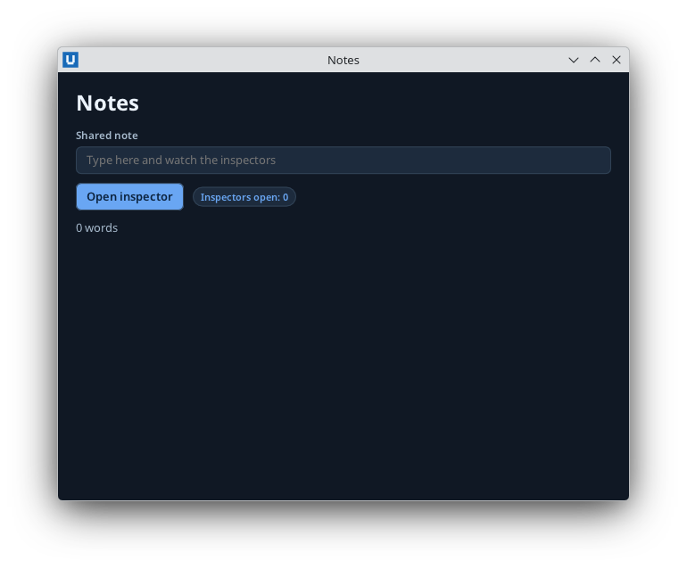

<details><summary>Full source</summary>

```python
"""Notes editor with live inspector windows that share the editor's state.

Teaches: several UI objects in one application, each in its own native window; binding two
windows to the same State; opening a window from a button handler; tracking windows the user
closes with app.on_window_event (marshalled to the UI owner with ui.post); closing a window
from code. Each inspector is a new UI; mounting one registers an SDK shutdown callback, so this
example caps the number of inspectors (see the B-0003 limitation).

Run:  python multi_window.py      (pip install nativehtmlkit_ui)
"""
from nativehtmlkit_ui import UI, computed, state

MAX_INSPECTORS = 3


# Workaround for a UI 0.1.1 stylesheet defect: a field placed directly in a column gets a
# 200px flex basis (meant for rows) and therefore 200px of height. See docs/LIMITATIONS.md.
FIELD_FIX = ".nhk-col > .nhk-field { flex: 0 0 auto; }"

def main(app):
    note = state("")
    edits = state(0)
    open_inspectors = state(0)
    words = computed(lambda: len(note.value.split()))

    main_ui = UI(title="Notes", width=640, height=480, extra_css=FIELD_FIX)

    def changed() -> None:
        edits.set(edits.value + 1)
    note.subscribe(changed)          # runs on whichever thread set the note (here: the UI owner)

    def open_inspector(_event):
        if open_inspectors.value >= MAX_INSPECTORS:
            return
        number = open_inspectors.value + 1
        inspector = UI(title=f"Inspector {number}", width=420, height=320, theme="graphite")
        with inspector.column():
            inspector.heading(f"Inspector {number}", level=2)
            inspector.text(lambda: f"Note: {note.value}")
            inspector.text(lambda: f"{words.value} words, {len(note.value)} characters")
            inspector.badge(lambda: f"{edits.value} edits")
            inspector.button("Close inspector", variant="secondary",
                             on_click=lambda _e: inspector.window.request_close())
        inspector.mount(app)
        window_id = inspector.window.id
        open_inspectors.set(number)

        def on_window(event: dict) -> None:          # SDK event thread: hand over to the owner
            if event.get("window_id") == window_id and event.get("type") == "closed":
                unsubscribe()
                main_ui.post(lambda: open_inspectors.set(open_inspectors.value - 1))
        unsubscribe = app.on_window_event(on_window)

    with main_ui.column():
        main_ui.heading("Notes", level=1)
        main_ui.input(note, label="Shared note", placeholder="Type here and watch the inspectors")
        with main_ui.row():
            main_ui.button("Open inspector", on_click=open_inspector,
                           disabled=lambda: open_inspectors.value >= MAX_INSPECTORS)
            main_ui.badge(lambda: f"Inspectors open: {open_inspectors.value}")
        main_ui.text(lambda: f"{words.value} words", muted=True)
    main_ui.mount(app)


if __name__ == "__main__":
    from nativehtmlkit import Application
    with Application.start(name="Notes") as application:
        main(application)
        application.run()
```

</details>

<a id="dashboard"></a>

## System dashboard

A responsive card grid with a live clock and disk usage, themed with extra CSS.

**Teaches:** responsive grid, themes and density, extra CSS, one-second timer.

**Run:** `python dashboard.py [cobalt|graphite|daylight]` (source: [`examples/python/dashboard.py`](https://github.com/nativehtmlkit/nativehtmlkit_ui/blob/main/examples/python/dashboard.py))

Related guide: [layouts](guides/layouts.md).

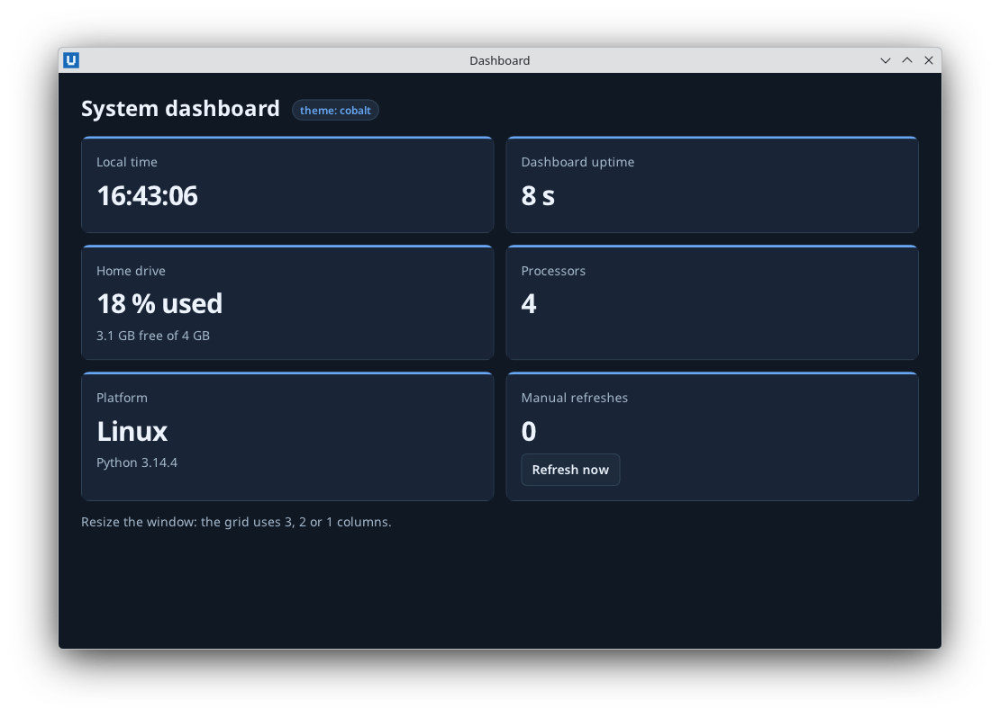

<details><summary>Full source</summary>

```python
"""System dashboard: a responsive card grid with a live clock and disk usage, themed via CSS.

Teaches: ui.grid() (3 columns, 2 below 1000 px, 1 below 620 px), theme and density options,
extra_css with your own classes and token overrides, ui.element() for a custom-styled tag, and
a periodic timer thread that updates state through ui.post().

Run:  python dashboard.py [cobalt|graphite|daylight]      (pip install nativehtmlkit_ui)
"""
import os
import platform
import shutil
import sys
import threading
import time
from datetime import datetime
from pathlib import Path

from nativehtmlkit_ui import UI, state

THEMES = ("cobalt", "graphite", "daylight")
CSS = """
.metric { font-size: 30px; font-weight: 700; letter-spacing: -0.02em; margin: 4px 0; }
.meter { height: 8px; border-radius: 99px; background: var(--nhk-panel-2); border: 1px solid var(--nhk-border); }
.nhk-card { border-top: 3px solid var(--nhk-accent); }
body.nhk-theme-daylight { --nhk-accent: #0f7b6c; --nhk-accent-strong: #0b6458; --nhk-focus: #0f7b6c; }
"""


def disk_text(path: Path) -> tuple[str, str]:
    usage = shutil.disk_usage(path)
    used = usage.used / usage.total * 100
    return f"{used:.0f} % used", f"{usage.free / 1024**3:.1f} GB free of {usage.total / 1024**3:.0f} GB"


def main(app):
    theme = sys.argv[1] if len(sys.argv) > 1 and sys.argv[1] in THEMES else "cobalt"
    started = time.monotonic()
    clock = state("--:--:--")
    uptime = state("0 s")
    disk, disk_detail = state(""), state("")
    refreshed = state(0)

    def refresh() -> None:                        # runs on the UI owner (posted)
        clock.set(f"{datetime.now():%H:%M:%S}")
        seconds = int(time.monotonic() - started)
        uptime.set(f"{seconds // 60} min {seconds % 60} s" if seconds >= 60 else f"{seconds} s")
        used, detail = disk_text(Path.home())
        disk.set(used)
        disk_detail.set(detail)

    ui = UI(title="Dashboard", width=980, height=640, theme=theme, density="regular", extra_css=CSS)
    with ui.column():
        with ui.row():
            ui.heading("System dashboard", level=1)
            ui.badge(f"theme: {theme}")
        with ui.grid():
            with ui.card():
                ui.text("Local time", muted=True)
                ui.element("div", css_class="metric", text=clock)
            with ui.card():
                ui.text("Dashboard uptime", muted=True)
                ui.element("div", css_class="metric", text=uptime)
            with ui.card():
                ui.text("Home drive", muted=True)
                ui.element("div", css_class="metric", text=disk)
                ui.text(disk_detail, muted=True)
            with ui.card():
                ui.text("Processors", muted=True)
                ui.element("div", css_class="metric", text=str(os.cpu_count() or "?"))
            with ui.card():
                ui.text("Platform", muted=True)
                ui.element("div", css_class="metric", text=platform.system())
                ui.text(f"Python {platform.python_version()}", muted=True)
            with ui.card():
                ui.text("Manual refreshes", muted=True)
                ui.element("div", css_class="metric", text=refreshed)
                ui.button("Refresh now", variant="secondary",
                          on_click=lambda _e: (refresh(), refreshed.set(refreshed.value + 1)))
        ui.text("Resize the window: the grid uses 3, 2 or 1 columns.", muted=True)

    stop = threading.Event()

    def tick() -> None:
        while not stop.wait(1.0):
            try:
                ui.post(refresh)
            except RuntimeError:
                pass

    ui.mount(app)
    ui.post(refresh)
    threading.Thread(target=tick, name="dashboard-timer", daemon=True).start()
    app.on_shutdown(stop.set)


if __name__ == "__main__":
    from nativehtmlkit import Application
    with Application.start(name="Dashboard") as application:
        main(application)
        application.run()
```

</details>

<a id="theme-preview"></a>

## Theme preview

Every component in a chosen theme and density, with an optional custom accent colour.

**Teaches:** themes and densities, overriding design tokens with extra CSS, several instances side by side.

**Run:** `python theme_preview.py [cobalt|graphite|daylight] [compact|regular|comfortable] [#RRGGBB]` (source: [`examples/python/theme_preview.py`](https://github.com/nativehtmlkit/nativehtmlkit_ui/blob/main/examples/python/theme_preview.py))

Related guide: [theming and custom css](guides/theming-and-custom-css.md).

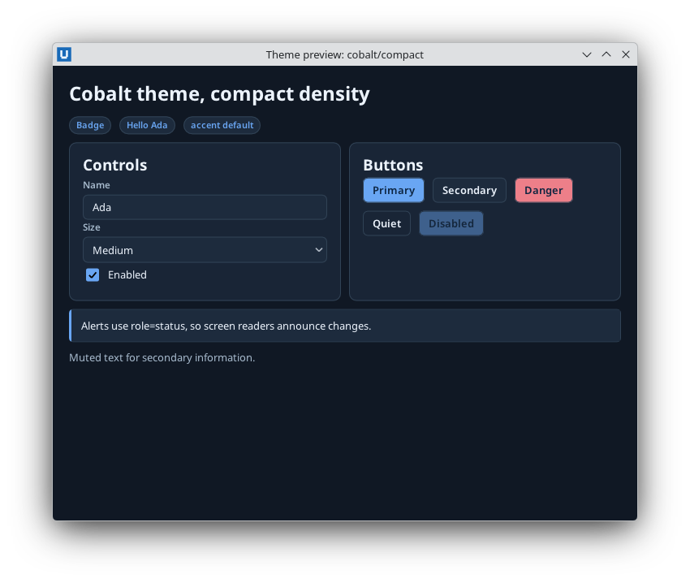

<details><summary>Full source</summary>

```python
"""Theme preview: try the UI library's themes, densities and a custom accent colour.

Teaches: UI(theme=..., density=..., extra_css=...), overriding the library's CSS custom properties
(--nhk-accent and friends) for one theme, and the main components side by side.
instance="multiple" lets you start several previews at once and compare them.
Run:     python theme_preview.py [cobalt|graphite|daylight] [compact|regular|comfortable] [#RRGGBB]
Guide:   docs/python/guides/theming-and-custom-css.md
"""
import re
import sys

from nativehtmlkit import Application
from nativehtmlkit_ui import UI, state

THEMES = ("cobalt", "graphite", "daylight")
DENSITIES = ("compact", "regular", "comfortable")


def main():
    with Application.start(name="Theme preview", instance="multiple") as app:
        args = sys.argv[1:]
        theme = args[0] if len(args) > 0 and args[0] in THEMES else "cobalt"
        density = args[1] if len(args) > 1 and args[1] in DENSITIES else "compact"
        accent = args[2] if len(args) > 2 and re.fullmatch(r"#[0-9A-Fa-f]{6}", args[2]) else None
        # extra_css is appended after the library stylesheet, so the same selector wins.
        extra = (f"body.nhk-theme-{theme} {{ --nhk-accent: {accent}; --nhk-accent-strong: {accent}; "
                 f"--nhk-focus: {accent}; }}") if accent else ""

        name = state("Ada")
        enabled = state(True)
        size = state("m")
        ui = UI(title=f"Theme preview: {theme}/{density}", theme=theme, density=density, extra_css=extra,
                width=720, height=560)
        with ui.column():
            ui.heading(f"{theme.title()} theme, {density} density", level=1)
            with ui.row():
                ui.badge("Badge")
                ui.badge(lambda: f"Hello {name.value}")
                ui.badge(f"accent {accent or 'default'}")
            with ui.grid():
                with ui.card():
                    ui.heading("Controls", level=2)
                    ui.input(name, label="Name")
                    ui.select(size, [("s", "Small"), ("m", "Medium"), ("l", "Large")], label="Size")
                    ui.checkbox(enabled, label="Enabled")
                with ui.card():
                    ui.heading("Buttons", level=2)
                    with ui.row():
                        ui.button("Primary")
                        ui.button("Secondary", variant="secondary")
                        ui.button("Danger", variant="danger")
                        ui.button("Quiet", variant="quiet")
                        ui.button("Disabled", disabled=True)
            ui.alert("Alerts use role=status, so screen readers announce changes.")
            ui.text("Muted text for secondary information.", muted=True)
        try:
            ui.mount(app)
            app.run()
        finally:
            ui.dispose()


if __name__ == "__main__":
    main()
```

</details>

<a id="message-preview"></a>

## Message composer

Untrusted typed text is always escaped; only fixed help markup is inserted as HTML.

**Teaches:** escaping untrusted text, trusted static markup, length limit.

**Run:** `python message_preview.py` (source: [`examples/python/message_preview.py`](https://github.com/nativehtmlkit/nativehtmlkit_ui/blob/main/examples/python/message_preview.py))

Related guide: [trusted and untrusted content](guides/trusted-and-untrusted-content.md).

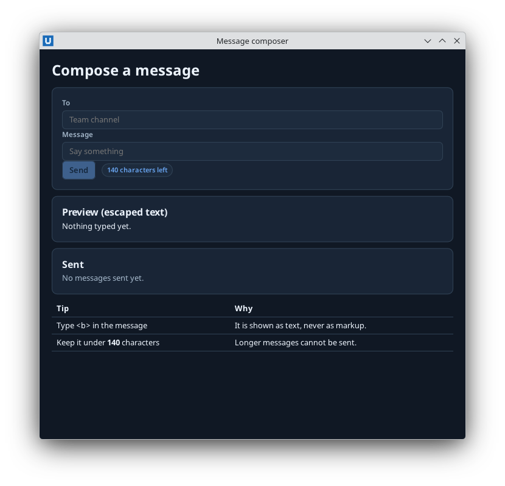

<details><summary>Full source</summary>

```python
"""Message composer: untrusted user text is always escaped; only static help uses raw_html().

Teaches: the trust boundary. Everything a user types reaches the window through text bindings
(ui.text, ui.text_list), which escape it, so typing <b>hi</b> shows those characters literally.
ui.raw_html() is used only for a fixed, developer-written snippet. Also: a length limit with a
computed counter and a sent-messages list.

Run:  python message_preview.py      (pip install nativehtmlkit_ui)
"""
from nativehtmlkit_ui import UI, computed, state

LIMIT = 140
HELP = """
<table class="help">
  <tr><th>Tip</th><th>Why</th></tr>
  <tr><td>Type <code>&lt;b&gt;</code> in the message</td><td>It is shown as text, never as markup.</td></tr>
  <tr><td>Keep it under <strong>140</strong> characters</td><td>Longer messages cannot be sent.</td></tr>
</table>
"""
CSS = ".help { border-collapse: collapse; width: 100%; } .help td, .help th { text-align: left; padding: 4px 8px;" \
      " border-bottom: 1px solid var(--nhk-border); }"


def main(app):
    recipient = state("")
    message = state("")
    sent = state([])
    remaining = computed(lambda: LIMIT - len(message.value))

    def send(_event):
        if message.value.strip() and remaining.value >= 0:
            sent.set([f"To {recipient.value.strip() or 'everyone'}: {message.value.strip()}", *sent.value][:10])
            message.set("")

    ui = UI(title="Message composer", width=700, height=640, extra_css=CSS)
    with ui.column():
        ui.heading("Compose a message", level=1)
        with ui.card():
            ui.input(recipient, label="To", placeholder="Team channel")
            ui.input(message, label="Message", placeholder="Say something")
            with ui.row():
                ui.button("Send", on_click=send, disabled=lambda: not message.value.strip() or remaining.value < 0)
                ui.badge(lambda: f"{remaining.value} characters left")
            with ui.when(lambda: remaining.value < 0):
                ui.alert(lambda: f"Too long by {-remaining.value} characters.")
        with ui.card():
            ui.heading("Preview (escaped text)", level=3)
            ui.text(lambda: message.value or "Nothing typed yet.")
        with ui.card():
            ui.heading("Sent", level=3)
            with ui.when(lambda: not sent.value):
                ui.text("No messages sent yet.", muted=True)
            ui.text_list(sent)
        ui.raw_html(HELP)                       # trusted, static, written by the developer
    ui.mount(app)


if __name__ == "__main__":
    from nativehtmlkit import Application
    with Application.start(name="Message composer") as application:
        main(application)
        application.run()
```

</details>
