# NativeHTMLKit UI examples

Twelve small applications, each written in Python (`python/`) and PowerShell (`powershell/`)
with the same behaviour and the same visible text. Every file starts with a comment that says
what it teaches and how to run it. They use only the public UI and SDK APIs.

| Example | What it is | Teaches |
|---|---|---|
| `counter` | Counter gallery | State, computed text, button, input, checkbox, text list, `when`, grid |
| `expenses` | Expense tracker (the [tutorial](../docs/tutorials/README.md) app) | Two-way inputs and select, validation, computed totals and filter, empty state |
| `todo` | Task list with Done/Remove per row and a filter | The slot pool pattern for rows with buttons, bound button labels |
| `signup_form` | Sign-up form | Validation as computed state, guarded submit, form/confirmation swap, reset |
| `settings` | Settings panel | Dirty tracking, Save/Revert/Defaults writing back into controls, nested `when` |
| `log_viewer` | Live log viewer | Streaming background producer, filter/search, pause, bounded history |
| `background` | Background calculation | Python executor + `ui.post()`; PowerShell `Start-NativeHTMLKitTask` with cancel |
| `clipboard_tool` | Text transformer with copy/paste | SDK clipboard calls from UI handlers, error handling |
| `file_picker` | File inspector | SDK open-file dialog, result handling, cancel/error paths |
| `multi_window` | Notes with inspector windows | Several UIs sharing state, opening/closing windows, window events |
| `dashboard` | System dashboard | Responsive grid, themes, density, extra CSS, a 1 s timer |
| `message_preview` | Message composer | Escaped untrusted text vs. trusted static `raw_html` / `Add-NHKUiHtml` |

## Running

Python 3.10+:

```bash
python -m pip install nativehtmlkit_ui
python examples/python/expenses.py
```

PowerShell 7.2+ (Linux, Windows) or Windows PowerShell 5.1:

```powershell
Install-Module NativeHTMLKit.UI -Scope CurrentUser
pwsh -File ./examples/powershell/expenses.ps1
powershell.exe -NoProfile -File .\examples\powershell\expenses.ps1
```

`dashboard` takes an optional theme argument (`cobalt`, `graphite`, `daylight`). The SDK
starts the native host, which runs the script again as its backend, so the scripts keep all
work behind their entry point.

## Verification

All examples (and the tutorial steps in `docs/tutorials/code/`) are run by
[`qualification/examples/run_examples.py`](../qualification/examples/run_examples.py) against
the real NativeHTMLKit Core 1.0.3 host in headless test mode, with the released Python SDK
0.1.2 and PowerShell SDK 0.1.2. Each example follows a scenario from
[`scenarios.json`](../qualification/examples/scenarios.json): simulated clicks and typing
(delivered where the SDK delivers native events), DOM read-back through the SDK, clean UI and
SDK diagnostics, exit code 0 and no leftover processes. See the
[testing guide](../docs/guides/testing.md) for how to run it and what it does and does not
prove. Headless mode has no clipboard or file dialogs, so for `clipboard_tool` and
`file_picker` the harness verifies the "unavailable" error handling, not the dialogs
themselves.

## Screenshots

Real captures on KDE Plasma 6.6 Wayland (100% scaling) with Core 1.0.3, Python/PowerShell SDK 0.1.2 and UI 0.1.1, taken by running each example unchanged. Windows looks the same apart from the window frame.

### Python

| | |
|---|---|
| [background](python/background.py)<br>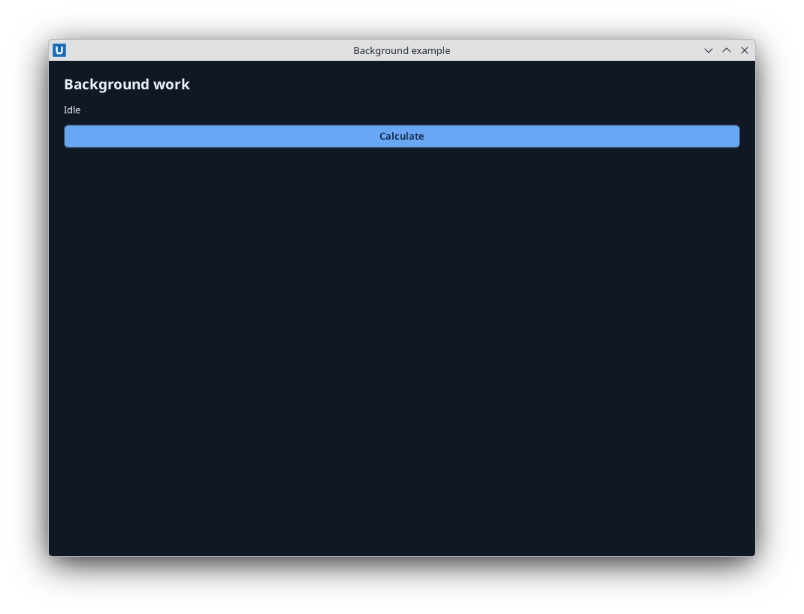 | [clipboard_tool](python/clipboard_tool.py)<br>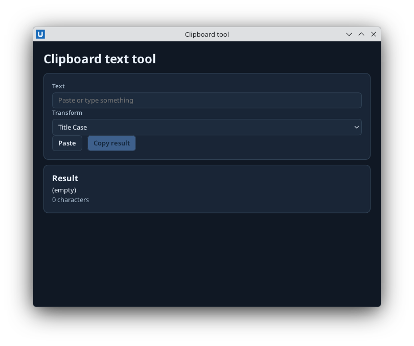 |
| [counter](python/counter.py)<br> | [dashboard](python/dashboard.py)<br>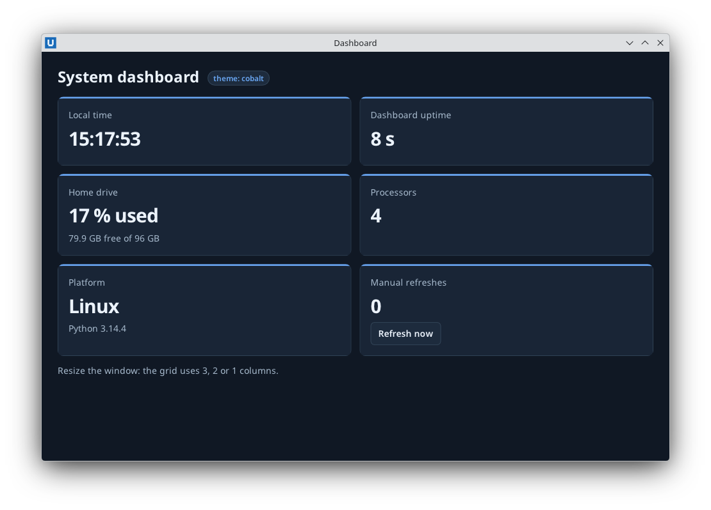 |
| [expenses](python/expenses.py)<br>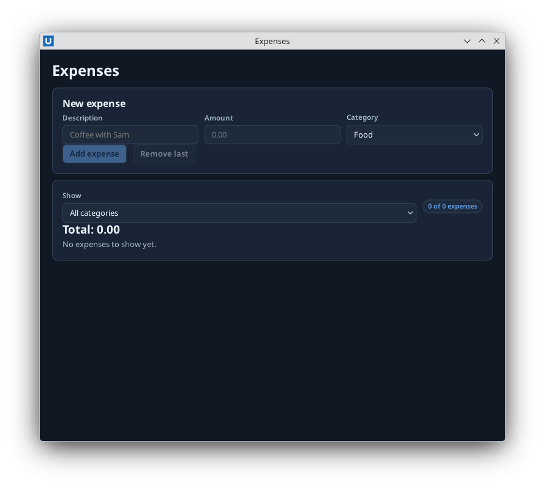 | [file_picker](python/file_picker.py)<br>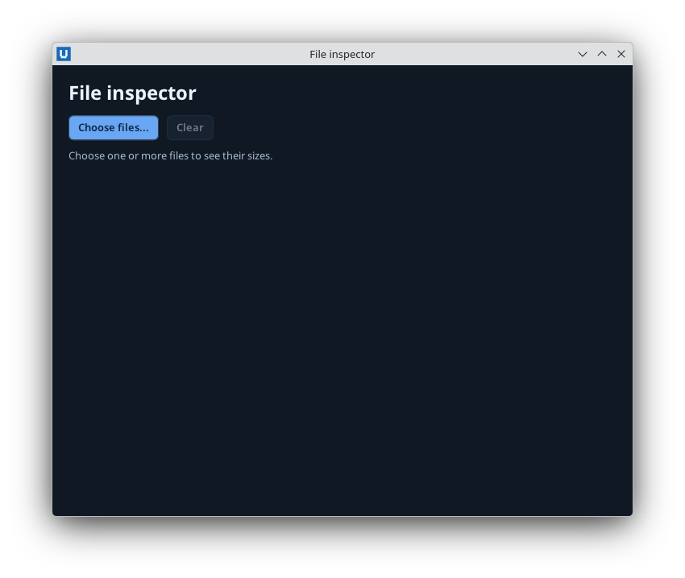 |
| [log_viewer](python/log_viewer.py)<br>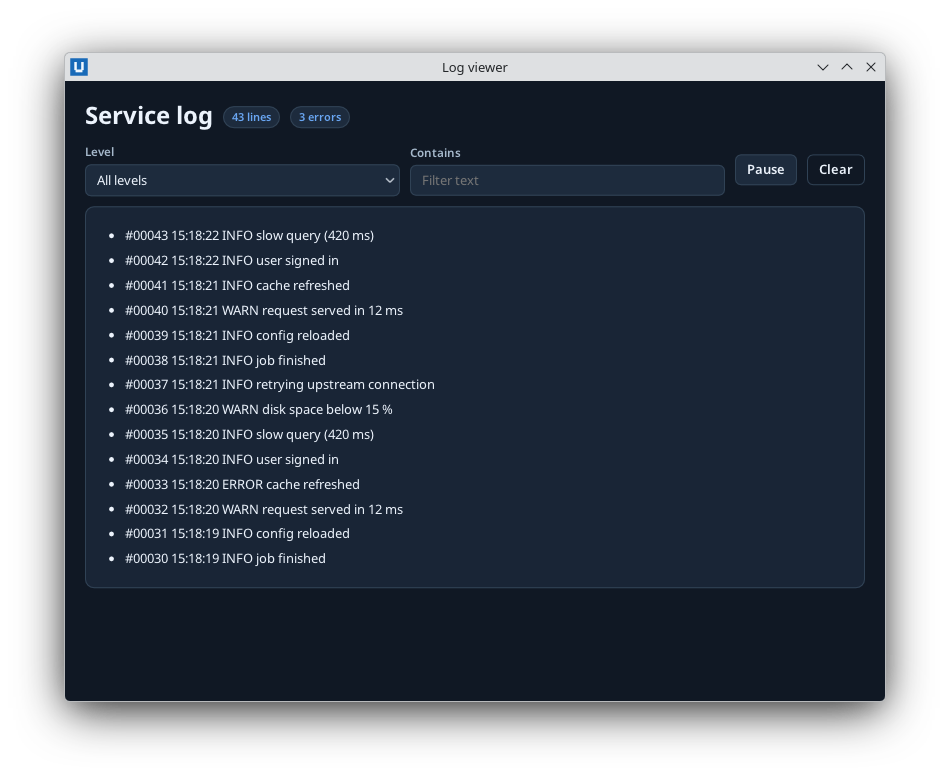 | [message_preview](python/message_preview.py)<br> |
| [multi_window](python/multi_window.py)<br>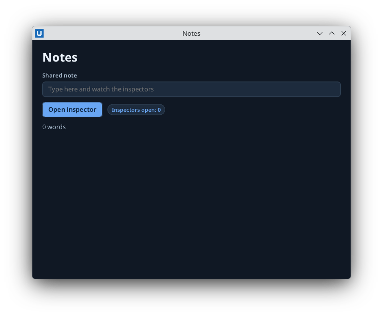 | [settings](python/settings.py)<br>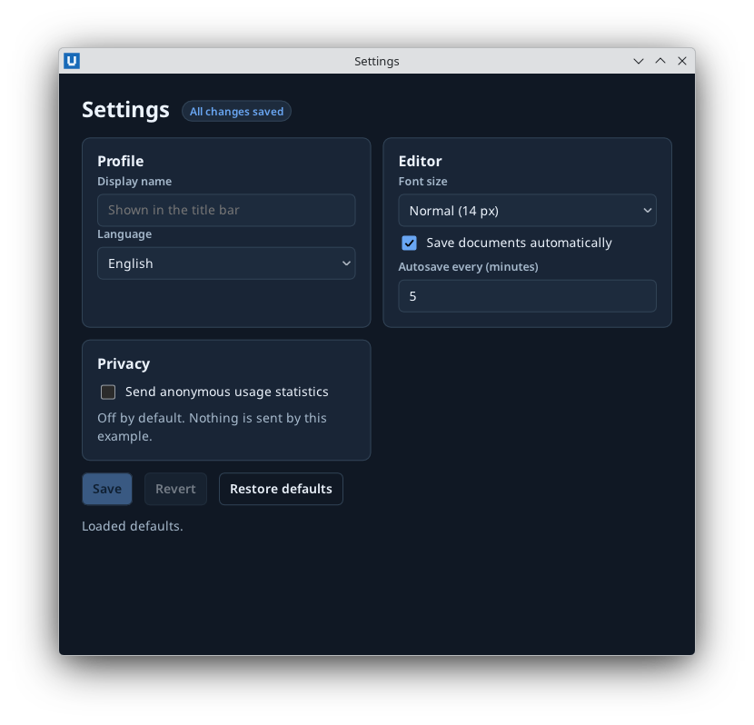 |
| [signup_form](python/signup_form.py)<br>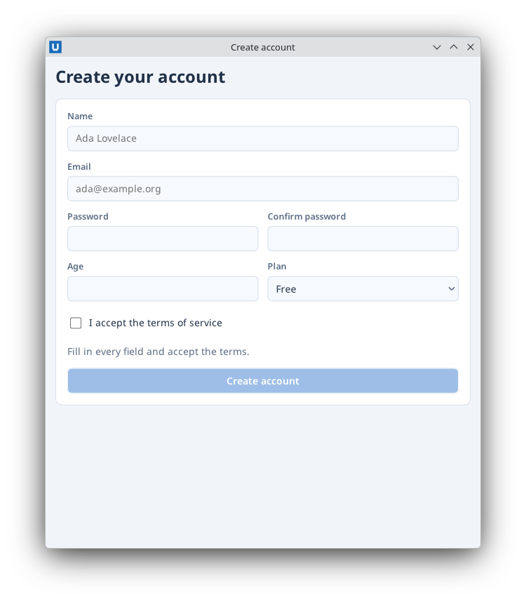 | [todo](python/todo.py)<br>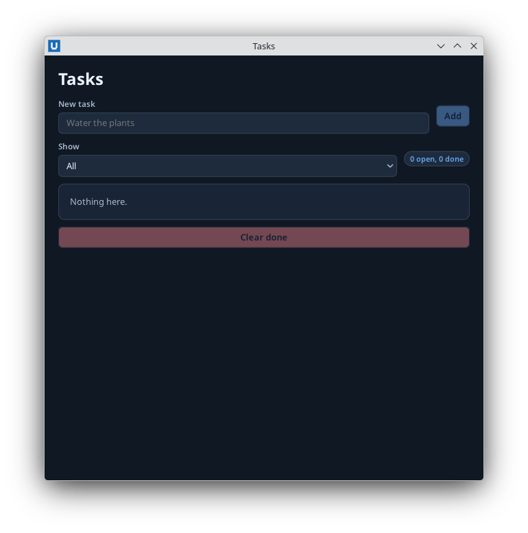 |

### PowerShell

| | |
|---|---|
| [background](powershell/background.ps1)<br>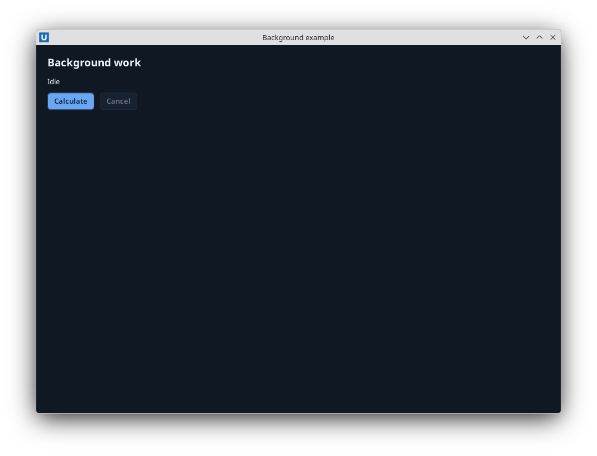 | [clipboard_tool](powershell/clipboard_tool.ps1)<br> |
| [counter](powershell/counter.ps1)<br>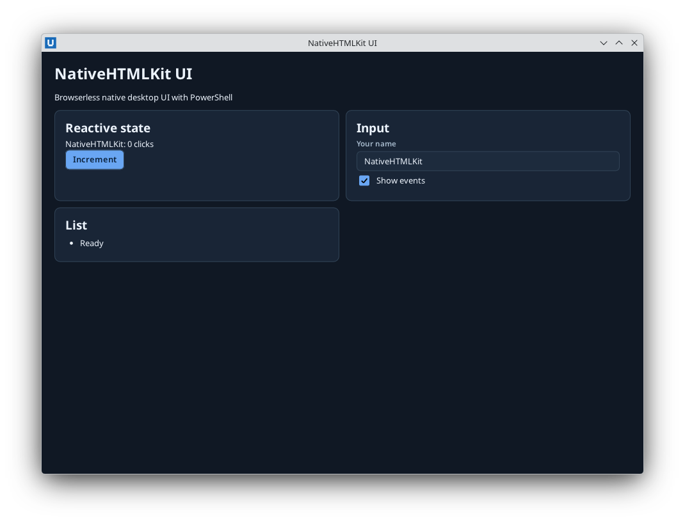 | [dashboard](powershell/dashboard.ps1)<br> |
| [expenses](powershell/expenses.ps1)<br> | [file_picker](powershell/file_picker.ps1)<br> |
| [log_viewer](powershell/log_viewer.ps1)<br>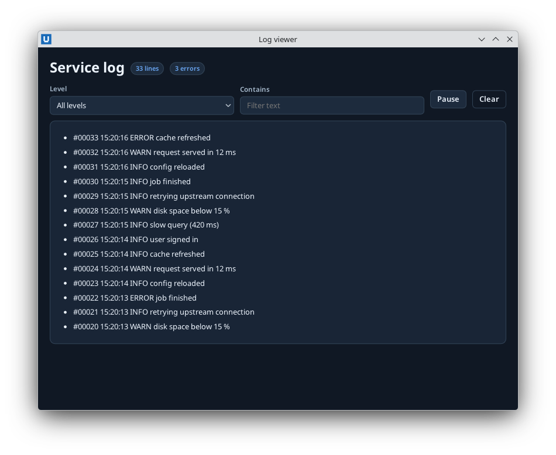 | [message_preview](powershell/message_preview.ps1)<br> |
| [multi_window](powershell/multi_window.ps1)<br> | [settings](powershell/settings.ps1)<br> |
| [signup_form](powershell/signup_form.ps1)<br> | [todo](powershell/todo.ps1)<br> |
