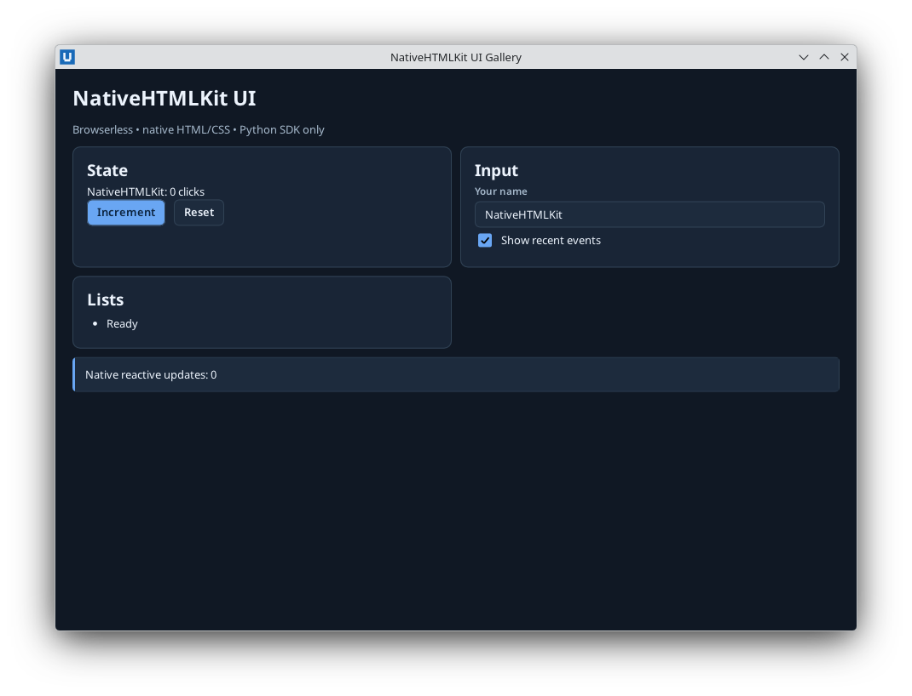
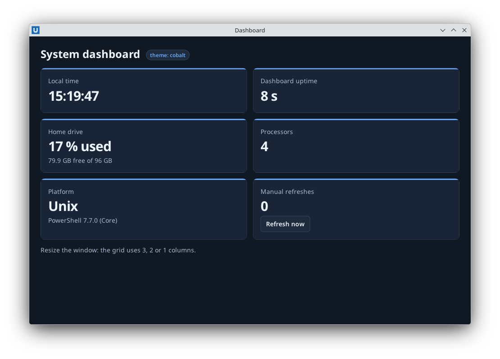
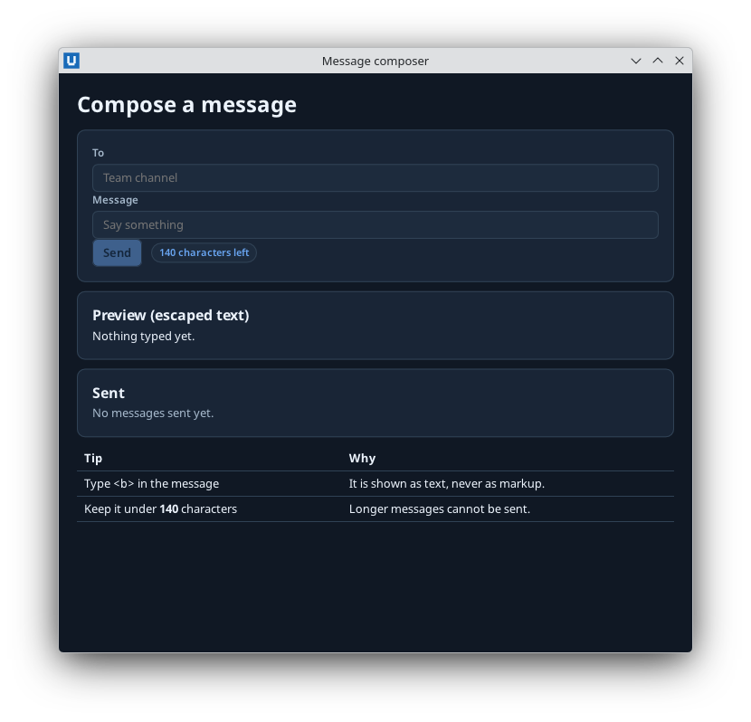

# NativeHTMLKit UI examples

16 small applications, each written in Python (`python/`) and PowerShell
(`powershell/`) with the same window title, behaviour and visible text, plus the runnable steps
of the two tutorials (`tutorials/`). Every file starts with a comment that says what it teaches
and how to run it. They use only the public UI and SDK APIs.

The machine-readable list is [`catalog.toml`](catalog.toml) (one entry per example id with its
Python and PowerShell file, run commands and related guide). The documentation shows every
example with its screenshot and full source: [Python examples](../docs/python/examples.md),
[PowerShell examples](../docs/powershell/examples.md).

| Id | Example | Python | PowerShell | Teaches |
|---|---|---|---|---|
| `hello` | Hello UI | [hello.py](python/hello.py) | [hello.ps1](powershell/hello.ps1) | state and computed values, two-way input, button handler, application lifecycle |
| `counter` | Counter gallery | [counter.py](python/counter.py) | [counter.ps1](powershell/counter.ps1) | state and computed values, bound text, two-way input and checkbox, when regions, grid |
| `expenses` | Expense tracker | [expenses.py](python/expenses.py) | [expenses.ps1](powershell/expenses.ps1) | two-way inputs and select, validation, computed totals and filter, empty state |
| `todo` | Task list | [todo.py](python/todo.py) | [todo.ps1](powershell/todo.ps1) | slot pool for rows with buttons, bound button labels, computed counts |
| `signup-form` | Sign-up form | [signup_form.py](python/signup_form.py) | [signup_form.ps1](powershell/signup_form.ps1) | validation as computed state, guarded submit, form/confirmation swap, reset by setting states |
| `settings` | Settings panel | [settings.py](python/settings.py) | [settings.ps1](powershell/settings.ps1) | dirty tracking with a computed snapshot, writing state back into controls, nested when regions |
| `settings-editor` | Settings editor | [settings_editor.py](python/settings_editor.py) | [settings_editor.ps1](powershell/settings_editor.ps1) | initial state from a file, computed validation message, atomic JSON save, revert from disk |
| `log-viewer` | Live log viewer | [log_viewer.py](python/log_viewer.py) | [log_viewer.ps1](powershell/log_viewer.ps1) | streaming background producer, bounded history, filtered text list, pause |
| `background` | Background calculation | [background.py](python/background.py) | [background.ps1](powershell/background.ps1) | Python executor and ui.post(), PowerShell Start-NativeHTMLKitTask, busy flag, cancel |
| `word-counter` | Word counter | [word_counter.py](python/word_counter.py) | [word_counter.ps1](powershell/word_counter.ps1) | background work with progress, cancellation, merging partial results, throttled updates |
| `clipboard-tool` | Clipboard text tool | [clipboard_tool.py](python/clipboard_tool.py) | [clipboard_tool.ps1](powershell/clipboard_tool.ps1) | SDK clipboard calls from UI handlers, error handling, computed preview |
| `file-picker` | File inspector | [file_picker.py](python/file_picker.py) | [file_picker.ps1](powershell/file_picker.ps1) | SDK file dialog from the UI, cancel and error paths, busy flag |
| `multi-window` | Notes with inspector windows | [multi_window.py](python/multi_window.py) | [multi_window.ps1](powershell/multi_window.ps1) | several UIs in one application, shared state, window events, closing windows from code |
| `dashboard` | System dashboard | [dashboard.py](python/dashboard.py) | [dashboard.ps1](powershell/dashboard.ps1) | responsive grid, themes and density, extra CSS, one-second timer |
| `theme-preview` | Theme preview | [theme_preview.py](python/theme_preview.py) | [theme_preview.ps1](powershell/theme_preview.ps1) | themes and densities, overriding design tokens with extra CSS, several instances side by side |
| `message-preview` | Message composer | [message_preview.py](python/message_preview.py) | [message_preview.ps1](powershell/message_preview.ps1) | escaping untrusted text, trusted static markup, length limit |

Tutorial steps: [`tutorials/python`](tutorials/python) and [`tutorials/powershell`](tutorials/powershell)
(expense tracker steps 1-3, settings editor step 1; the final apps are `expenses` and
`settings_editor`).

## Running

Python 3.10+:

```bash
python -m pip install nativehtmlkit_ui
python examples/python/expenses.py
```

PowerShell 7.2+ (Linux, Windows) or Windows PowerShell 5.1:

```powershell
Install-Module NativeHTMLKit.UI -Scope CurrentUser
pwsh -File ./examples/powershell/expenses.ps1
powershell.exe -NoProfile -File .\examples\powershell\expenses.ps1
```

Optional arguments: `dashboard` takes a theme (`cobalt`, `graphite`, `daylight`);
`theme_preview` a theme, a density and an accent colour (`#RRGGBB`); `settings_editor` the
settings file path; `word_counter` a text file. The SDK starts the native host, which runs the
script again as its backend, so the scripts keep all work behind their entry point.

## Verification

All catalogue entries and tutorial steps are run in both languages by
[`qualification/examples/run_examples.py`](../qualification/examples/run_examples.py) against
the real NativeHTMLKit Core 1.0.3 host in headless test mode, with the released Python SDK 0.1.2
and PowerShell SDK 0.1.2. Each example follows a scenario from
[`scenarios.json`](../qualification/examples/scenarios.json): simulated clicks and typing
(delivered where the SDK delivers native events), DOM read-back through the SDK, clean UI and
SDK diagnostics, exit code 0 and no leftover processes. The run fails when an example lacks a
file in either language, a scenario, or a catalogue entry. See the testing guide
([Python](../docs/python/guides/testing.md), [PowerShell](../docs/powershell/guides/testing.md))
for what it does and does not prove. Headless mode has no clipboard or file dialogs, so for
`clipboard_tool` and `file_picker` the harness verifies the "unavailable" error handling, not
the dialogs themselves. The Python `background` Cancel path is not exercised headless (the
calculation finishes before a simulated click could cancel it); the PowerShell Cancel paths of
`background` and `word_counter` are.

## Screenshots

Real captures (of the first twelve examples) on KDE Plasma 6.6 Wayland (100% scaling) with Core 1.0.3, Python/PowerShell SDK 0.1.2 and UI 0.1.1, taken by running each example unchanged. Windows looks the same apart from the window frame. The PowerShell `counter` and the Python `background` captures predate this round's parity changes (the PowerShell counter now has the Python version's title, Reset button and status alert; the Python background example gained a Cancel button). `hello`, `settings_editor`, `word_counter` and `theme_preview` have no capture yet.

### Python

| | |
|---|---|
| [background](python/background.py)<br> | [clipboard_tool](python/clipboard_tool.py)<br> |
| [counter](python/counter.py)<br> | [dashboard](python/dashboard.py)<br> |
| [expenses](python/expenses.py)<br> | [file_picker](python/file_picker.py)<br> |
| [log_viewer](python/log_viewer.py)<br> | [message_preview](python/message_preview.py)<br> |
| [multi_window](python/multi_window.py)<br> | [settings](python/settings.py)<br> |
| [signup_form](python/signup_form.py)<br> | [todo](python/todo.py)<br> |

### PowerShell

| | |
|---|---|
| [background](powershell/background.ps1)<br> | [clipboard_tool](powershell/clipboard_tool.ps1)<br> |
| [counter](powershell/counter.ps1)<br> | [dashboard](powershell/dashboard.ps1)<br> |
| [expenses](powershell/expenses.ps1)<br> | [file_picker](powershell/file_picker.ps1)<br> |
| [log_viewer](powershell/log_viewer.ps1)<br> | [message_preview](powershell/message_preview.ps1)<br> |
| [multi_window](powershell/multi_window.ps1)<br> | [settings](powershell/settings.ps1)<br> |
| [signup_form](powershell/signup_form.ps1)<br> | [todo](powershell/todo.ps1)<br> |
